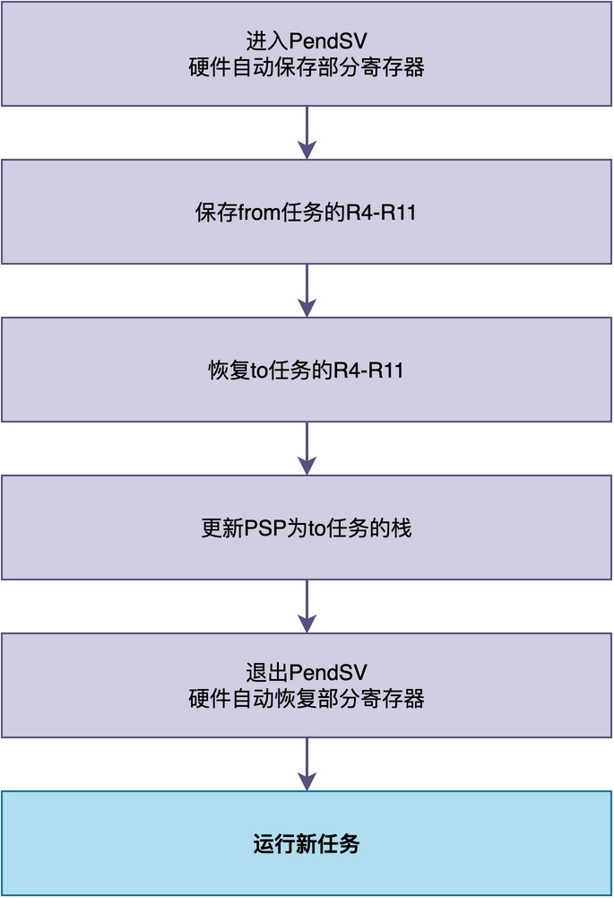

# 什么是上下文切换？它和普通函数调用有什么区别？

对于某些喜欢刨根究底的同学来说，他们可能会注意到RT-Thread提供了rt_schedule()调度函数。

当这个函数被调用的时候，RT-Thread会进行任务调度。当需要任务切换时，会进一步调用rt_hw_context_switch()进行任务上下文切换，从而切换到其他任务运行。

你可能会产生这样的疑问：

> 什么是任务上下文切换？
> rt_hw_context_switch()看起来不就是一个普通的C函数吗？为什么能进行上下文切换？
> 相比函数调用，上下文切换到底有什么区别之处？

在这篇文章，我将结合就上述问题进行一一介绍。

## 普通函数调用在做什么

首先，让我们先看一下普通的函数调用到底在做什么。

下面给出了一段简单的C代码：一个任务函数调用add()函数，计算3加5的结果。

```c
int add(int a, int b)
{
    int sum;
    sum = a + b;
    return sum;
}

void task_entry(void *parameter)
{
    int result;
    result = add(3, 5);
    for (;;) {}
}
```

当CPU执行到result = add(3, 5);这一行的时候，它会做哪些事情呢？

### 准备工作

在调用add()函数之前，CPU会做一些准备工作：

1. **传递参数**：按照ARM的调用约定，第一个参数3放到R0寄存器，第二个参数5放到R1寄存器。
2. **保存返回地址**：把当前指令的下一条指令地址（也就是add()的返回地址）保存到LR链接寄存器。
3. **跳转到函数**：跳转到add()函数的入口地址开始执行。

### 执行函数

进入add()函数之后，CPU会继续做：

1. **分配栈空间**：把SP（栈指针）往下移动，为局部变量sum分配空间。
2. **执行函数体**：把R0和R1的值相加，结果存到局部变量sum里。
3. **设置返回值**：把sum的值放到R0寄存器，作为函数返回值。

### 函数返回时

函数执行完，要返回的时候，CPU会做：

1. **恢复栈空间**：把SP往上移动4字节，释放局部变量sum占用的栈空间。
2. **跳回调用处**：根据LR寄存器中保存的返回地址，跳回task_entry()函数继续执行。
3. **使用返回值**：task_entry()函数从R0寄存器中取出返回值，存到result变量里。

在上述整个过程中，**函数调用始终使用的是同一个栈**。不管是task_entry()函数还是add()函数，它们的局部变量、返回地址都压在同一个栈里。

此外，**函数调用不会改变当前运行的任务，任务只是暂时去执行add()函数的代码而已**。

## 上下文切换在做什么

上下文切换看起来似乎和函数调用相同，都是跳转到别的地方运行一段时间，最后再跳转回来继续执行原任务。

不过，二者也有区别：**上下文切换是跳转到另一个任务（而非函数）中去执行，且下次切换回来的时间是不确定的。** 不过，我们似乎也可以将上下文切换看作是一种”**特殊的函数调用**“。

具体来说，上下文切换主要做三件事情：

1. **保存当前任务的上下文**：把当前任务的所有CPU寄存器（R0-R11、PC、LR、SP、PSR等）保存到当前任务自己的栈里。
2. **恢复下一个任务的上下文**：从下一个任务的栈里，把它之前保存的寄存器值恢复到CPU的寄存器中。
3. **跳转到下一个任务运行**：更新栈指针，跳转到下一个任务的代码开始执行。


当上下文切换完成后，CPU的占有权就发生了变化，比如从任务A变成了任务B。此时，任务A暂停运行，任务B开始运行。

可以发现，区别于函数调用，**上下文切换过程中发生了栈切换，由任务A的栈变成了任务B的栈。**
## RT-Thread中的上下文切换实现

下面，让我们来看一下rt_hw_context_switch()的源码，以便对上下文切换有进一步的理解。

rt_hw_context_switch()函数的源码如下：

```arm
; void rt_hw_context_switch(rt_uint32 from, rt_uint32 to);
; r0 --> from, r1 --> to
rt_hw_context_switch    PROC
    EXPORT rt_hw_context_switch
    ; 设置切换标志
    LDR     r2, =rt_thread_switch_interrupt_flag
    MOV     r3, #1
    STR     r3, [r2]
    ; 保存from任务的栈指针地址
    LDR     r2, =rt_interrupt_from_thread
    STR     r0, [r2]
    ; 保存to任务的栈指针地址
    LDR     r2, =rt_interrupt_to_thread
    STR     r1, [r2]
    ; 触发PendSV异常
    LDR     r0, =NVIC_INT_CTRL
    LDR     r1, =NVIC_PENDSVSET
    STR     r1, [r0]
    BX      LR
```

忽略掉前面的一部分汇编代码，在后半部分中，通过向NVIC的PENDSVSET位写1，触发PendSV异常。

异常发生时，CPU会调用PendSV_Handler()异常处理函数，该函数的源码如下：

```arm
PendSV_Handler   PROC
    EXPORT PendSV_Handler
    ; 关中断，保护上下文切换过程
    MRS     r2, PRIMASK
    CPSID   I
    ; 检查是否需要切换
    LDR     r0, =rt_thread_switch_interrupt_flag
    LDR     r1, [r0]
    CBZ     r1, pendsv_exit
    ; 清除切换标志
    MOV     r1, #0x00
    STR     r1, [r0]
    ; 检查from任务是否为空（第一次切换时不需要保存）
    LDR     r0, =rt_interrupt_from_thread
    LDR     r1, [r0]
    CBZ     r1, switch_to_thread
    ; 保存from任务的R4-R11到它的栈
    MRS     r1, psp
    STMFD   r1!, {r4 - r11}
    LDR     r0, [r0]
    STR     r1, [r0]
switch_to_thread
    ; 从to任务的栈恢复R4-R11
    LDR     r1, =rt_interrupt_to_thread
    LDR     r1, [r1]
    LDR     r1, [r1]
    LDMFD   r1!, {r4 - r11}
    MSR     psp, r1
pendsv_exit
    ; 恢复中断状态
    MSR     PRIMASK, r2
    ; 设置EXC_RETURN，确保返回到任务时使用PSP栈
    ORR     lr, lr, #0x04
    BX      lr
    ENDP
```

这里，我们可以用一个流程图来简化对上述源码的理解：


从代码和流程图可以看出，PendSV_Handler主要完成以下工作：

1. 进入PendSV异常时，硬件自动把当前任务的PSR、PC、LR、R12、R3-R0压入当前任务的栈。
2. 把当前任务的R4-R11保存到它的栈，更新任务控制块中的栈指针。
3. 从下一个任务的栈中恢复R4-R11，更新PSP指向下一个任务的栈。
4. 退出PendSV异常时，硬件自动从新任务的栈中弹出PSR、PC、LR、R12、R3-R0
5. CPU跳转到新任务的PC地址开始运行

可以看出：**上下文切换的实际工作是在PendSV中完成的，rt_hw_context_switch()只是触发了PendSV异常，进而引发切换**。

这就是为什么rt_hw_context_switch()看起来是一个普通函数调用，但它能完成任务切换。

## 总结

综上所述，普通函数调用和上下文切换，看起来都是跳转到另一段代码去执行，但它们有着本质的区别。

> **普通函数调用始终在同一个任务的栈空间内进行,当前运行的任务不会变**。
> **上下文切换会改变当前运行的任务，且会发生栈空间的切换。**

那么，上下文切换到底干了什么呢？简单来说，它就是**把当前任务的"工作现场"完整地保存下来，再把另一个任务之前保存的"工作现场"恢复出来，然后让CPU去运行那个任务**。

---

> 如果你希望系统地学习RTOS底层原理，可以了解我的《RTOS开发与实战》课程。
>
> 课程不是简单地讲解FreeRTOS API的使用，而是带你从零开始编写一个RTOS内核，逐步实现任务管理、任务调度、上下文切换、同步与通信等核心机制，并通过一个远程温湿度监控设备项目，将操作系统原理应用到实际嵌入式开发中。
>
> 适合希望深入理解RTOS工作原理、提升嵌入式底层开发能力的同学。
>
> [课程详情](/blog/diyrtos/)
