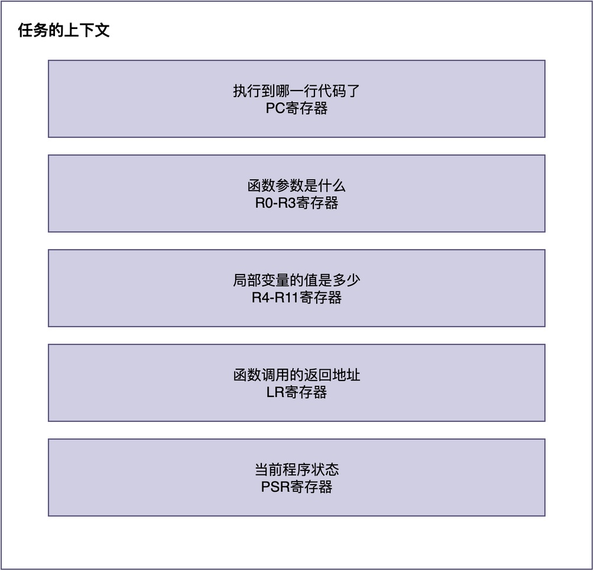
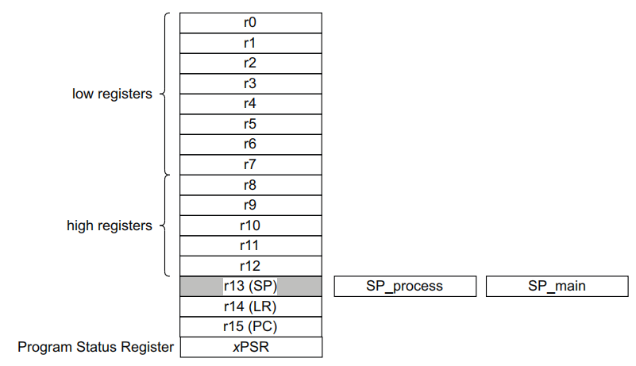

# 一个任务的上下文包含哪些内容？

在之前的文章中，我们已经知道了什么是上下文切换。但是，你可能还有一些疑惑：

> 上下文到底是什么？它包含哪些内容？
> 为什么上下文切换时，要保存这些东西？

在这篇文章中，我将继续介绍上下文切换的相关内容。为方便起见，本文将以ARM Cortex-M架构为硬件平台。

## 生活案例类比

让我们先来看一个生活中的例子。

假设有几个画家共用一个画架，画架上只能夹一块画布。

> 画家A正在画画，画架上夹着他的画布，旁边摆着他的颜料盘和画笔。这时候画家A要离开一会儿，画家B要来画画。
> 为了避免自己的东西被搞乱，A离开之前，把自己的画布取下来放好，把颜料盘和画笔收起来。
> B开始夹上自己的画布，摆好自己的颜料和画笔。当B离开时，同样收好自己的东西。
> A再把自己的画布夹回画架，摆好颜料和画笔，就能从刚才停下的地方继续画。

对于上述流程，对应的流程图如下：


可以看到，**为了让每个画家回来时都能从自己刚才停下的地方继续画，在离开时都必须把自己的画布、颜料盘和画笔取下来收好**。

### 上下文是什么

同样的，**当进行任务切换时，也需要完成类似的工作，即对任务的完整运行状态进行保存**。这样一来，当任务再次运行时，就可以恢复到原有的工作状态，继续往下运行。

**我们将任务的完整运行状态，称之为“上下文”。通常情况下，上下文主要指一个任务运行时所需要的全部CPU内核寄存器值。**

在Cortex-M中，这些内核寄存器如下所示：


**由于CPU的寄存器是所有任务共享的，当暂停某个任务时，就必须把这些寄存器的值都保存下来；否则，其他任务运行时会覆盖这些寄存器，等再切回原来时，这些寄存器的值发生了变化。原来的任务就不知道从哪里继续了，局部变量、函数参数的值也可能会出现问题**。

在这里，你可能会疑问：

> 那全局变量、静态变量为什么不需要保存呢？这些也体现了任务的运行状态啊。

之所以不需要保存，主要是因为：
1. **全局变量和静态变量的访问，通常由程序员自行负责，如通过互斥锁等机制来保证访问的安全性。**
2. **RTOS无法预知任务到底使用了哪些全局变量和静态变量**。

因此，RTOS只做最核心的工作：保存CPU的内核寄存器状态。

## 上下文的具体示例

接下来，让我们来看一下，在Cortex-M架构中，任务的上下文具体包含哪些东西。

在该架构中，完整的CPU内核寄存器如下图所示（不含浮点运算寄存器）。



也就是说，**在Cortex-M中，任务的上下文主要指：任务运行时，这些CPU寄存器的值。** 并且，这些寄存器的值保存在栈中**。

这里你可能会问：为什么这些寄存器的值要保存到栈里，而不是保存到别的地方？

主要原因有两点：

1. 每个任务都有自己独立的栈空间，天然实现了任务之间的隔离。
2. 可以方便地使用压栈和出栈指令进行保存和恢复。

正因如此，保存在栈中最合适、自然的选择。
## RT-Thread中的上下文初始化

通过前面的分析可知：任务的上下文随其运行状态而不断变化。

不过，**RTOS需要在创建任务时初始化上下文，以便让任务初次运行时，跳转到入口函数，并获得相应的任务参数**。在RT-Thread中，完成这些工作的源码如下：

```c
rt_uint8_t *rt_hw_stack_init(void *tentry, void *parameter,
                              rt_uint8_t *stack_addr, void *texit)
{
    struct stack_frame *stack_frame;
    rt_uint8_t *stk;

    /* 对齐栈指针 */
    stk = stack_addr + sizeof(rt_uint32_t);
    stk = (rt_uint8_t *)RT_ALIGN_DOWN((rt_uint32_t)stk, 8);
    stk -= sizeof(struct stack_frame);

    stack_frame = (struct stack_frame *)stk;

    /* 所有寄存器默认值设为0xdeadbeef，方便调试 */
    for (int i = 0; i < sizeof(struct stack_frame) / sizeof(rt_uint32_t); i++)
    {
        ((rt_uint32_t *)stack_frame)[i] = 0xdeadbeef;
    }

    /* 异常栈帧：硬件自动保存的部分 */
    stack_frame->exception_stack_frame.r0  = (unsigned long)parameter;
    stack_frame->exception_stack_frame.r1  = 0;
    stack_frame->exception_stack_frame.r2  = 0;
    stack_frame->exception_stack_frame.r3  = 0;
    stack_frame->exception_stack_frame.r12 = 0;
    stack_frame->exception_stack_frame.lr  = (unsigned long)texit;
    stack_frame->exception_stack_frame.pc  = (unsigned long)tentry;
    stack_frame->exception_stack_frame.psr = 0x01000000L; /* Thumb模式 */

    return stk;
}
```

从这段代码可以看出，仅对部分关键寄存器进行设置，R1-R3、R12设置为0，R4-R11设置为0xdeadbeef这个特殊调试值：

- **R0 = parameter**：该寄存器被设置成任务的入口参数parameter。
- **LR = texit**：该寄存器被设置成任务的返回地址。
- **PC = tentry**：该寄存器被设置成任务函数的入口地址。
- **PSR = 0x01000000**：设置CPU状态寄存器初始值。

之所以要将这些寄存器设置成特定的值，是由ARM的AAPCS调用约定和Cortex-M架构决定的。我将在后续的文章中，对这两块内容进行介绍。

## 总结

简单来说，**上下文就是任务的完整运行状态，主要指任务运行时所需要的全部CPU内核寄存器值。**

通过将上下文保存在任务自己的栈中，并在任务切换时进行前一任务上下文的保存、下一任务的上下文恢复，RTOS才能支持多任务的正常运行。

---

> 如果你希望系统地学习RTOS底层原理，可以了解我的《RTOS开发与实战》课程。
>
> 课程不是简单地讲解FreeRTOS API的使用，而是带你从零开始编写一个RTOS内核，逐步实现任务管理、任务调度、上下文切换、同步与通信等核心机制，并通过一个远程温湿度监控设备项目，将操作系统原理应用到实际嵌入式开发中。
>
> 适合希望深入理解RTOS工作原理、提升嵌入式底层开发能力的同学。
>
> [课程详情](/blog/diyrtos/)
