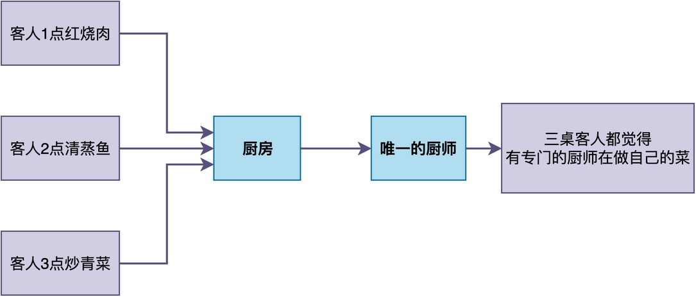
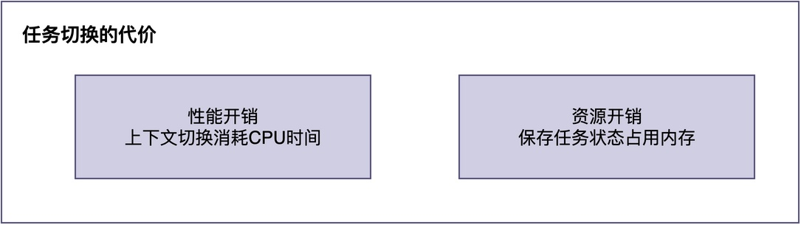

# 单核CPU为什么能够让多个任务看起来同时运行？

很久以前，当我第一次接触RTOS时，对它提供的工作机制表示非常不解：

> 明明单片机里只有一个CPU核心，为什么能同时运行好几个任务？

直到后来搞清楚了背后的原理，才发现原来其实很简单：它通过某种技巧，让我们误以为系统里的任务都能同时运行。

在今天这篇文章中，我们就来好好聊一聊，RTOS到底是怎么让多个任务看起来同时运行的？

## 生活中的类比

首先，让我们来看一个生活中的例子。

假设你去一家餐馆吃饭，并且和另外两桌客人几乎同时点了菜，分别是：红烧肉、清蒸鱼和炒青菜。

当菜单送到厨房后，厨房开始炒菜。此时，你和其他客户并不知道里面到底有几个厨师在炒菜。

如果厨房里只有一个厨师，他该怎么办呢？如果一道菜一道菜炒，可能会导致有的客户等待时间太长而走人。

虽然他不可能同时炒三个菜，但他可以快速切换：炒一会儿红烧肉，然后去看看清蒸鱼蒸得怎么样，再去扒拉两下炒青菜，然后回来继续炒红烧肉。


对于外面的客人来说，下单之后菜就在做了，感觉就像是有专门的厨师在做自己的那道菜。**但实际上，从头到尾只有一个厨师在轮流炒不同的菜。**

也就是说：**只要厨师的动作足够快，这三道菜就似乎同时在炒。**

## RTOS是怎么切换的

RTOS中的多任务运行也是类似的道理：只要让CPU快速地、轮流在不同任务上执行，这些任务似乎都在同时执行。

这里，我们用三个任务来模拟餐馆厨房的场景：

```c
/* Task0：红烧肉任务 */
void task0(void *parameter)
{
    while (1)
    {
        printf("炒红烧肉...\n");
        rt_thread_mdelay(10);
    }
}

/* Task1：清蒸鱼任务 */
void task1(void *parameter)
{
    while (1)
    {
        printf("蒸清蒸鱼...\n");
        rt_thread_mdelay(10);
    }
}

/* Task2：炒青菜任务 */
void task2(void *parameter)
{
    while (1)
    {
        printf("炒青菜...\n");
        rt_thread_mdelay(10);
    }
}
```

RTOS会管理所有的任务，决定什么时候运行哪个任务。其中一种简单的做法是：给每个任务分配一定的运行时间，即时间片，当时间片用完之后，切换至另一个任务运行。


例如，在上图中，CPU在三个任务之间快速切换，使得这三个任务的执行都能往前推进。

如果每个时间片只有1毫秒，那么在1秒内，CPU可以在三个任务之间来回切换数百次。**对于人来说，根本感觉不到这种切换，只会觉得三个任务都在同时运行**。

## 并发和并行

这里有必要提一下在操作系统相关资料中，经常提及的两个概念：

- **并发**：多个任务在宏观上同时运行，但在微观上是交替执行的。
- **并行**：多个任务在同一时刻真正同时执行。

简单来说：并发是”看起来同时”，并行是”真的同时”。

我们常见的单片机大多数都是单核CPU，所以RTOS只是让多个任务进行并发执行，并不是真正的并行执行。而在多核CPU上，RTOS可以做到让一定数量的任务并行执行，具体数量取决于CPU核心的数量。

## 付出的代价

虽然RTOS能实现任务的”并发”运行，但这要付出额外的代价：


首先是**性能开销**。RTOS需要实现所谓的上下文切换，这个过程需要消耗一定的CPU时间。虽然单次切换只需要几微秒，但如果任务数量很多、切换很频繁，这个时间就变得不可忽略。

这就像餐馆里的厨师，如果同时做的菜太多，不停地在灶台之间跑来跑去，光跑动的时间就占了很多，真正用来炒菜的时间反而少了。

其次是**资源开销**。RTOS需要为每个任务分配内存空间，用于保存自己的运行状态（当前执行到哪一行代码）、任务控制块等。

这就像厨师需要记住每道菜做到哪一步、有没有放盐。这些都需要厨师花精力去记，记的菜越多，需要的”脑力”就越多。

## 总结

综上所述，RTOS之所以能够让多个任务看起来同时运行，是因为：

> CPU快速地在不同任务间轮流执行。
> 只要分配给每个任务的时间足够短、切换速度足够快，人根本感觉不到切换的过程。

同时，这种机制也是有代价的：既有切换本身的性能开销，也有保存任务状态的资源开销。理解了这些，才能在实际开发中合理地设计任务数量和切换策略。

---

> 如果你希望系统地学习RTOS底层原理，可以了解我的《RTOS开发与实战》课程。
>
> 课程不是简单地讲解FreeRTOS API的使用，而是带你从零开始编写一个RTOS内核，逐步实现任务管理、任务调度、上下文切换、同步与通信等核心机制，并通过一个远程温湿度监控设备项目，将操作系统原理应用到实际嵌入式开发中。
>
> 适合希望深入理解RTOS工作原理、提升嵌入式底层开发能力的同学。
>
> [课程详情](/blog/diyrtos/)
