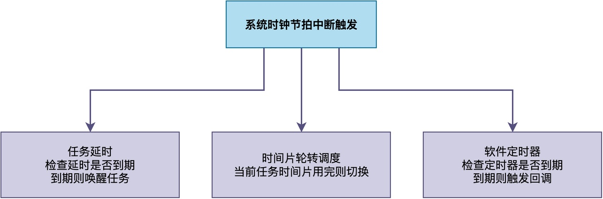
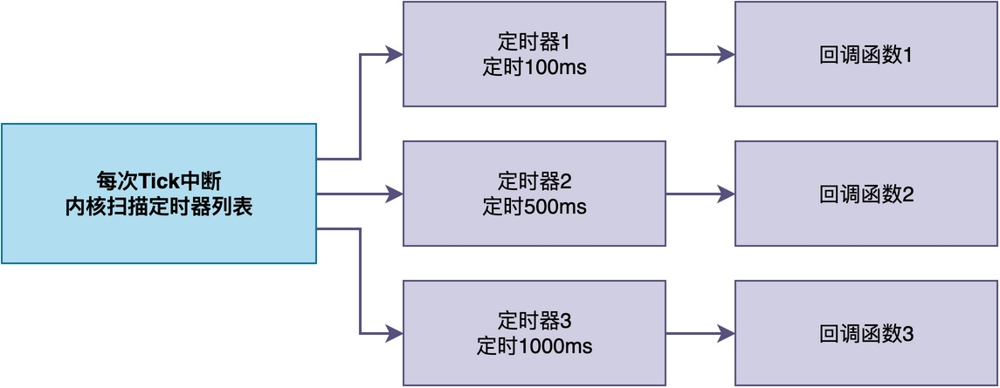
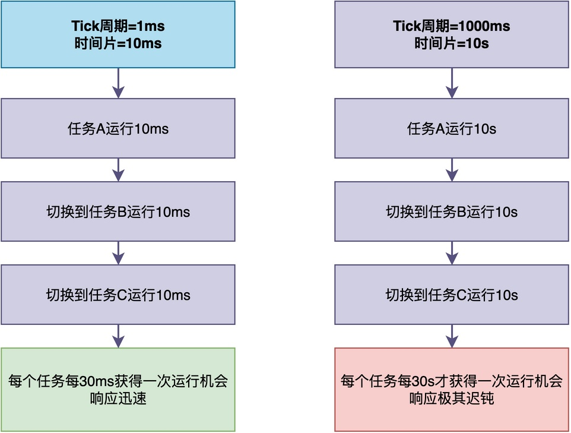

# 当系统节拍中断周期设置为1000ms，会发生什么？

我们已经知道，在RTOS中有一个叫**系统时钟节拍（简称Tick）**的东西，它是整个系统时间管理的基础。

任务延时需要用到它，时间片轮转调度需要用到它，软件定时器也需要用到它。

那么，这里有一个非常有意思的问题：

> 如果将这个时钟节拍的周期设得很长，比如1000ms，你猜会发生什么？

今天这篇文章，我们就来好好分析一下，这么设置会产生怎样的后果。

## 系统时钟节拍的作用

首先，让我们先来回顾一下：系统时钟节拍到底是干什么的，为什么它这么重要？

系统时钟节拍是RTOS中**周期性触发的定时器中断**。你可以把它理解为RTOS的"心跳"。每隔固定的时间，这个中断就会触发一次。


具体来说，系统时钟节拍主要用于以下三个方面：

1. **任务延时**：系统节拍中断发生时，内核会检查延时队列中有没有任务延时到达，如果有，则唤醒任务。
2. **时间片轮转调度**：当多个任务优先级相同时，RTOS通常会采用时间片轮转的方式实现公平调度。
3. **软件定时器**：内核在每次时钟节拍中断中检查有没有定时器到期，如果到期了就触发对应的回调函数。

显然，如果时钟节拍的周期设得比较长，这三方面都会受到影响。

通常情况下，我们会将系统时钟节拍的周期设置为1ms、10ms等较小的数值。但如果把周期设成1000ms，会发生什么呢？
## 任务延时变得非常粗糙

当你想延时500ms，并调用rt_thread_mdelay(500)，可能会发现实际延时约1秒！

这是因为：**RTOS的延时只能是Tick的整数倍，不可能有比一个Tick更短的延时**。

为了确认这一点，可以深入RT-Thread的rt_thread_mdelay()源码，看看它是怎么把毫秒转换成Tick的：

```c
rt_err_t rt_thread_mdelay(rt_int32_t ms)
{
    rt_tick_t tick;

    tick = rt_tick_from_millisecond(ms);

    return rt_thread_sleep(tick);
}
```

可以看到，该函数内部调用了rt_tick_from_millisecond()函数来把毫秒转换成Tick数。

```c
rt_tick_t rt_tick_from_millisecond(rt_int32_t ms)
{
    rt_tick_t tick;

    if (ms < 0)
    {
        tick = RT_WAITING_FOREVER;
    }
    else
    {
        tick = (RT_TICK_PER_SECOND * ms + 999) / 1000;
    }

    return tick;
}
```

转换的关键代码为：tick = (RT_TICK_PER_SECOND * ms + 999) / 1000。其中，宏RT_TICK_PER_SECOND表示每秒有多少个Tick，也就是Tick频率。

这种转换实际上是典型的**向上取整**。我们来算一下：

- 如果RT_TICK_PER_SECOND = 1000，一个Tick是1ms，那么tick = (1000 × 500 + 999) / 1000 = 500，实际延时约500ms。
- 如果RT_TICK_PER_SECOND = 1，一个Tick是1000ms，那么tick = (1 × 500 + 999) / 1000 = 1，实际延时约1000ms。

由此可见，当Tick周期是1000ms时，不管你请求的是延时10ms还是500ms，最终都会被向上取整为1个Tick，也就是约1秒。

**此外，由于一个Tick的周期为1秒，这使得实际延时只能是1秒的整数倍**。这就好比你用一把只有米刻度的尺子去量毫米级的东西，根本量不准。

## 软件定时器精度降到秒级

**软件定时器也同样基于系统时钟节拍来完成相应的工作**。

我们来看一下软件定时器的工作机制。RTOS中通常会维护一个软件定时器的列表，每个定时器都有自己的定时时间和对应的回调函数。在每次Tick中断时，内核会扫描这个列表，检查有没有定时器到期，如果到期了就触发相应的回调函数。


同样的，如果Tick是1ms，那么软件定时器的精度就是1ms，可以实现比较精确的定时。

**而如果Tick周期是1000ms，相应地，精度就降到了秒级。也就是说，只能指定定时为1秒、2秒、3秒……**

如果想设置一个500ms的定时器？对不起，最小只能设置1秒，而且实际触发时间可能在1秒到2秒之间。

## 系统响应变得迟钝

**RTOS的时间片轮转调度机制通常将CPU的时间分成相等的长度，轮流分配给不同的任务执行，从而保证任务的公平性和实时响应。**

也就是说，每个任务在运行完指定的时间片长度之后，就会切换到下一个任务。

**当时间片长度不合理时，将会影响系统的实时性**。例如，有任务A、任务B和任务C，假设每个任务的时间片长度为10个Tick，那么：

1. **一个Tick是1ms**：任务最多每次占用CPU运行10ms，就必须切换到其它任务。
2. **一个Tick是1000ms**：任务最多每次占用CPU运行10秒，才能轮到下一个任务运行。

从下图可以看出，当一个Tick就是1000ms时，每个任务10秒执行完后，需要再等20秒才能执行，即每30秒才获得一次执行机会。


**这对于需要及时响应的系统来说，简直是无法忍受的，甚至是灾难。**

## 是不是Tick周期越短越好

看到这里，你可能会问：

> 既然Tick的时间设置成1000ms有这么多问题，那干脆把Tick周期设置得越短越好，比如1微秒？

实际上，这么做也存在很多问题。**最典型的问题就是：频繁的Tick中断将带来更严重的开销**。

当Tick中断触发时，CPU都需要保存上下文、执行中断处理函数、再恢复上下文。这个过程虽然通常较短，但当中断太频繁时，中断本身的开销就会占用大部分CPU时间，真正用来执行任务的时间反而变少，任务执行变得更慢。

> 这就好比你正在看我的文章，如果每看一句就去回复一个微信信息，看文章的速度将变得更慢。

因此，Tick周期的设置需要在**精度和开销之间取得平衡**。

对于大多数嵌入式系统来说，设置为1ms、10ms是一个比较合适的选择。

## 总结

简单来说，**系统时钟节拍中断是RTOS的"心跳"。任务延时、时间片轮转调度、软件定时器，这三个核心功能都依赖时钟节拍来驱动**。

如果把节拍周期设置为1000ms，会导致任务延时变得非常粗糙、系统响应变得迟钝、软件定时器精度降低。但这也不意味着Tick周期越短越好，因为中断本身也有开销。

通常情况下，设置为1ms或10ms是精度和开销之间的一个平衡点。

---

> 如果你希望系统地学习RTOS底层原理，可以了解我的《RTOS开发与实战》课程。
>
> 课程不是简单地讲解FreeRTOS API的使用，而是带你从零开始编写一个RTOS内核，逐步实现任务管理、任务调度、上下文切换、同步与通信等核心机制，并通过一个远程温湿度监控设备项目，将操作系统原理应用到实际嵌入式开发中。
>
> 适合希望深入理解RTOS工作原理、提升嵌入式底层开发能力的同学。
>
> [课程详情](/blog/diyrtos/)
