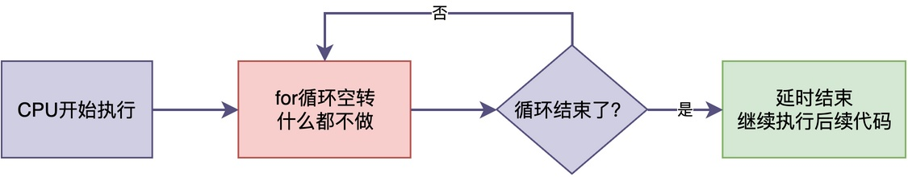
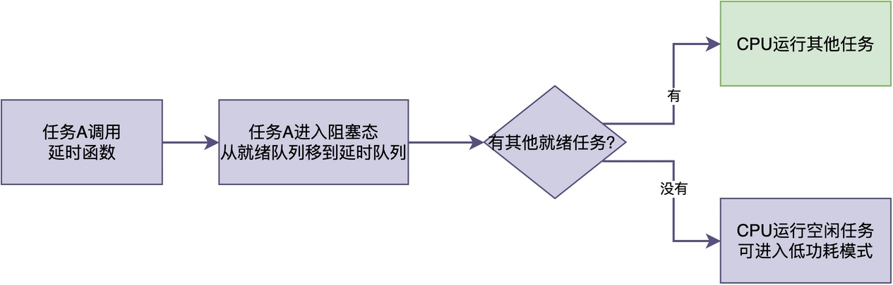

# 任务延时时CPU在干什么？

很多人刚从裸机转到RTOS的时候，会提出这样一个疑问：

> 在裸机里，要实现延时就是写一个循环空转，让CPU在那里干等着，无法做其他事情。
> 可在RTOS里，需要调用RTOS的延时接口。这时候CPU在干什么呢？是也在空转吗？如果不是，它在做什么？

在这篇文章中，我就来揭开这个谜底，看看任务延时时，CPU究竟在忙些什么。

## 任务延时不是空转

首先，我们要了解一个基本事实：**RTOS中的任务延时，CPU不是在空转**。

**本来，我们使用RTOS是为了提高系统的运行效率，如果CPU仍然在空转，那使用RTOS的意义就降低了。**

在裸机编程中，为实现延时，通常的做法是：写一个for循环，循环很多次，等循环结束。也就是说，在这种方式下，CPU将时间花在执行空指令上，什么有用的事情都没做。


而在RTOS中，任务调用延时函数之后，这个任务会主动放弃CPU，进入延时状态。此时，**CPU转去运行其他就绪的任务**。相比之下，RTOS比裸机更加高效：等待的时间用来做别的事情，而不是白白浪费掉。


## 延时的底层实现过程

为了真正理解任务延时，我们可以深入RT-Thread的延时函数rt_thread_mdelay()的源码。该函数的代码简化如下：

```c
rt_err_t rt_thread_mdelay(rt_int32_t ms)
{
    rt_tick_t tick;

    /* 把毫秒转换成tick数 */
    tick = rt_tick_from_millisecond(ms);

    /* 让当前任务睡眠指定的tick数 */
    return rt_thread_sleep(tick);
}

rt_err_t rt_thread_sleep(rt_tick_t tick)
{
    register rt_base_t temp;
    struct rt_thread *thread;

    temp = rt_hw_interrupt_disable();

    thread = rt_thread_self();

    /* 1. 挂起当前任务，从就绪队列移除 */
    rt_thread_suspend(thread);

    /* 2. 设置定时器，时间到了唤醒任务 */
    rt_timer_control(&(thread->thread_timer),
                     RT_TIMER_CTRL_SET_TIME, &tick);
    rt_timer_start(&(thread->thread_timer));

    rt_hw_interrupt_enable(temp);

    /* 3. 触发调度，切换到其他任务 */
    rt_schedule();

    return RT_EOK;
}
```

从源码可以看到，当任务调用rt_thread_mdelay()时，首先将延时时间转换成tick数，再调用rt_thread_sleep()。

之后，rt_thread_sleep()进行以下工作：

1. 调用rt_thread_suspend()：把当前任务挂起，即从就绪队列中移出。
2. 调用rt_timer_control()：设置一个定时器，记录它需要延时的tick数。
3. 调用rt_schedule()：触发一次任务切换，切换至其他任务运行。

也就是说，只有当延时时间到时，任务才会被唤醒并重新获得运行机会，完成延时。**在整个延时过程中，CPU并没有在空转浪费时间**。

## 运行哪些任务

前面提到，进入延时后，CPU转而去运行其它任务。

那么，有的同学可能就会提出疑问：

> 如果系统里所有任务都在延时或者阻塞，这时候CPU运行什么？
> 答案是：运行空闲任务。

空闲任务是RTOS启动时创建的一个特殊任务，它的优先级是系统最低的。也就是说，**只有当系统中没有其他任何就绪任务的时候，空闲任务才会运行**。

在RT-Thread中，空闲任务的工作代码（简化版本）如下所示：

```c
/* 空闲任务入口函数 */
static void rt_thread_idle_entry(void *parameter)
{
    while (1)
    {
        /* 第一步：执行空闲钩子函数（如果用户注册了） */
        if (rt_thread_idle_hook != RT_NULL)
        {
            rt_thread_idle_hook();
        }

#ifdef RT_USING_HEAP
        /* 第二步：回收已删除任务的资源 */
        rt_thread_defunct_cleanup();
#endif
    }
}
```

空闲任务除了优先级最低之外，**它总是保持着就绪状态，不会进入阻塞或者延时状态**。

如果确实没有什么事情可做，通常会让CPU进入低功耗模式。比如在ARM Cortex-M中，空闲任务可以执行WFI（Wait For Interrupt）指令，让CPU进入睡眠状态。这样在系统空闲的时候，CPU的功耗可以降到很低。

## 总结

综上所述，我们得知RTOS延时和裸机延时的不同：

1. **裸机延时**：CPU在执行空转指令，白白浪费时间，其它什么有用的事情都做不了，功耗也降不下来。
2. **RTOS延时**：CPU转去运行其他任务，让其他任务有运行的机会；甚至进入低功耗模式，降低功耗。

通过对比可知：由于RTOS延时能够将CPU切换到其他任务运行，进一步提升了系统的运行效率。

---

> 如果你希望系统地学习RTOS底层原理，可以了解我的《RTOS开发与实战》课程。
>
> 课程不是简单地讲解FreeRTOS API的使用，而是带你从零开始编写一个RTOS内核，逐步实现任务管理、任务调度、上下文切换、同步与通信等核心机制，并通过一个远程温湿度监控设备项目，将操作系统原理应用到实际嵌入式开发中。
>
> 适合希望深入理解RTOS工作原理、提升嵌入式底层开发能力的同学。
>
> [课程详情](/blog/diyrtos/)
