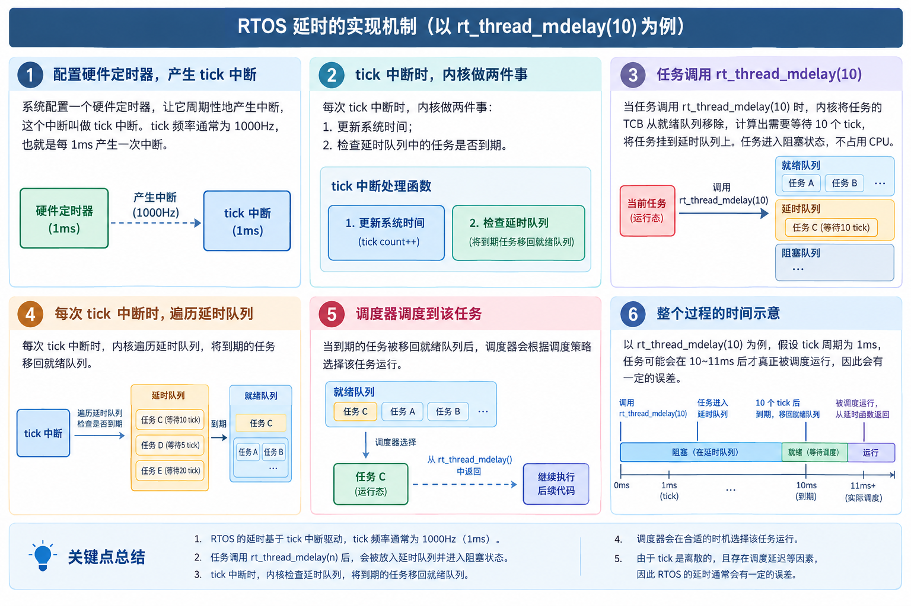
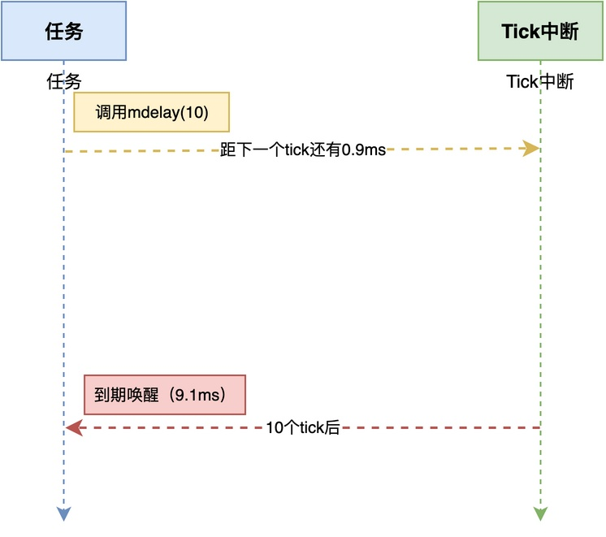
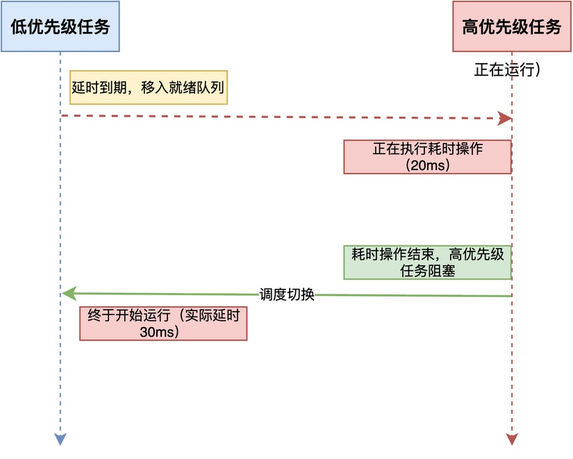
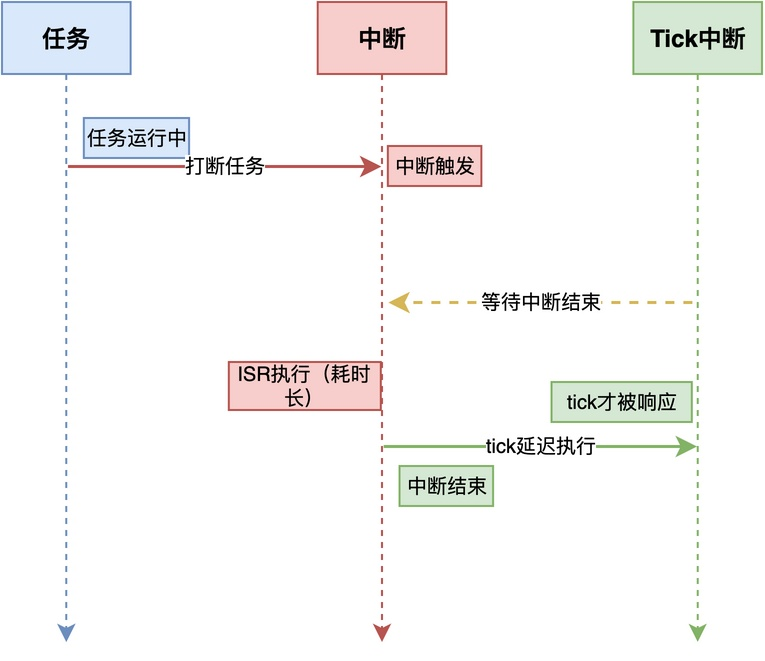
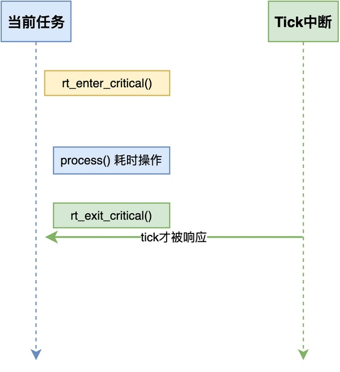

# 为什么RTOS中的延时不一定精确？

在实际开发中，由于RTOS提供了任务延时函数，很自然地，这些函数成为任务中常用的API之一。

> 比如，在RT-Thread中，我们可以使用rt_thread_mdelay(10)来延时10毫秒。

不过，很多同学在实际调试时会发现一个问题：

> **rt_thread_mdelay(10)实际延时的时间，不一定正好是10毫秒。有时候不到10毫秒、有时候可能是11毫秒、有时候甚至更长。**

为什么会出现这种情况？

今天，在这篇文章中，我将深入分析造成这一问题的原因。

## RTOS延时的基本原理

要理解为什么RTOS的延时不准确，我们首先要搞清楚RTOS的延时是怎么实现的。

这里以RT-Thread为例，其延时机制如下图所示：


具体来说：
1. RTOS会配置一个硬件定时器（比如SysTick），让它周期（如1000Hz）地产生中断，即**tick中断**。
2. 每次tick中断时，RTOS做两件事：更新系统时间，同时检查延时队列中的任务是否到期。
3. 当任务调用rt_thread_mdelay(10)时，RTOS计算出需要等待10个tick，将任务挂到延时队列上。
4. 当tick中断发生时，RTOS遍历延时队列，将到期的任务移回就绪队列。
5. 当调度器调度到这个任务时，任务才从延时函数中返回，继续执行后面的代码。

**由此可见，RTOS的延时不是直接让CPU"干等"指定时间，而是基于系统tick的"间接延时"。**

换句话说，<font color="#245bdb">**延时函数的本质是让任务等待指定的tick中断次数，而不是精确等待指定的时间**</font>。

## 延时不精确的几个原因

具体来说，RTOS延时不精确主要有以下几个原因。
### tick中断周期的限制

这是最根本的原因。

我们知道，**RTOS的延时是以tick中断周期为单位的，延时时间只能是tick的整数倍**。

假设tick频率是1000Hz（即1ms一个tick），那么当调用rt_thread_mdelay(10)时，RTOS会让任务等待10个tick。

不过，调**用延时函数的时刻，并不能保证一定能在tick发生时，而是会有所偏差**。

例如，调用时机距离下一个tick中断可能还有0.9ms，也可能只有0.1ms，这将使得实际的延时可能是9.1ms或9.9ms。



**在最坏的情况下，实际延时时间可能相差接近一个tick（1ms）。**

### 调度延迟

**当任务延时到期后，任务被移回就绪队列，但这不意味着任务会立即运行。**

此时，如果有**更高优先级的任务正在运行，那么刚到期的任务只能等待，直到高优先级任务阻塞或结束**。这段等待时间就是调度延迟，时间长度可能是几个tick甚至更长。

例如，当一个高优先级任务正在执行一个耗时20ms的操作时，任务需要再等20ms才能运行，这就使得实际延时就是30ms而不是10ms。



### 中断影响

由于中断的优先级比任何任务都高，中断触发时CPU会立即响应中断，暂停当前任务的执行，也会打断调度器的执行。

如果中断处理时间较长，或者中断频繁发生，会导致tick中断本身被延迟响应，延时到期的检查也会被推迟。

同时，中断也会延迟调度器的调度，进一步增加延时误差。



### 临界区影响

在某些情况下，多个任务需要访问共享的资源，为避免访问冲突会暂时关闭中断或锁定调度器，从而进入临界区。

在临界区期间，tick中断不会被响应，延时到期的检查也不会执行。**如果临界区执行时间较长，会导致延时到期检查被推迟，影响其它任务的延时**。

下面给出RT-Thread中临界区的简单示例：

```c
void critical_section_example(void)
{
    /* 进入临界区，锁定调度器，任务切换被禁止 */
    rt_enter_critical();

    /* 访问共享资源，此时即使tick中断到来，
       也不会触发任务调度，当前任务继续执行 */
    process();   // 比较耗时的操作 

    /* 退出临界区，恢复调度器 */
    rt_exit_critical();
}
```

在rt_enter_critical()和rt_exit_critical()之间，调度器被锁定，任务切换不会发生。

**如果这段临界区的执行时间较长，其他任务的延时到期检查就会被推迟，导致实际延时变长**。



## 最坏情况

由此可见，我们可知：**任务延时函数并不能保证比较准确的延时**。

甚至于在高优先级任务长时间占用CPU的情况下，任务希望延时10ms，实际延时到期后，任务迟迟无法运行。

**因此，延时的最坏情况，可以说是没有上限的。**

## 总结

综上所述，**RTOS中的延时不一定精确，其根本原因在于延时是基于系统tick中断，而不是直接让CPU等待指定时间**。

那么，如何实现更精确的延时，我将在后续文章中详细介绍，欢迎持续关注！

---

> 如果你希望系统地学习RTOS底层原理，可以了解我的《RTOS开发与实战》课程。
>
> 课程不是简单地讲解FreeRTOS API的使用，而是带你从零开始编写一个RTOS内核，逐步实现任务管理、任务调度、上下文切换、同步与通信等核心机制，并通过一个远程温湿度监控设备项目，将操作系统原理应用到实际嵌入式开发中。
>
> 适合希望深入理解RTOS工作原理、提升嵌入式底层开发能力的同学。
>
> [课程详情](/blog/diyrtos/)
