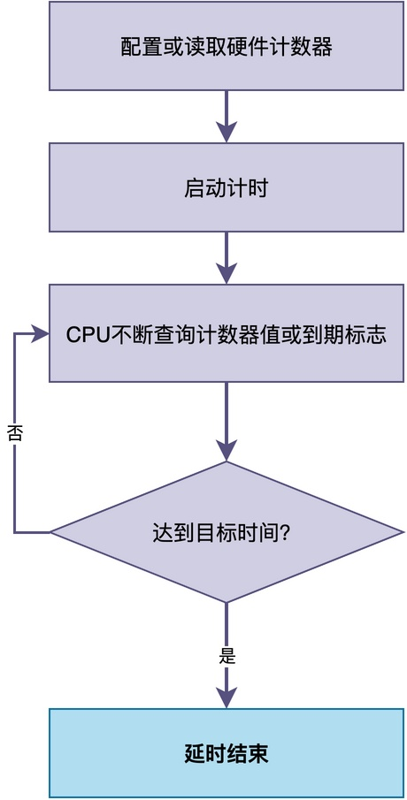
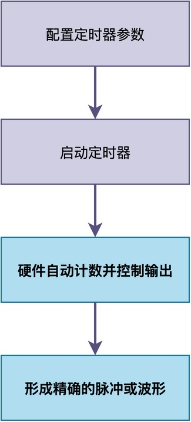

# RTOS中如何实现更精确的延时？

在我之前的文章《为什么RTOS中的延时不一定精确》中，解释了RTOS延时函数不能实现准确延时的原因，那你可能会问：

> 如果要求延时更加精确，应该怎么办？

接下来，我将介绍几种常见方法的实现思路，这些思路不依赖具体的硬件和RTOS。你可以根据自己所用的环境自行实现。

当然，如果你有其他更好的方法，欢迎评论区补充。

## 软件忙等待

**最直接、最简单的方法是：使用空循环进行延时。** 

这种方法也是我们在裸机程序中最常用的方法。它的原理很简单：

> CPU执行循环指令本身需要时间，循环执行的次数越多，延时就越长。通过调整循环次数，可以实现不同长度的延时。

下面给出了一段简单示例代码。

```c
void delay_loop(uint32_t count)
{
    while (count--)
    {
        __NOP(); // 空指令，防止编译器优化掉循环
    }
}
```

这种方法的**优点是：实现非常简单、不需要任何外设支持、不依赖RTOS、可以实现极短暂的微秒级等待**。

但是，它的缺点也很明显：

- **延时时间不准确**：时间受到编译器优化等级、CPU主频、流水线、缓存等多种因素的影响，很难精确控制。
- **可移植性差**：在将代码移植至其他硬件平台时，需要重新校准循环次数。
- **白白占用CPU**：CPU一直在执行空循环，无法去做其他有意义的事情。

## 硬件定时器查询

如果系统中有空闲的定时器或计数器，则可以使用定时器或计数器来计时。

这种方法的本质是：**让硬件计数器独立计时，CPU不断查询计数器的值或到期标志，直到达到目标时间**。


在实际的MCU中，有很多种定时器和计数器可以用来实现这种方法，常见的有：

- **Cortex-M内核的SysTick定时器**：很多RTOS会使用SysTick作为系统时钟节拍的来源，如果已经被RTOS占用了，就不能再随意使用。
- **Cortex-M的DWT周期计数器**：该计数器的计数频率等于CPU主频，可以实现非常高精度的计时。
- **MCU的通用定时器**：如STM32的TIM1等，通常可以配置成向上计数或向下计数，支持预分频，可以用来实现精确延时。

我们可以读取这些自由运行计数器的计数值，根据计数差来判断等待时间是否达到目标。

```c
/* 平台相关函数：读取硬件自由运行计数器的值 */
void delay_us_counter(uint32_t us)
{
    uint32_t start = get_hw_counter();
    uint32_t target = us * (counter_freq / 1000000);

    while ((get_hw_counter() - start) < target)
    {
        /* 持续检查计数器 */
    }
}
```

也可以将计数值设置为一个初始值，**程序中可以不断检查其计数到期（溢出）标志，来判断等待时间是否达到目标**。

```c
void delay_us_timer_poll(uint32_t us)
{
    /* 配置定时器的定时时间 */
    timer_config(us);

    /* 清除标志，启动定时器 */
    timer_clear_flag();
    timer_start();

    /* 查询等待定时器到期 */
    while (!timer_is_expired())
    {
        /* 等待定时器到期 */
    }

    /* 关闭定时器 */
    timer_stop();
}
```

对比软件忙等待，**这种方式同样存在"白白占用CPU"的问题。当移植到其他平台时，如果没有这些计数器，延时函数需要重新实现**。

## 让硬件自动完成时序

如果要求的是精确脉冲、通信波形或定时采样，通常还有一种更合适的方案：

> **直接配置硬件，让它按照预定时间自动执行操作**。

例如，很多MCU（如STM32）的定时器可以通过输出比较功能，在指定计数时刻改变输出引脚的状态，从而产生精确的脉冲。


同样的，也可以设置当定时中断触发后，通过DMA自动访问指定的外设接口（比如I2C或ADC）以进行数据采集。这使得整个数据采集过程不需要CPU干预，不受其他因素的影响。

## 如何保证忙等延时的准确性

你可能会发现：前面介绍的几种方法，在祼机环境中也是可以正常使用的。

> 那么，是否意味着可以完全无需作任何调整，就能将原来祼机中的代码迁到RTOS环境中？

要注意的是，**对于软件忙等待和硬件定时器查询这两种方式，在延时过程中可能会被其他中断或者任务切换打断，导致实际的延时时间比预期的要长**。

例如，某个任务想延时10微秒，它可能会这样写：

```c
/* 忙等延时函数，前面已经介绍过 */
void delay_us_counter(uint32_t us);

/* 任务函数 */
void sensor_task(void *parameter)
{
    while (1)
    {
        /* 读取传感器数据 */
        read_sensor();

        /* 延时10微秒，等待传感器转换完成 */
        delay_us_counter(10);

        /* 继续处理 */
        process_data();
    }
}
```

但是，在调用delay_us_counter(10)的过程中，可能会被其他中断或者任务切换打断，导致实际的延时时间超过10微秒。

因此，如果不希望被打断，可以在延时期间关闭中断，延时结束后再打开中断，以避免干扰：

```c
/* 带中断保护的忙等延时函数 */
void delay_us_with_irq_disable(uint32_t us)
{
    /* 关闭中断，保存当前中断状态 */
    rt_base_t level = rt_hw_interrupt_disable();

    /* 执行忙等延时 */
    delay_us_counter(us);

    /* 恢复中断状态 */
    rt_hw_interrupt_enable(level);
}

/* 任务函数 */
void sensor_task(void *parameter)
{
    while (1)
    {
        /* 读取传感器数据 */
        read_sensor();

        /* 延时10微秒，带中断保护，确保不被打断 */
        delay_us_with_irq_disable(10);

        /* 继续处理 */
        process_data();
    }
}
```

**不过，关闭中断会影响系统的实时性。因此，这种方法只适合较短的延时（比如几微秒到几十微秒），不适合长时间使用。**
## 总结

简单来说，在RTOS中实现更精确的延时，**常见思路可以归纳为三类：软件忙等待、硬件定时器查询，以及硬件自动完成时序**。具体选择哪一种方法，需要考虑延时精度、CPU占用、任务调度、中断响应等多方面的因素。

---

> 如果你希望系统地学习RTOS底层原理，可以了解我的《RTOS开发与实战》课程。
>
> 课程不是简单地讲解FreeRTOS API的使用，而是带你从零开始编写一个RTOS内核，逐步实现任务管理、任务调度、上下文切换、同步与通信等核心机制，并通过一个远程温湿度监控设备项目，将操作系统原理应用到实际嵌入式开发中。
>
> 适合希望深入理解RTOS工作原理、提升嵌入式底层开发能力的同学。
>
> [课程详情](/blog/diyrtos/)
