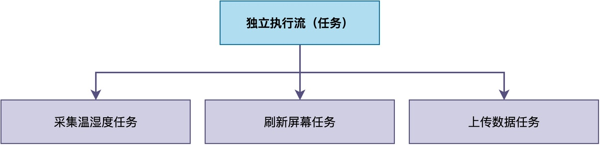
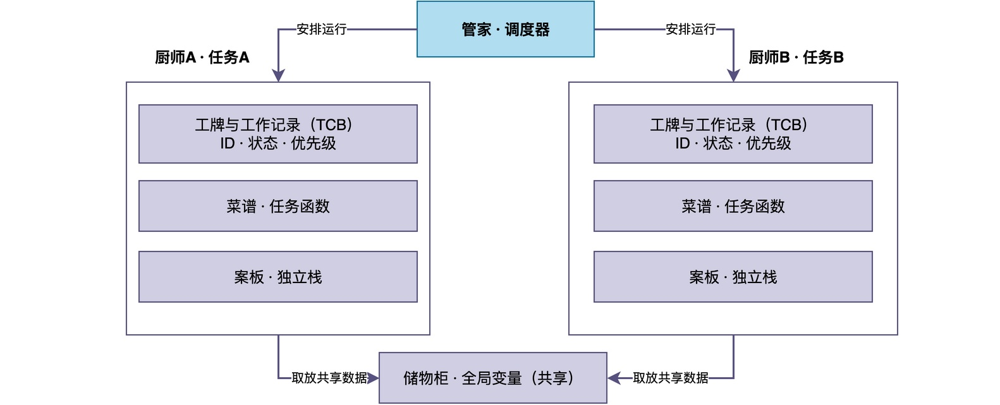

# RTOS 中的任务到底是什么？

当我们在第一次接触RTOS的时候，往往都会有这样一个疑惑：

> 在裸机程序里，我只需要在main函数里写代码就行了。结果，一用上RTOS，必须创建任务？
> 
> 任务倒底是什么东西？

在这篇文章中，我将解答以上问题。
## 一、任务是什么

简单来说，**任务是RTOS中可被调度的最小单位，它代表的是一条可以被暂停、也可以被恢复的独立执行流。**

当然，以上表述有点过于专业性，不是很好理解，这里可以借助之前文章中的例子来进行类比。

例如，假设要做一个温湿度监控设备，它要同时完成几件事：每隔一秒采集一次温湿度数据、每隔半秒刷新一次屏幕显示，并且还要在后台将数据上传到服务器。

如果是在裸机程序里，这些事情只能挤在一个while(1) 大循环里依次执行。当使用了RTOS后，我们可以把它们分别做成采集任务、显示任务和上传任务。这样一来，每一件事都有一个特定的任务去完成。



所以，任务就相当于给这个设备里的每一件事都安排了一个专属的”负责人“，这些“负责人各自独立工作、互不干扰“，由 RTOS 调度器统一管理。

而原来的祼机程序，则相当于这个设备只有一个”负责人“。

## 二、任务的现实表现：以 RT-Thread 为例

不过，对我们来说，任务仍然是一个很抽像的概念。那么，任务具体表现成什么样？

这里以RT-Thread 为例来说明，具体示例代码如下：

```
/* 采集任务入口 */
static void sensor_thread_entry(void *parameter)
{
    while (1)
    {
        read_temp_humi();
        rt_thread_mdelay(1000);
    }
}

/* 显示任务入口 */
static void display_thread_entry(void *parameter)
{
    while (1)
    {
        display_update();
        rt_thread_mdelay(500);
    }
}

/* 上传任务入口 */
static void uart_send_thread_entry(void *parameter)
{
    while (1)
    {
        upload_data();
        rt_thread_mdelay(500);
    }
}

int main(void)
{
    rt_thread_t tid;
    tid = rt_thread_create("sensor", sensor_thread_entry,
                           RT_NULL, 1024, 10, 10);
    rt_thread_startup(tid);
    tid = rt_thread_create("display", display_thread_entry,
                           RT_NULL, 1024, 11, 10);
    rt_thread_startup(tid);
    tid = rt_thread_create("upload", uart_send_thread_entry,
                           RT_NULL, 1024, 11, 10);
    rt_thread_startup(tid);
    return 0;
}
```

从上面的代码可以看到，一共定义了三个函数，分别负责采集、显示和上传。

之后，在main()里用rt_thread_create()创建任务，再用rt_thread_startup()启动该任务。同时，在创建任务的时候，还指定了任务的栈大小、优先级等信息。

在创建并启动完成之后，RTOS就会自动根据内部调度需求，合理安排各个任务的运行。

当相应的任务运行时，CPU便开始执行该任务的任务函数。例如，当sensor任务运行时，CPU开始执行sensor_thread_entry()函数中的代码。

## 三、任务到底需要什么

从前面的例子还可以看出，一个任务能跑起来，仅有任务函数是远远不够的，还需要栈空间等资源。

除此之外，RTOS内部会维护该任务运行时状态信息。在很多RTOS内部，都有相应的任务结构体，例如，在RT-Thread中使用**线程控制块（struct rt_thread）结构：

```
struct rt_thread
{
    /* rt object */
    char        name[RT_NAME_MAX];                      /**< the name of thread */
    rt_uint8_t  type;                                   /**< type of object */
    rt_uint8_t  flags;                                  /**< thread's flags */
 
    rt_list_t   list;                                   /**< the object list */
    rt_list_t   tlist;                                  /**< the thread list */
 
    /* stack point and entry */
    void       *sp;                                     /**< stack point */
    void       *entry;                                  /**< entry */
    void       *parameter;                              /**< parameter */
    void       *stack_addr;                             /**< stack address */
    rt_uint32_t stack_size;                             /**< stack size */
 
    /* error code */
    rt_err_t    error;                                  /**< error code */
 
    rt_uint8_t  stat;                                   /**< thread status */
 
    /* priority */
    rt_uint8_t  current_priority;                       /**< current priority */
    rt_uint8_t  init_priority;                          /**< initialized priority */
#if RT_THREAD_PRIORITY_MAX > 32
    rt_uint8_t  number;
    rt_uint8_t  high_mask;
#endif
    rt_uint32_t number_mask;
 
#if defined(RT_USING_EVENT)
    /* thread event */
    rt_uint32_t event_set;
    rt_uint8_t  event_info;
#endif
 
    rt_ubase_t  init_tick;                              /**< thread's initialized tick */
    rt_ubase_t  remaining_tick;                         /**< remaining tick */
 
    struct rt_timer thread_timer;                       /**< built-in thread timer */
 
    void (*cleanup)(struct rt_thread *tid);             /**< cleanup function when thread exit */
 
    rt_uint32_t user_data;                              /**< private user data beyond this thread */
};
typedef struct rt_thread *rt_thread_t;
```

而在我的《从0手写嵌入式操作系统》系列课程中，实现的RTOS采用的任务控制块结构如下：

```
typedef struct _os_task_t {

    char name[OS_TASK_NAME_SIZE];       // 任务名称[

#if OS_TASK_INFO_ENABLE || OS_SCHED_CHECK_TASK_STACK

    cpu_stack_t * start_stack;          // 栈的起始地址

    int stack_size;                     // 栈的大小

#endif

    os_task_ctx_t ctx;                // 任务的当前上下文

    int delay_tick;                     // 延时计数器

    uint16_t prio;                      // 优先级

    uint16_t flags;                     // 一些标志位

#if OS_SCHED_RR_ENABLE

    int slice;                          // 时间片

#endif

    os_list_item_t info_item;           // 所有任务的链接结点

    os_list_item_t run_item;            // 链接结构

    task_wait_t event_wait;               // 等待的事件

    os_list_item_t event_item;          // 等待的结点

}os_task_t;
```

通过对比可以看到，不同RTOS的实现，会根据其设计需要，在任务控制块中包含不同的成员定义。

为了便于理解，这里可以用做饭进行类比理解：

> 任务函数就像是一份菜谱，它只告诉你每一步该做什么，本身并不能完成工作。

真正要把菜做出来，还需要案板切菜，还需要储物柜来存放公共调料。

> 栈相当于每个任务独有的那块案板，用来存放局部变量和函数调用现场，而全局变量就是共享的储物柜。

此外，很多时候，往往有多个任务在系统中同时运行，也就类似于同时有多个厨师在工作。

> 任务控制块好比每个厨师身上的工牌与工作记录：上面写着他是谁（任务 ID）、当前状态是“正在切菜”还是“等着锅烧热”、该优先做哪道菜（优先级）。

而<font color="#245bdb">RTOS就相当于是整个厨房的管家，他管理着厨房内所有的厨师（任务），每个厨师各自独立做菜（运行）。</font>



## 五、总结

综上所述，RTOS 中的任务并不是一个普通的C函数，而是由任务函数、栈和任务控制块共同组成的一条独立执行流。

它需要选通过RTOS的相关API接口进行创建与启动，该过程本质上是在向RTOS注册一条可以被调度的执行流。

之后，任务就被RTOS接管，RTOS会根据时机来决定任务何时运行。

---

> 如果你希望系统地学习RTOS底层原理，可以了解我的《RTOS开发与实战》课程。
>
> 课程不是简单地讲解FreeRTOS API的使用，而是带你从零开始编写一个RTOS内核，逐步实现任务管理、任务调度、上下文切换、同步与通信等核心机制，并通过一个远程温湿度监控设备项目，将操作系统原理应用到实际嵌入式开发中。
>
> 适合希望深入理解RTOS工作原理、提升嵌入式底层开发能力的同学。
>
> [课程详情](/blog/diyrtos/)
