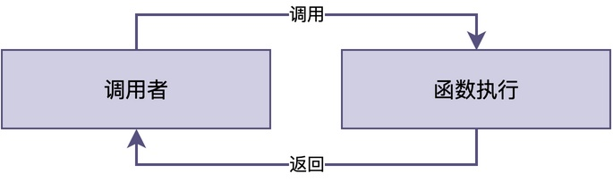
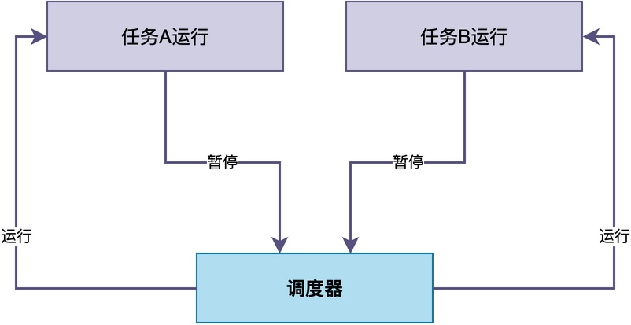
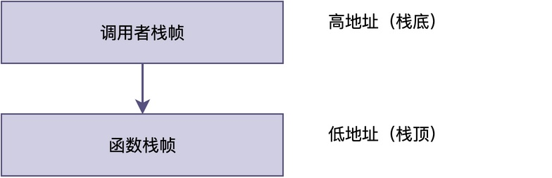
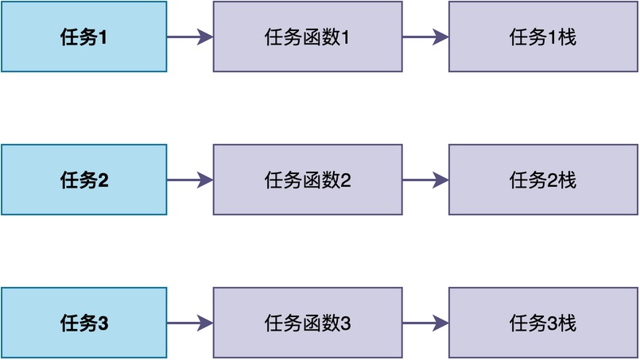

# RTOS任务函数和普通C函数有什么区别？

很多人刚开始学RTOS的时候，都会有这样的疑问：

> 任务函数看起来就是个普通的C函数，是用花括号包起来的函数体。
> 那为什么不能直接调用它，非要先创建任务再启动？
> 这两者到底有什么本质区别？

在这篇文章中，我就来聊一聊RTOS任务函数和普通C函数的一些区别。

## 先看两段代码

首先，让我们先来看两段代码，一段是普通的C函数，另一段是RTOS中的任务函数。

**普通C函数：** add()用于对两个数进行相加。

```c
int add(int a, int b)
{
    return a + b;
}

void main(void)
{
    int result = add(1, 2);
    printf("%d\n", result);
}
```

**RTOS任务函数：** led_thread()用于完成特定的任务。

```c
static void led_thread(void *p)
{
    while (1) {
        led_toggle();
        rt_thread_mdelay(500);
    }
}

int main(void)
{
    rt_thread_t tid = rt_thread_create("led", led_thread, ...);
    rt_thread_startup(tid);
    return 0;
}
```

从表面来看，这两个函数的区别为：

> **是否返回**：普通函数执行完后直接return，而任务函数通常是while(1)死循环；
> **使用方式**：普通函数是直接调用的，而任务函数要先创建任务才能运行。

## 内部执行上的区别

如果分析这两个函数的具体执行逻辑，会看到其分别有不同的特点。

对于普通函数，**需要调用者主动跳过去（通过跳转、子程序调用指令）执行，执行完再跳回来**。在这个过程中，调用者必须停下来等它执行完。


对于任务函数，**它什么时候运行，是由RTOS的调度器决定的**。调度器根据优先级、任务状态等信息，决定当前让哪个任务运行，也就是执行哪个任务函数。



## 栈使用上的区别

虽然普通函数和任务函数的运行都用到栈空间；但是，二者使用的栈是不同的。

**普通函数和调用者共用同一块栈。** 函数的局部变量、返回地址都存在调用者的栈上。也就是说，谁调用这个函数，这个函数就用谁的栈。



**任务函数使用对应任务的栈。** 创建任务的时候，RTOS会为任务分配一块独立的栈空间。这块栈空间专门用于执行任务的任务函数。也就是说，这个任务函数被哪个任务所执行，就使用哪个任务的栈。



例如，在上图中，每个任务都有自己对应的任务函数和栈空间。这些不同任务函数之间的执行互不干扰。
## 总结

实际上，**对于编译器来说，无论是普通函数和任务函数，二者完全是同一类东西**。

只不过，由于我们引入了RTOS，一个”看似普通”的函数被任务加载执行。这使得该函数运行时使用任务的栈空间，由调度器决定何时运行，并且可以随时被暂停和恢复，从而让这个函数表现出了与普通函数完全不同的行为特征。

---

> 如果你希望系统地学习RTOS底层原理，可以了解我的《RTOS开发与实战》课程。
>
> 课程不是简单地讲解FreeRTOS API的使用，而是带你从零开始编写一个RTOS内核，逐步实现任务管理、任务调度、上下文切换、同步与通信等核心机制，并通过一个远程温湿度监控设备项目，将操作系统原理应用到实际嵌入式开发中。
>
> 适合希望深入理解RTOS工作原理、提升嵌入式底层开发能力的同学。
>
> [课程详情](/blog/diyrtos/)
