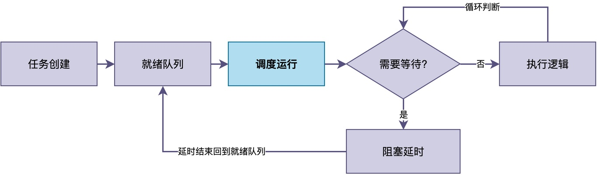

# 任务必须是无限循环吗？

在初学RTOS的时候，你可能会注意到一个现象：

> 不管是FreeRTOS、RT-Thread还是μC/OS，几乎所有的例程里，任务函数的实现都类似，即使用了一个while(1)的无限循环。

比如，在RT-Thread里，最常见的任务写法如下：

```c
static void sensor_thread_entry(void *parameter)
{
    while (1)
    {
        read_temp_humi();
        rt_thread_mdelay(1000);
    }
}
```

于是，不少人心里就会冒出一个疑问：<font color="#245bdb">任务函数是不是必须写成无限循环？能不能使用return？</font>

在这篇文章中，将解答这些疑问。

## 一、为什么通常写成无限循环

为什么任务函数通常写成无限循环？要回答这个问题，我们得先想一想任务到底是用来干什么的。

**在嵌入式系统里，大多数任务承担的都是某种长期运行的服务**，比如每隔一秒采集一次温湿度数据、或者一直在后台监听有没有网络数据要上传。我们会发现：这些任务有一个共同特点，那**就是它们需要设备在整个运行期间持续不断地工作，而不是做一次就结束。**

这里仍然以温湿度监控设备为例说明。

比如，传感器采集任务的职责是周期性地读取传感器数据。如果这个任务只检测一次就return了，那么系统跑完这一次采集之后，就再也不会去读传感器了。此时，设备也就失去了监控的意义。

<font color="#245bdb">也就是说，对于这类任务来说，将它写成无限循环是最合理的选择。</font>

不过，有人可能会担心使用无限循环，会导致任务长期占用CPU，别的任务就无法运行。其实，这种担心是多余的。

在这些任务中，通常使用信号量等待、任务延时等接口，让任务在不需要工作的时候主动让出CPU，从而避免CPU空转浪费资源。此时，RTOS会将任务的TCB从就绪队列中，放入阻塞或延时队列，直至需要工作时再放回原来的就绪队列。


由此可见，<font color="#245bdb">无限循环加上阻塞延时，任务的执行实际上是"运行->等待->再运行。。。"这种模式。这正是长期服务型任务最典型的运行模式。</font>

## 二、任务其实可以执行完就销毁

不过，无限循环并不是任务的唯一写法。在有些情况下，也可以在任务中使用return，很多RTOS本身也并不禁止使用return。

事实上，<font color="#245bdb">很多RTOS都支持"按需创建任务、工作完就销毁"的模式。</font>（注意，有些RTOS并不一定支持，请查看其使用手册）

例如，在系统启动时，需要做一些一次性的初始化工作，如读取配置参数、检查硬件版本。这些事情做完一次就不需要再做了，完全可以写成一个普通函数，执行完就return。

我们也可以创建一个动态任务来进行初始化，初始化结束后再主动退出。以RT-Thread为例，示例代码如下：

```c
static void init_thread_entry(void *parameter)
{
    sensor_calibrate();
    load_config();
    check_hw_version();
    /* 执行完直接 return，任务自动结束 */
}

int main(void)
{
    rt_thread_t tid;
    tid = rt_thread_create("init", init_thread_entry,
                           RT_NULL, 512, 5, 10);
    rt_thread_startup(tid);
    return 0;
}
```

当init_thread_entry执行到函数末尾的时候，RT-Thread的内核会检测到init任务已经执行完毕结束。

此时，内核将自动把任务的TCB从调度队列中移除，并回收对应的栈空间和TCB等资源。整个过程不需要我们手动调用删除接口，内核会帮我们处理好。

## 三、按需创建销毁的代价

既然按需创建任务这么方便，并且能及时回收相应的资源，那为什么不把所有任务都写成这样呢？主要原因在于：

1.首先，<font color="#245bdb">频繁地创建和销毁任务是有代价的</font>。当每次创建任务时，内核都要为它分配栈空间、初始化任务控制块、将TCB插入就绪队列。而销毁的时候，又要把这些资源释放掉、从各种内核链表中移除。

如果频繁地执行这种操作，系统调度和内存管理的开销将会明显增加，实时性也会受到影响。

2.其次，<font color="#245bdb">可能会出现创建失败的情况。</font>例如，当任务是用rt_thread_create()等接口从堆中动态创建时，这就意味着每次创建都要向堆申请内存。

在嵌入式设备上，堆空间通常比较有限，频繁地申请和释放不同大小的内存，也很容易产生内存碎片。综合这些因素，导致有可能产生内存不够分配失败的情况，此时任务将无法创建。

所以，在实际工作中，我们往往<font color="#245bdb">会把长期运行的服务类任务写成无限循环，在系统启动时创建并一直运行。对于那些确实只需要执行一次的初始化工作、或者偶尔才触发一次的短时操作，也会尽可能采用其它方式来实现，避免采用按需动态创建任务</font>。

## 四、总结

综上所述，任务函数并不是必须写成无限循环，很多RTOS支持任务执行完后return。

在绝大多数嵌入式场景下，任务需要持续运行，写成无限循环加阻塞延时是最合理、最高效的选择。"按需创建任务、工作完销毁"的模式虽然灵活，但会带来调度和内存分配的开销及相关风险，实际比较少用这种方式。

---

> 如果你希望系统地学习RTOS底层原理，可以了解我的《RTOS开发与实战》课程。
>
> 课程不是简单地讲解FreeRTOS API的使用，而是带你从零开始编写一个RTOS内核，逐步实现任务管理、任务调度、上下文切换、同步与通信等核心机制，并通过一个远程温湿度监控设备项目，将操作系统原理应用到实际嵌入式开发中。
>
> 适合希望深入理解RTOS工作原理、提升嵌入式底层开发能力的同学。
>
> [课程详情](/blog/diyrtos/)
