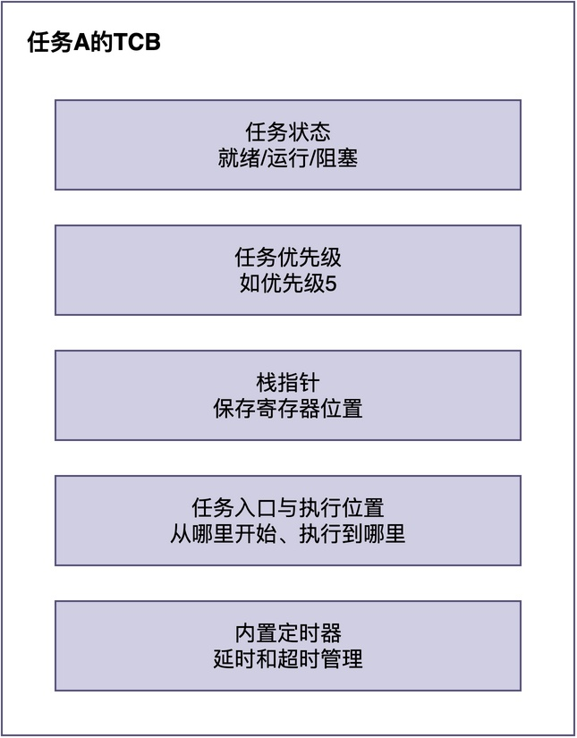
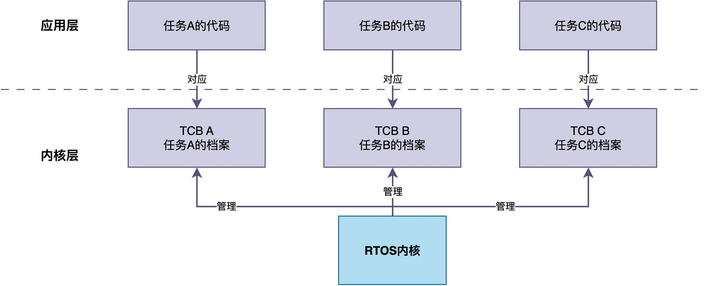
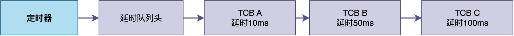

# 什么是任务控制块（TCB）？

在学习RTOS的时候，我们经常会听到"任务控制块"（TCB）这个词。

实际上，很多同学对这个概念一知半解，只知道它是一个结构体，在创建任务的时候需要它。之后，凡是需要操作该任务时，都传入该任务的结构体。

此外，**在我的《从0手写嵌入式操作系统》课程中，手写RTOS内核的第一步，也是从定义TCB这个数据结构开始的**。

可以说，理解了TCB，就拿到了理解整个RTOS内核的钥匙。

> 那么，任务控制块到底是什么？它里面存了什么东西？为什么RTOS内核需要它？

在这篇文章中，我们就来详细聊聊什么是任务控制块，理解它的主要功能。

## 为什么需要TCB

你可能会想：只需要给任务指定相应的任务函数，让任务去执行就行了，为什么还要额外配置TCB？

试想一下，在多任务运行的环境中，CPU在多个任务之间来回切换。假设任务A正在运行，RTOS决定切换到任务B运行。过了一会儿，又要切换回任务A继续运行。

> 那么问题来了：RTOS怎么知道任务A上次执行到哪里了？
> 任务A的CPU寄存器里原来存的值是什么？
> 任务A的栈在哪里？任务A的优先级是多少？
> 任务A现在是就绪状态还是阻塞状态？

这些信息，RTOS都必须记住，否则切换回任务A的时候，就无法正确恢复它的执行状态。

下面的图示展示了TCB中保存的这些关键信息：



那这些信息存在哪里呢？答案就是：**任务控制块（TCB）**。

## 什么是TCB

简单来说，**TCB就是RTOS为每个任务维护的一个"档案"，里面保存了这个任务的所有信息。** 如果这样解释难以理解的话，你可以将TCB看作是一个结构体，里面保存了任务的所有信息。



> 在RTOS内部，**每个任务对应一个TCB，RTOS通过TCB来识别和管理每一个任务**。

可以说，<font color="#245bdb">TCB就是任务在内核中的"身份证"</font>。没有TCB，操作系统就不知道这个任务的存在，更无法管理它。

## TCB里面存了什么

在不同的RTOS实现中，TCB的具体字段可能有所不同，但核心字段大致是类似的。

这里以RT-Thread的为例，来看看TCB里都存了什么（省略一些不常用的字段）。

```c
struct rt_thread
{
    /* 任务名称 */
    char name[RT_NAME_MAX];

    /* 任务状态：就绪、运行、阻塞、挂起等 */
    rt_uint8_t stat;

    /* 任务优先级 */
    rt_uint8_t current_priority;

    /* 栈顶指针：保存任务切换时的栈顶位置 */
    rt_uint32_t *sp;

    /* 栈的起始地址和大小 */
    void *stack_addr;
    rt_uint32_t stack_size;

    /* 任务入口函数和参数 */
    void (*entry)(void *parameter);
    void *parameter;

    /* 时间片计数器 */
    rt_uint32_t remaining_tick;

    /* 内置定时器：用于任务延时和超时 */
    struct rt_timer thread_timer;

    /* 等待队列节点：用于将任务挂到IPC对象的等待链表上 */
    rt_list_t tlist;

    /* 任务错误码 */
    rt_err_t error;
};
```

下面用列表简要说明各字段的作用：

1. **任务名称（name）**：任务的名字。
2. **任务状态（stat）**：记录任务当前处于就绪、运行、阻塞还是关闭状态。
3. **任务优先级（current_priority）**：任务的优先级，调度器根据优先级决定先运行哪个任务。
4. **栈指针（sp）**：保存任务的栈顶位置。
5. **栈信息（stack_addr、stack_size）**：记录任务栈的起始地址和大小。
6. **任务入口函数（entry、parameter）**：任务的入口函数地址和传入参数。
7. **时间片计数器（remaining_tick）**：用于时间片轮转调度，记录当前任务还剩多少个tick的运行时间。
8. **内置定时器（thread_timer）**：用于任务延时和IPC等待超时。
9. **等待队列节点（tlist）**：链表节点，用于将任务挂到就绪队列、延时队列、IPC等待队列等各种内核链表上。
10. **错误码（error）**：记录任务的错误状态。

## TCB在内核中的作用

在RTOS内核内部，TCB通常作为结点插入到内核的各种队列中，用于实现就绪运行调度、延时、阻塞和挂起等多种功能。

为便于理解，下面给出了简单的示例（有些RTOS的队列设计比较复杂，这里不展开说明）。

### 调度器管理任务

**RTOS的调度器维护着就绪队列。就绪队列里存放的是所有就绪任务的TCB。


通常情况下，就绪队列中的TCB按优先级排序，调度器每次取队首（最高优先级）的TCB来运行。

当任务被创建时，它的TCB被加入就绪队列；任务阻塞时，它的TCB从就绪队列移除；任务被唤醒时，它的TCB重新加入就绪队列。

在RT-Thread中，创建任务时调用rt_thread_create()或rt_thread_init()，初始化完成后TCB被加入就绪队列；调度器通过rt_schedule()从就绪队列中选择最高优先级的TCB来运行。

### 任务延时

**当任务调用延时函数进行延时时，RTOS将任务的TCB从就绪队列移除，并将任务挂到定时器链表（延时队列）上。**

当延时时间到后，定时器回调函数将TCB从延时队列移除，重新加入就绪队列，任务被唤醒。



延时队列中的TCB通常按延时时间从小到大排序。定时器每次检查队首的TCB是否到期，到期后将其从延时队列移除，加入就绪队列。

在RT-Thread中，任务调用rt_thread_mdelay()或rt_thread_delay()进入延时，TCB被加入延时队列；延时时间到后，定时器回调函数rt_thread_timeout()将TCB从延时队列移除，重新加入就绪队列。

### IPC等待队列

**当任务调用等待函数（如等待信号量、等待消息）时，如果资源不可用，内核将任务的TCB从就绪队列移除，通过TCB中的链表节点将其挂到IPC对象（信号量、消息队列等）的等待链表上**。

当其他任务或中断释放资源时，内核从等待链表上取下最高优先级的TCB，将其移回就绪队列，任务被唤醒。


通常情况下，IPC等待队列中的TCB也同样按优先级排序，当资源可用时，内核唤醒等待队列中优先级最高的任务。这样保证了高优先级任务能优先获得资源。

在RT-Thread中，任务调用rt_sem_take()等函数时，如果资源不可用，TCB被加入对应IPC对象的等待队列；其他任务或中断调用rt_sem_release()等函数释放资源时，内核从等待队列中取下最高优先级的TCB，移回就绪队列。

## 总结

综上所述，**TCB就是RTOS为每个任务维护的"档案"，里面保存了任务的所有信息：任务名称、状态、优先级、栈指针等。每个任务对应一个TCB，操作系统通过TCB来识别和管理每一个任务**。

并且，TCB贯穿了RTOS内核的所有核心机制，RTOS通过多种不同的队列（就绪队列、延时队列、阻塞队列等）让TCB进行排队，从而实现任务的有序运行、公平获得各种资源。

---

> 如果你希望系统地学习RTOS底层原理，可以了解我的《RTOS开发与实战》课程。
>
> 课程不是简单地讲解FreeRTOS API的使用，而是带你从零开始编写一个RTOS内核，逐步实现任务管理、任务调度、上下文切换、同步与通信等核心机制，并通过一个远程温湿度监控设备项目，将操作系统原理应用到实际嵌入式开发中。
>
> 适合希望深入理解RTOS工作原理、提升嵌入式底层开发能力的同学。
>
> [课程详情](/blog/diyrtos/)
