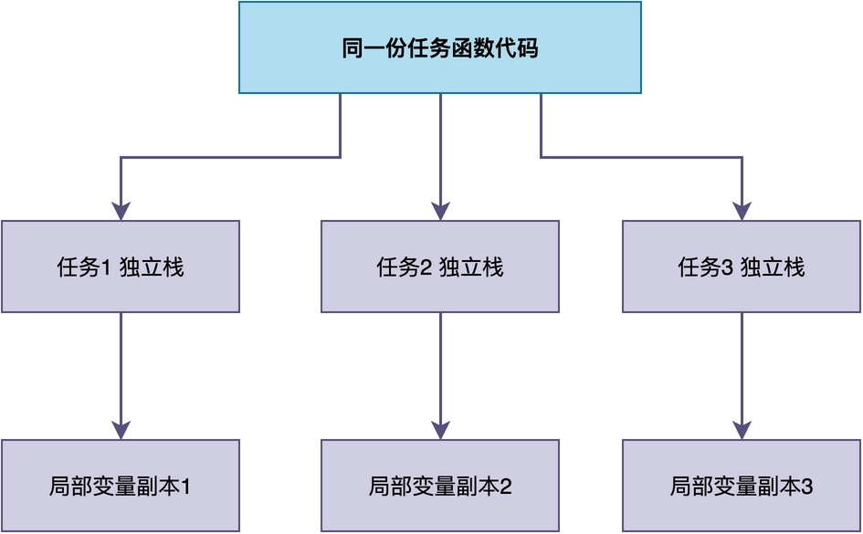
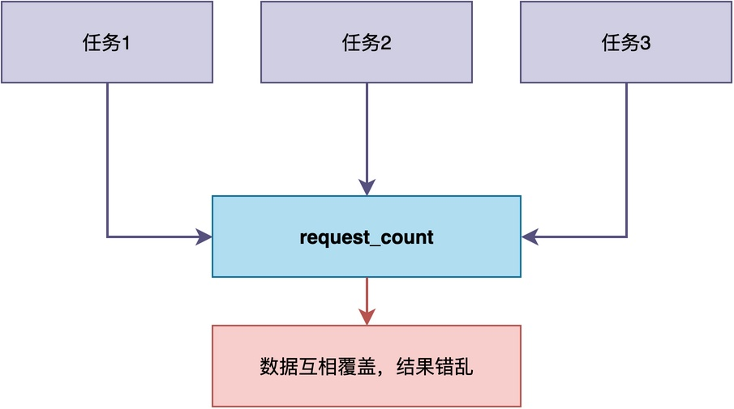

# 一个任务函数可以被多个任务共同使用吗？

今天上午，有位同学咨询了一个比较有意思的问题，这里写出来分享：

> 假设有一块开发板上，开发板跑了一个HTTP服务器，允许不同的用户同时通过浏览器访问SD卡中的网页。
> 为了加快访问速度、提升用户体验，应当为每个用户请求创建特定的任务来处理。

那么，对于这些处理不同用户请求的任务，每个任务的任务函数应该怎样写呢？

## 问题的描述

这位同学从直观上认为，应该给每个任务单独写一个任务函数。下面给出一个示例代码：

```c

/* 处理用户1的请求 */
void http_task1(void *parameter)
{
    while (1) {
        handle_http_request(parameter);
        rt_thread_mdelay(10);
    }
}

/* 处理用户2的请求 */
void http_task2(void *parameter)
{
    while (1) {
        handle_http_request(parameter);
        rt_thread_mdelay(10);
    }
}

int http_handle(void)
{
    rt_thread_t t1 = rt_thread_create("http1", http_task1, "a.html", 1024, 10, 10);
    rt_thread_t t2 = rt_thread_create("http2", http_task2, "b.html", 1024, 10, 10);
    rt_thread_startup(t1);
    rt_thread_startup(t2);
}
```

但是，他也意识到：http_task1和http_task2的流程完全相同。

这种写法代码复用性很差，白白浪费Flash空间。如果有10个用户同时访问，就要写10个几乎相同的任务函数。

显然，这位同学对任务是如何使用任务函数存在误区。**更合理的做法应当是：所有任务共享同一个任务函数，通过参数区分不同的用户。**

```c
void http_task(void *parameter)
{
    char *filename = (char *)parameter;
    while (1) {
        handle_http_request(filename);
        rt_thread_mdelay(10);
    }
}

int main(void)
{
    rt_thread_t t1 = rt_thread_create("http1", http_task, "a.html", 1024, 10, 10);
    rt_thread_t t2 = rt_thread_create("http2", http_task, "b.html", 1024, 10, 10);
    rt_thread_startup(t1);
    rt_thread_startup(t2);
}
```

这样一来，不管有多少个用户同时访问，都只需要一份任务函数代码。

你可能会疑惑：为什么多个任务能使用同一个任务函数？

## 任务函数为什么能共享

要理解这件事，关键是理解任务函数是什么。

在我的另一篇文章《什么是任务》中介绍过：**任务函数就像是一份菜谱，它只告诉你每一步该做什么。**

可以打个比方：菜谱本身是固定的，但不同的厨师（对应不同的任务）照着同一份菜谱做菜时，因为各自的食材和调味不同（对应各自的参数和局部变量），最终做出来的菜品也各不相同。

类似地，任务函数经过编译之后，生成的机器指令存于Flash，这些指令只是告诉任务应该做什么。而任务最终产出的结果，则与各自的数据有关。即便所有任务共用这一份指令，函数真正跑起来之后产生的数据，如局部变量、传入的参数、函数调用的返回地址等，全部存放在各自任务自己的栈上，任务之间彼此独立。


例如，在上图中，三个任务共享同一份任务函数代码，但由于各自的局部变量分别放在各自的栈里，不同任务对局部变量的访问互不影响。

由此可见，用同一个任务函数创建多个任务是完全可行的。

## 共享任务函数时易出的问题

既然局部变量的访问都可以做到互不干扰，那是不是就没有别的问题了？

也不是，仍然可能出现某些冲突。

以HTTP服务器为例，如果在任务函数里用了静态变量来统计请求次数，就容易出现问题：

```c
void http_task(void *parameter)
{
    static int request_count;   /* 静态变量全系统只有一份，多个任务会互相覆盖 */
    char *filename = (char *)parameter;
    ...
    request_count++;
    ...
}
```

比方说，有三个任务同时在执行，都在对request_count做自增操作。由于request_count只有一份，任务1刚读到的值还没来得及写回去，任务2可能就已经把它改掉了，最终统计出来的请求次数会比实际值少，而且每次运行的结果都可能不一样。



因此，当涉及到共享资源的访问时，容易出现问题：

- **静态局部变量和全局变量**：这些变量没有放在任务栈，而是放在内存中一块固定的区域里，被所有任务共享。
- **共享的硬件外设**：如对同一个串口，多个任务同时往里写数据，输出可能会错乱。
- **不可重入的标准库函数**：如C标准库中的strtok()这类函数。这些函数内部使用了静态变量，多个任务同时调用时可能出现问题。

## 如何解决冲突问题

要让任务函数能被多个任务安全共用，我们可以参考任务之间共享资源访问冲突的解决方案，例如：

- **控制全局和静态变量的访问**：仅使用局部变量和参数，不依赖静态变量或全局变量。
- **共享资源加锁保护**：对于确实需要共享的全局变量或硬件外设，用互斥锁等机制保护。
- **使用可重入版本的库函数**：对于strtok()这类不可重入的C库函数，使用它的可重入版本，比如strtok_r()。

## 总结

综上所述，**不同的任务完全可以共享同一份任务函数。**

RTOS会为每个任务分配独立的栈，用于存放任务函数的局部变量和参数。这些栈之间相互独立，使得一份函数代码可以安全地被多个任务共享。

在实际使用这种方式时，需注意尽量避免在函数中使用静态变量等可能共享的资源。如果无法避免，可以考虑对共享资源加锁。

---

> 如果你希望系统地学习RTOS底层原理，可以了解我的《RTOS开发与实战》课程。
>
> 课程不是简单地讲解FreeRTOS API的使用，而是带你从零开始编写一个RTOS内核，逐步实现任务管理、任务调度、上下文切换、同步与通信等核心机制，并通过一个远程温湿度监控设备项目，将操作系统原理应用到实际嵌入式开发中。
>
> 适合希望深入理解RTOS工作原理、提升嵌入式底层开发能力的同学。
>
> [课程详情](/blog/diyrtos/)
