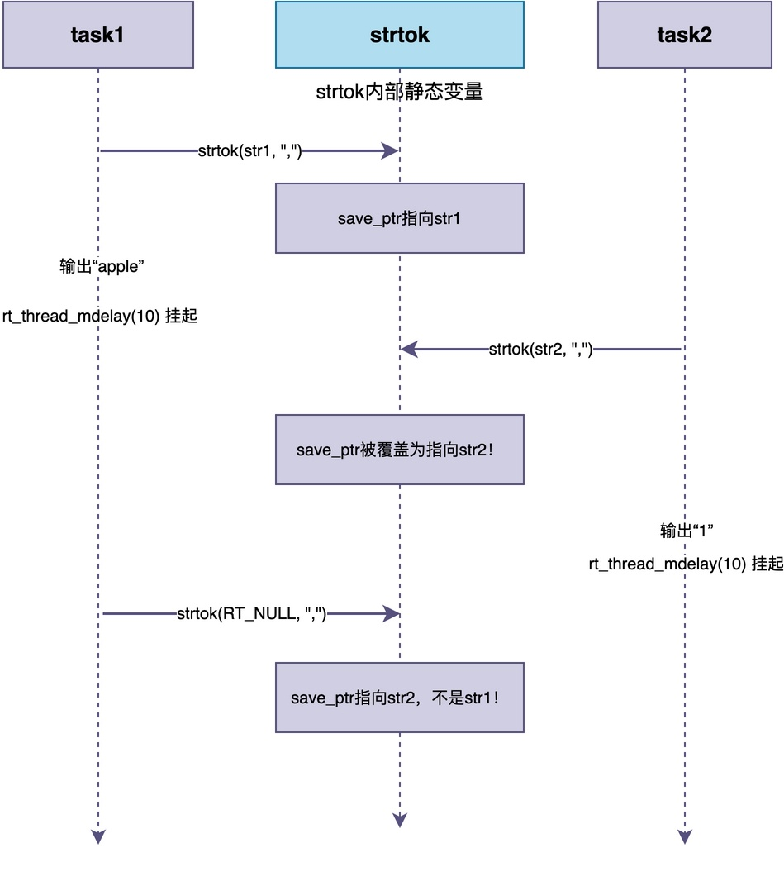

# 什么是任务安全函数？

当引入RTOS之后，原来的裸机环境就变成了多任务运行环境。

这些任务看似相互独立运行，但实际上它们需要相互协作，并且**有时候会出现多个任务同时调用同一个函数的情况**。

此时，有的同学可能会发现一个非常莫名其妙的问题：多个任务一起跑偶尔会出现问题，而且问题很难复现，调试起来非常头疼。

这些bug的根源，有时是因为任务调用的不是**任务安全（线程安全）函数**。

今天，让我们就从一个实际的例子出发，来搞清楚什么是任务安全函数，以及为什么它这么重要。

## 问题示例

下面给出一个简单的两个任务的工作代码。在这两个任务中，都使用strtok()函数来分割字符串：

```c
/* task1：分割字符串A */
static void task1(void *param)
{
    char str1[] = "apple,banana,orange";
    char *token = strtok(str1, ",");
    while (token != RT_NULL) {
        rt_kprintf("task1: %s\n", token);
        token = strtok(RT_NULL, ",");
        rt_thread_mdelay(10);
    }
}

/* task2：分割字符串B */
static void task2(void *param)
{
    char str2[] = "1,2,3,4,5";
    char *token = strtok(str2, ",");
    while (token != RT_NULL) {
        rt_kprintf("task2: %s\n", token);
        token = strtok(RT_NULL, ",");
        rt_thread_mdelay(10);
    }
}
```

其中，strtok()是C标准库提供的字符串分割函数，用于将一个字符串按照指定的分隔符分割成多个子串（token）。它的函数原型为：

```c
char *strtok(char *str, const char *delim);
```

它的用法比较特殊：第一次调用时，str参数传入要分割的字符串，函数返回第一个子串；之后每次调用时，str参数传NULL，函数会继续从上一次分割结束的位置开始分割，返回下一个子串。简单的使用示例如下：

```c
char str[] = "hello,world,foo";
char *token = strtok(str, ",");
while (token != RT_NULL) {
    rt_kprintf("%s\n", token);
    token = strtok(RT_NULL, ",");
}
/* 输出依次为：hello、world、foo */
```

让我们再回头看之前的两个任务函数。

task1将"apple,banana,orange"依次分割为apple、banana、orange三个字符串，task2将"1,2,3,4,5"依次分割为1、2、3、4、5五个字符串。每个任务在分割的同时，还会将字符串打印出来。也就是说，上述程序的正常运行结果应该为：

```
task1: apple
task1: banana
task1: orange
task2: 1
task2: 2
task2: 3
task2: 4
task2: 5
```

（实际运行时由于任务调度，两个任务的输出可能交替出现，但每个任务自己的分割结果应该是正确的。）

然而，如果实际运行这段代码，有可能会发现输出结果是混乱的：

```
task1: apple
task2: 1
task1: 2          ← task1居然输出了"2"！
task2: banana     ← task2居然输出了"banana"！
task1: 3
task2: orange
...
```

从上面的结果可以看出，task1本来应该输出apple、banana、orange，结果输出了apple、2、3；task2本来应该输出1、2、3、4、5，结果输出了1、banana、orange。两个任务的输出混在了一起，完全乱了。

## 问题出在哪里

如果单纯看task1和task2的代码，我们很难找清楚问题出现在哪里。

**事实上，问题并不在于这些任务函数本身，而是在strtok()这个函数上。**

为了记住"上一次分割结束的位置"，strtok()内部使用了一个**静态变量**来保存这个位置。该函数的实现原理大概是这样的：

```c
/* strtok的简化实现（仅用于说明原理） */
static char *save_ptr;  /* 静态变量，保存上次分割位置 */

char *strtok(char *str, const char *delim)
{
    if (str != RT_NULL) {
        save_ptr = str;  /* 第一次调用，保存起始位置 */
    }
    /* 从save_ptr开始查找分隔符，分割字符串 */
    ...
    save_ptr = next_pos;  /* 更新保存位置 */
    return token;
}
```

可以看到，save_ptr是全局静态变量，全局只有一份。**当多个任务同时调用strtok()函数时，相当于这些任务同时对save_ptr进行读写**。

下面，我们来还原一下刚才的混乱输出是怎么发生的：

1. task1第一次调用strtok(str1, ",")，save_ptr指向str1中的"banana"位置，返回"apple"
2. task1调用rt_thread_mdelay(10)，主动让出CPU，task1被挂起
3. 调度器切换到task2运行，task2第一次调用strtok(str2, ",")，save_ptr被覆盖为指向str2中的"2"位置，返回"1"
4. task2调用rt_thread_mdelay(10)，task2被挂起，调度器切换回task1运行
5. task1调用strtok(RT_NULL, ",")，此时save_ptr已经被task2改成指向str2了！所以task1从str2中分割，返回"2"

整个过程可以用下面的图示来表示：



所以，我们可以发现出错的原因：

> **由于strtok()使用了静态变量保存中间状态，而这个静态变量是所有任务共享的。
> 当任务在函数执行过程中被切换出去，另一个任务调用同一个函数时，就会覆盖这个静态变量，导致原来的任务恢复运行后读到错误的值。**

正是由于这个原因，导致两个任务打印出的结果出现异常。

## 什么是任务安全函数

在上面的例子中，strtok()就是一个典型的**非任务安全函数**。

所谓的**任务安全函数（Thread-Safe Function）**，实际指的是：

> **一个函数如果可以被多个任务同时或交替调用，而不会产生数据错误或系统异常，那么它就是任务安全的。**

换句话说，任务安全的函数不怕被多个任务一起调用，不管任务怎么切换，函数的执行结果都是正确的。

## 什么样的函数是任务安全函数

通过前面的示例，我们可以推测出，要做到任务安全，函数至少需要满足以下几个核心要求（可能有其他情况，本文未能覆盖）：

### 1. 不使用全局变量或静态变量保存中间状态

函数的中间状态应该保存在局部变量（实际放在任务栈）中，而不是全局或静态变量中。

由于每个任务有自己独立的栈，这些局部变量是任务私有的，不会被其他任务覆盖或影响。

### 2. 如果必须使用共享资源，要有正确的保护

如果在函数中，不可避免地要访问共享资源（比如全局变量、硬件寄存器、文件等），这时候必须用互斥锁、关中断等方式保护对共享资源的访问，确保同一时间只有一个任务进入临界区。

### 3. 不调用不可重入的函数

如果函数内部调用了其他不是任务安全的函数，那么这个函数本身也不是任务安全的。

例如，我们写的函数内部调用了strtok()，那这个函数也就不是任务安全的了。

### 4. 返回值不能指向静态内存

有些函数返回一个指针，指向内部的静态缓冲区。比如，C库函数gmtime()返回一个指向静态struct tm的指针。

当多个任务同时调用这些函数时，后调用的任务会覆盖静态缓冲区，导致先调用的任务读到错误的数据。

## 如何使用C标准库的非任务安全函数

在C标准库中，有不少函数是非任务安全函数。除了strtok()外，下面还提供了一些例子：

| 不安全函数       | 问题原因        | 安全版本          |
| ----------- | ----------- | ------------- |
| strtok()    | 静态变量保存分割位置  | strtok_r()    |
| rand()      | 静态变量保存随机数种子 | rand_r()      |
| gmtime()    | 返回静态结构体指针   | gmtime_r()    |
| localtime() | 返回静态结构体指针   | localtime_r() |
| asctime()   | 返回静态字符串指针   | asctime_r()   |
| ctime()     | 返回静态字符串指针   | ctime_r()     |
| getenv()    | 返回静态指针      | 无标准替代，需自行保护   |

当我们希望使用这些函数提供的功能时，可以调用C标准库实现的安全版本，这些函数的名称带_r后缀（r代表reentrant，可重入）。

当在多个任务中都有调用同一函数时，应该优先使用这些_r版本。比如，前面的strtok()例子，两个任务的代码按如下方式改下：

```c
/* task1：使用strtok_r，安全版本 */
static void task1(void *param)
{
    char str1[] = "apple,banana,orange";
    char *saveptr1;  /* 每个任务自己的保存指针，在栈上 */
    char *token = strtok_r(str1, ",", &saveptr1);
    while (token != RT_NULL) {
        rt_kprintf("task1: %s\n", token);
        token = strtok_r(RT_NULL, ",", &saveptr1);
        rt_thread_mdelay(10);
    }
}
```

相比strtok()，strtok_r()要求传入额外的参数saveptr，该参数用于保存位置（替代strtok()函数中的save_ptr）。task1用自己的saveptr1，task2用自己的saveptr2，两个指针在各自的任务栈上，互不干扰，所以是任务安全的。

## 如果必须调用不安全函数怎么办

如果C库没有提供安全版本的库函数，而我们又想使用怎么办？

**此时，可以用互斥锁来保护对不安全函数的调用。使用方法也很简单：在调用不安全函数之前获取互斥锁，调用完毕后释放互斥锁。**

```c
/* 定义互斥锁 */
static rt_mutex_t strtok_lock;

/* task1：用互斥锁保护strtok调用 */
static void task1(void *param)
{
    char str1[] = "apple,banana,orange";
    while (1) {
        rt_mutex_take(strtok_lock, RT_WAITING_FOREVER);  /* 获取锁 */
        char *token = strtok(str1, ",");
        while (token != RT_NULL) {
            rt_kprintf("task1: %s\n", token);
            token = strtok(RT_NULL, ",");
        }
        rt_mutex_release(strtok_lock);  /* 释放锁 */
        rt_thread_mdelay(10);
    }
}
```

这样一来，同一时间只有一个任务能进入这个不安全函数。不过要注意，用互斥锁保护会降低并发性，如果对性能要求高，还是应该优先使用可重入版本。

而**如果被调函数是我们自己在工程中开发的，那么最好是在设计函数的时候就预先考虑多任务环境，将函数设计成任务安全的**。比如，尽量使用局部变量、不依赖全局状态、对共享资源加锁保护等。

## 总结

综上所述，**任务安全函数就是可以被多个任务同时或交替调用而不会产生数据错误的函数**。

它的核心要求是：**不使用全局或静态变量保存中间状态、对共享资源有正确的保护、不调用不可重入的函数、返回值不指向静态内存**。

C标准库中有不少函数不是任务安全的，在多任务环境下应该优先使用带_r后缀的可重入版本。如果必须调用不安全函数，可以通过添加互斥锁来保护调用过程，确保同一时间只有一个任务进入临界区。而对于自己开发的函数，最好在设计阶段就将其设计为任务安全的。

---

> 如果你希望系统地学习RTOS底层原理，可以了解我的《RTOS开发与实战》课程。
>
> 课程不是简单地讲解FreeRTOS API的使用，而是带你从零开始编写一个RTOS内核，逐步实现任务管理、任务调度、上下文切换、同步与通信等核心机制，并通过一个远程温湿度监控设备项目，将操作系统原理应用到实际嵌入式开发中。
>
> 适合希望深入理解RTOS工作原理、提升嵌入式底层开发能力的同学。
>
> [课程详情](/blog/diyrtos/)
