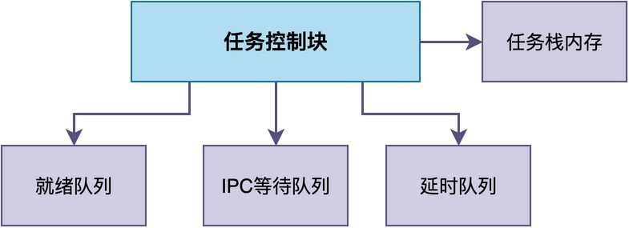
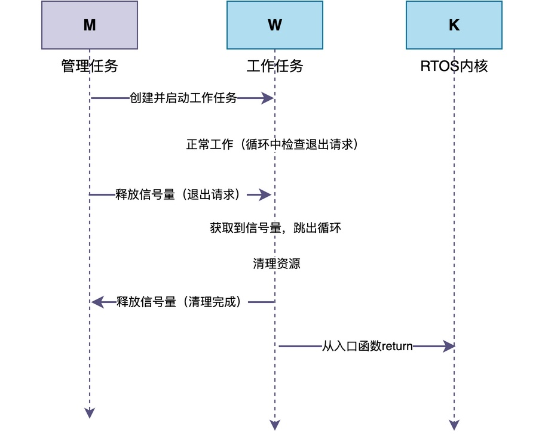

# 任务删除时需要注意什么？

在使用RTOS时，创建任务通常比较简单，但删除任务却很容易出现问题。

> 有时候，删除任务后系统莫名卡死。
> 有时候，反复创建和删除任务后，系统可用内存越来越少。
> 还有的时候，任务删除后，其他任务一直处于阻塞状态而无法运行。

你可会想：为什么删除一个任务会引发这么多问题？

这是因为，任务并不是一个简单的函数，它还涉及任务控制块、任务栈等各种内核资源。删除任务时，如果没有正确处理这些关联关系，就可能导致系统异常。

在今天的这篇文章，我将来聊一聊：**RTOS删除任务时倒底做了什么？应该如何正确的删除任务？**。

## 任务删除不是简单的内存释放

首先，<font color="#245bdb">我们必须明白一个基本事实：任务删除，并不是仅仅是释放任务控制块的内存。</font>

事实上，一个任务可能同时涉及多种内核数据结构。例如，处于就绪态的任务位于就绪队列中，处于延时状态的任务处于延时队列上，而等待信号量或消息队列的任务，则处在对应的IPC等待链表上。



这使得删除任务时，**需要根据任务当前的状态，将其从相关链表中移除，并正确处理任务控制块和任务栈的内存**。

如果坚持要反其道行之，那么就可能导致任务仍然位于某个队列，但内核却已经释放了任务控制块。显然，此时链表中就出现了问题，可能导致出现非法内存访问，进而整个系统崩溃。

## 正在运行的任务不能立即删除自己

有的同学可能会问了：当一个任务能否自己调用删除接口，是否是把自己立即删除了？

显然，这里有个问题：如果任务调用删除接口之后，任务栈立即被释放，那么后续的函数调用、局部变量访问或函数返回就有可能出现问题。

所以，如果当任务删除自己时，很多RTOS的常见实现方式是：**先将当前任务从就绪队列中移除，让CPU切换到其他任务，再由RTOS回收任务栈和任务控制块**。

例如，在RT-Thread中，任务退出后并不会立即回收资源，而是把任务控制块挂到一个叫defunct队列的临时队列上，然后由空闲任务在系统空闲时统一回收。下面是相应的处理代码简化版本：

```c
/* 空闲任务入口：不断回收defunct队列中的任务 */
static void rt_thread_idle_entry(void *parameter)
{
    while (1)
    {
        rt_thread_defunct_execute();
    }
}

/* 回收已退出的动态任务：释放栈和TCB */
void rt_thread_defunct_execute(void)
{
    struct rt_thread *thread;
    rt_base_t temp;

    temp = rt_hw_interrupt_disable();
    while (!rt_list_isempty(&rt_thread_defunct))
    {
        /* 从defunct队列取出一个任务 */
        thread = rt_list_entry(rt_thread_defunct.next,
                               struct rt_thread, tlist);
        rt_list_remove(&thread->tlist);
        rt_hw_interrupt_enable(temp);

        /* 先释放栈，再释放任务控制块 */
        rt_free(thread->stack_addr);
        rt_free(thread);

        temp = rt_hw_interrupt_disable();
    }
    rt_hw_interrupt_enable(temp);
}
```

可以看到，**任务删除自己时只是把自己挂到defunct队列上，真正的资源回收是在空闲任务里完成的**。

关于空闲任务的更多细节，可以参考我之前写的《空闲任务是做什么的》这一篇。
## 删除前必须确保资源都已释放

此外，非常容易被很多同学忽略的是：任务在运行过程中，可能获取互斥锁、申请动态内存、打开文件，或者建立网络连接。这些资源并不一定会随着任务删除而自动释放。

因此，**在删除任务必须释放这些资源；否则，就可能出现资源泄漏甚至系统死锁**。

下面举一个最简单的例子：

```c
static void worker_thread(void *param)
{
    /* 获取互斥锁 */
    rt_mutex_take(lock, RT_WAITING_FOREVER);

    /* ... 正在工作 ... */

    /* 任务在这里被外部强制删除，下面的释放代码永远不会执行 */
    rt_mutex_release(lock);
}
```

在这个例子里，worker_thread任务拿到了互斥锁后，还没来得及释放就被强制删除了。此时，锁仍然处于"被持有"的状态，等其他任务再去获取这把锁时，就会永远阻塞。

由此可见，最佳的做法是：**让任务在结束之前主动完成资源清理工作**。

## 优雅的退出方式：让任务自己清理后再退出

基于上述原因，<font color="#245bdb">当需要删除任务时，最好是让自己自行删除，而非随时强制删除一个正在运行的任务。</font>

这里推荐采用协作式删除机制：**向待删除的任务发出删除请求，待删除任务完成必要的清理后，再进行删除操作**。

下面用一个简单的例子来说明：

```c
static rt_thread_t worker;
static rt_sem_t exit_sem;   /* 一个信号量：退出请求 + 清理完成通知 */

/* 工作任务 */
static void worker_thread(void *parameter)
{
    while (1)
    {
        /* 非阻塞检查是否有退出请求 */
        if (rt_sem_trytake(exit_sem) == RT_EOK)
        {
            break;
        }

        /* ... 正常工作 ... */
        rt_thread_mdelay(10);
    }

    /* 退出前清理资源，然后通知管理任务 */
    rt_sem_release(ok_sem);
}

/* 管理任务 */
static void manager_thread(void *parameter)
{
    exit_sem = rt_sem_create("exit", 0, RT_IPC_FLAG_PRIO);

    worker = rt_thread_create("worker", worker_thread, RT_NULL,
                              1024, 10, 10);
    rt_thread_startup(worker);

    /* ... 工作任务运行一段时间 ... */
    rt_thread_mdelay(5000);

    rt_sem_release(exit_sem);                            /* 1. 发出退出请求 */
    rt_sem_take(ok_sem, RT_WAITING_FOREVER);          /* 2. 等待清理完成 */
    worker = RT_NULL;                                     /* 3. 句柄置空 */
}
```

上述代码共包含了两个任务：管理任务manager_thread和工作任务worker_thread，其工作流程图示如下：


从这张图可以清楚地看到，这种工作方式的核心在于："**请求-响应**"模式。

> 管理任务不直接删除任务，而是发出退出请求；
> 工作任务检测到请求后，先把释放全部持有的资源，再通知管理任务"已经释放"，最后从入口函数返回。

这种方式的好处是：资源清理的主动权在工作任务自己手里，同时管理任务通过等待信号量，可以准确知道任务什么时候真正退出。

## 总结

综上所述，删除一个任务并不是简单地释放它的任务控制块就完事了，它还涉及到任务栈的回收、内核中各类链表的移除以及任务持有的互斥锁等各种资源的释放等一系列问题。

如果这些处理不当，就可能导致内存泄漏、系统死锁，甚至整个系统崩溃。

所以，在实际项目中，<font color="#245bdb">最佳的做法就是让任务自己清理完它所占有的资源之后，再进行删除或者退出工作</font>。

---

> 如果你希望系统地学习RTOS底层原理，可以了解我的《RTOS开发与实战》课程。
>
> 课程不是简单地讲解FreeRTOS API的使用，而是带你从零开始编写一个RTOS内核，逐步实现任务管理、任务调度、上下文切换、同步与通信等核心机制，并通过一个远程温湿度监控设备项目，将操作系统原理应用到实际嵌入式开发中。
>
> 适合希望深入理解RTOS工作原理、提升嵌入式底层开发能力的同学。
>
> [课程详情](/blog/diyrtos/)
