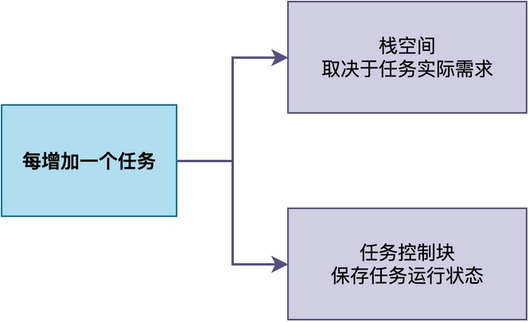
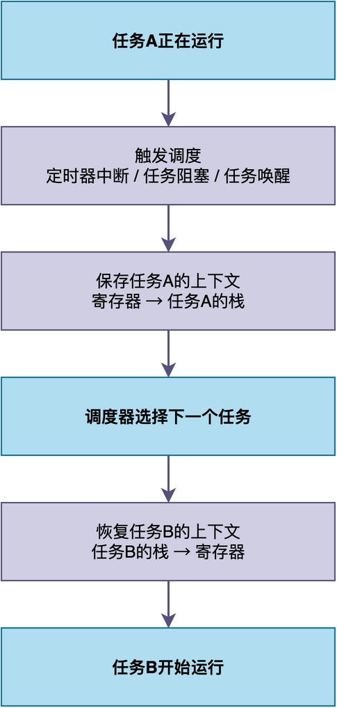
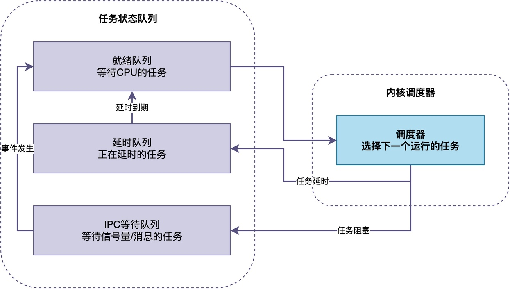
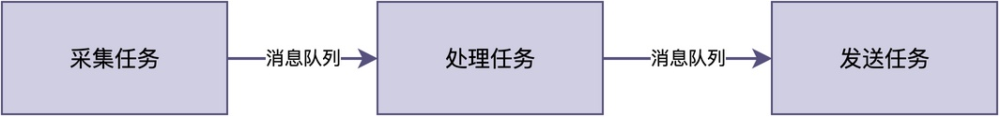

# RTOS中的任务数量是不是越多越好？

有些初学者在刚开始学习使用RTOS的时候，会出现这样一种奇怪的错误：**觉得任务越多，自己的设计就越专业**。

> 例如，在一个设备采集设备中，一口气创建了好多个任务。
> 采集任务、处理任务、显示任务、通信任务........，恨不得把每个功能都拆成独立任务。

他们觉得，这样做看起来职责清晰，也方便独立开发。

不过，任务真的是越多越好吗？会不会反而增加系统的复杂度和资源开销？今天我们就来聊一聊上述问题。

## 每个任务都有内存开销

相信很多同学都知道：**每增加一个任务，通常都会带来一定的内存开销。**

每个任务通常都需要独立的栈空间，用于保存函数调用现场等内容。栈空间太小可能导致栈溢出，设置得太大又会浪费RAM。

除了任务栈，还需要为每个任务**分配任务控制块（TCB）**，用于保存任务状态、栈顶指针等信息。

由此可见，任务数量首先受到系统内存容量的限制。划分任务时，不能只考虑功能是否独立，还需要评估每个任务带来的实际内存成本。

## 任务切换开销

当RTOS决定从一个任务切换到另一个任务时，通常需要保存当前任务的上下文，并恢复下一个任务的上下文。

对于常见的ARM Cortex-M处理器，这个过程涉及部分通用寄存器、程序状态寄存器、栈指针的保存和恢复。

**这种上下文切换需要通过执行一定数量的指令完成，自然也会产生相应的时间开销**。显而易见的是，**如果系统频繁发生任务切换，这些开销就可能逐渐累积**，占用原本可以用于业务处理的CPU时间。

**当系统中任务数量增多，任务之间切换的频率也可能会更加提高，导致额外增加上下文切换的时间开销**。不过，需要注意的是，如果大部分任务长期处于阻塞状态，只有少数任务周期性运行，那么即使任务数量较多，这种开销也可能较低。

因此，**优化任务设计的重点并不是一味减少任务数量，而是避免不必要的任务切换**。

## 调度和管理的复杂度

在RTOS内部，需要维护延时队列、阻塞队列等数据结构。

虽然对这些队列进行操作的时间复杂度取决于具体的内核实现，但是我们可以明显推测得知：**当任务数量增多以后，RTOS可能需要额外花更多的时间对队列进行操作**。

比如，有些RTOS的延时队列采用普通链表实现，没有做特殊优化。

那么，当处于延时状态的任务增多时，RTOS需要遍历更长的链表来检查哪些任务的延时已经到期，这就会额外增加调度器的时间开销。

## 易出现工程问题

对于RTOS的使用者来说，任务数量过多还可能增加系统设计与调试的难度。

从上图可以看出，当任务数量增多后，任务之间的协作关系也变得更复杂。

具体来说，可能带来以下问题：
1. **优先级分配困难**：任务越多，需要考虑的实时性要求和执行关系就越复杂。
2. **同步关系更复杂**：不同任务之间可能需要使用信号量、互斥锁、消息队列等多种机制进行通信和同步。
3. **调试和维护更加困难**：当出现异常时，问题定位的难度可能随之增加。

## 实际项目中，任务数量多少比较合适？

说了这么多，一个项目究竟应该设置多少个任务呢？

实际上，并不存在适用于所有项目的固定答案，**任务数量取决于处理器性能、RAM容量、功能复杂度、实时性要求等多种因素**。

简单的项目可能只需要两三个任务，而复杂的项目可能需要十几个甚至更多，只要内存、实时性和系统复杂度都在可控范围内，任务数量本身并不是问题。

所以，**任务不是越多越好，也不是越少越好，而是应该根据实际需求进行划分。**

## 总结

综上所述，RTOS中的任务数量并不是越多越好。

每个任务都可能带来栈内存、任务控制块和上下文切换等开销，任务之间的同步关系也会增加系统设计与维护的复杂度。

但这并不一定是要尽可能减少任务的数量，而是应该根据实际需求，在功能独立性、实时性要求、资源消耗和系统复杂度之间取得一个合理的平衡。

---

> 如果你希望系统地学习RTOS底层原理，可以了解我的《RTOS开发与实战》课程。
>
> 课程不是简单地讲解FreeRTOS API的使用，而是带你从零开始编写一个RTOS内核，逐步实现任务管理、任务调度、上下文切换、同步与通信等核心机制，并通过一个远程温湿度监控设备项目，将操作系统原理应用到实际嵌入式开发中。
>
> 适合希望深入理解RTOS工作原理、提升嵌入式底层开发能力的同学。
>
> [课程详情](/blog/diyrtos/)
