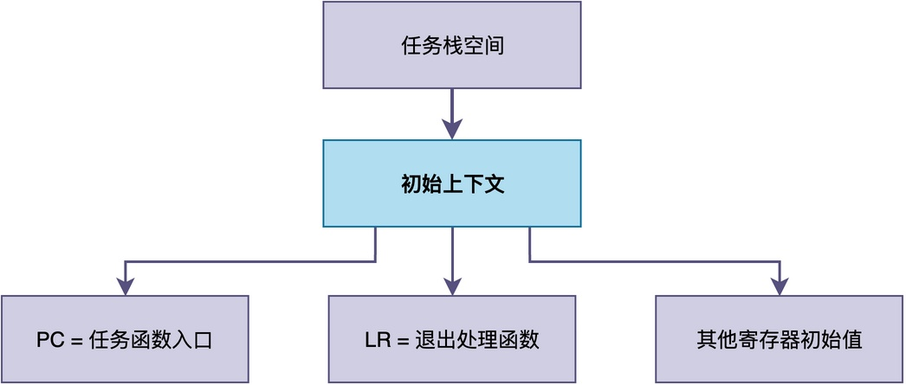

# RTOS创建任务时，内核究竟做了哪些事情？

RTOS的核心功能是提供多任务的运行环境，每个任务必须先创建才能运行。

在RT-Thread中，我们可以使用rt_thread_create()创建任务，传入任务的优先级、入口函数地址等参数。

那么，当创建任务时，RTOS到底做了哪些事情呢？在这篇文章，我将向你完整拆解任务创建的完整过程。

## 创建任务的主要步骤

通常情况下，为了创建任务，RTOS大致会执行若干步骤：**分配任务控制块、分配任务栈、填充任务控制块字段、加入就绪队列。


不同的RTOS可能会在步骤细分及其顺序上略有差别，但核心仍遵循上图所示。

接下来，我以RT-Thread为例，介绍其任务创建流程。

## 任务创建函数

在RT-Thread中，任务创建可以使用rt_thread_create()或rt_thread_init()来完成。

其中，rt_thread_create()函数代码如下，下面将介绍该函数的实现：

```c
rt_thread_t rt_thread_create(const char *name,
                             void (*entry)(void *parameter),
                             void       *parameter,
                             rt_uint32_t stack_size,
                             rt_uint8_t  priority,
                             rt_uint32_t tick)

{
    struct rt_thread *thread;
    void *stack_start;
    
    thread = (struct rt_thread *)rt_object_allocate(RT_Object_Class_Thread,
                                                    name);
    if (thread == RT_NULL)
        return RT_NULL;

    stack_start = (void *)RT_KERNEL_MALLOC(stack_size);
    if (stack_start == RT_NULL)
    {
        /* allocate stack failure */
        rt_object_delete((rt_object_t)thread);
        return RT_NULL;
    }

    _rt_thread_init(thread,
                 name,
                 entry,
                 parameter,
                 stack_start,
                 stack_size,
                 priority,
                 tick);
    return thread;
}
```

rt_thread_create()主要完成了前三步：分配TCB、分配栈、以及调用_rt_thread_init()完成栈初始化和字段填充。

至于第四步"加入就绪队列"，则需要单独调用rt_thread_startup()来完成。关于该函数的功能，将在后面介绍。

下面我们逐步展开来看每一步具体做了什么。

### 分配任务控制块TCB和栈空间

任务控制块TCB是内核管理任务的核心数据结构，每一个任务都对应一个TCB。

**创建任务的第一步，就是分配一块内存来存放这个TCB，同时分配任务栈的空间。** 

如果使用的是动态创建（rt_thread_create()）方式，内核会从堆内存中分配；如果使用静态创建（使用rt_thread_init()）方式，则需要用户提前定义好TCB和栈的存储位置（此处不作介绍）。

当使用动态创建时，相应的代码如下：

```c
/* 分配线程对象（TCB） */
thread = (struct rt_thread *)rt_object_allocate(RT_Object_Class_Thread, name);
if (thread == RT_NULL)
    return RT_NULL;

/* 分配线程栈空间 */
stack_start = (void *)RT_KERNEL_MALLOC(stack_size);
if (stack_start == RT_NULL) {
    rt_object_delete((rt_object_t)thread);  /* 栈分配失败, 先释放已分配的TCB */
    return RT_NULL;
}
```

可以看到，RT-Thread通过rt_object_allocate()在内核对象管理器中分配一个任务控制块。

之后，调用RT_KERNEL_MALLOC()宏分配栈空间，用于保存函数调用时的局部变量、参数和返回地址。

### 填充TCB字段

TCB和栈分配完成后，内核会把当前的栈顶指针记录到TCB中，同时填充TCB里的其他字段。这些字段包括任务的名称、优先级、栈的起始地址和大小、任务的初始状态等。

该操作由_rt_thread_init()完成，其实现如下所示（有精简）：

```c
static rt_err_t _rt_thread_init(struct rt_thread *thread,
                                 const char *name,
                                 void (*entry)(void *parameter),
                                 void *parameter,
                                 void *stack_start,
                                 rt_uint32_t stack_size,
                                 rt_uint8_t priority,
                                 rt_uint32_t tick)
{
    /* 初始化链表节点 */
    rt_list_init(&(thread->tlist));

    /* 记录入口函数、参数、栈信息 */
    thread->entry = (void *)entry;
    thread->parameter = parameter;
    thread->stack_addr = stack_start;
    thread->stack_size = (rt_uint16_t)stack_size;

    /* 初始化栈空间, 构造初始上下文 */
    rt_memset(thread->stack_addr, '#', thread->stack_size);
    thread->sp = (void *)rt_hw_stack_init(thread->entry, thread->parameter,
                                           (void *)((char *)thread->stack_addr + thread->stack_size - 4),
                                           (void *)rt_thread_exit);

    /* 记录优先级、时间片、错误码等信息 */
    thread->init_priority = priority;
    thread->current_priority = priority;
    thread->init_tick = tick;
    thread->remaining_tick = tick;
    thread->error = RT_EOK;

    /* 任务状态设为初始态 */
    thread->stat = RT_THREAD_INIT;
    thread->cleanup = 0;
    thread->user_data = 0;

    /* 初始化内嵌定时器, 用于延时和IPC等待超时 */
    rt_timer_init(&(thread->thread_timer), thread->name,
                  rt_thread_timeout, thread, 0, RT_TIMER_FLAG_ONE_SHOT);
                  
    /* ..... 代码有精简 ...... */
    return RT_EOK;
}
```

其中，任务状态会被设为初始态RT_THREAD_INIT，表示任务已经创建完成，但还没有被加入就绪队列。

此外，在初始化TCB的过程中，还会调用rt_hw_stack_init()初始化栈空间。

```c
/* 先用'#'填充整个栈空间, 便于后续栈使用率检测 */
rt_memset(thread->stack_addr, '#', thread->stack_size);

/* 构造初始上下文, 返回新的栈顶指针 */
thread->sp = (void *)rt_hw_stack_init(thread->entry,      /* 任务函数入口 */
                                        thread->parameter,  /* 任务参数 */
                                        (void *)((char *)thread->stack_addr + thread->stack_size - 4),  /* 栈顶 */
                                        (void *)rt_thread_exit);  /* 任务退出函数 */
```

在栈空间中，**内核通常会在栈中构造一个初始的任务上下文。这个上下文的作用，是让任务第一次被调度器选中运行时，CPU能够正确地从任务函数的入口地址开始执行**。

例如，在Cortex-M3中，内核会把程序计数器PC设置为任务函数的地址，把链接寄存器LR设置为任务退出时的处理函数，同时把其他通用寄存器设为初始值。



由于任务上下文与CPU架构紧密相关，而不同的CPU架构，寄存器的数量和种类不同；因此，该函数的实现依赖具体的CPU架构。

比如在ARM Cortex-M上，它会按照异常入栈的顺序，在栈中依次布置xPSR、PC、LR、R12、R3到R0这些硬件自动保存的寄存器，然后再布置R4到R11这些需要软件手动保存的寄存器。而在RISC-V上，布置的寄存器和顺序又完全不同，其示例代码如下：

```c
rt_uint8_t *rt_hw_stack_init(void       *tentry,
                             void       *parameter,
                             rt_uint8_t *stack_addr,
                             void       *texit)

{
    struct rt_hw_stack_frame *frame;
    rt_uint8_t         *stk;
    int                i;
    stk  = stack_addr + sizeof(rt_ubase_t);
    stk  = (rt_uint8_t *)RT_ALIGN_DOWN((rt_ubase_t)stk, REGBYTES);
    stk -= sizeof(struct rt_hw_stack_frame);
    frame = (struct rt_hw_stack_frame *)stk;

    for (i = 0; i < sizeof(struct rt_hw_stack_frame) / sizeof(rt_ubase_t); i++)
    {
        ((rt_ubase_t *)frame)[i] = 0xdeadbeef;
    }

    frame->ra      = (rt_ubase_t)texit;
    frame->a0      = (rt_ubase_t)parameter;
    frame->epc     = (rt_ubase_t)tentry;

    /* force to machine mode(MPP=11) and set MPIE to 1 */
    frame->mstatus = 0x00007880;
    return stk;
}
```

正因为如此，这个函数也是把RTOS移植到新的CPU架构时，必须由移植者自己实现的函数之一。

### 加入就绪队列

**完成所有初始化工作之后，任务控制块需要加入就绪队列中。**

有些RTOS在做初始化工作时，就会完成此工作；但对于RT-Thread而言，需要调用rt_thread_startup()来完成，该函数的实现如下：

```c
rt_err_t rt_thread_startup(rt_thread_t thread)
{
    /* 参数检查: 任务必须处于INIT状态 */
    RT_ASSERT(thread != RT_NULL);
    RT_ASSERT(thread->stat == RT_THREAD_INIT);

    /* 设置当前优先级 */
    thread->current_priority = thread->init_priority;

    /* 计算优先级掩码, 用于调度器快速查找 */
#if RT_THREAD_PRIORITY_MAX > 32
    thread->number = thread->current_priority >> 3;
    thread->number_mask = 1L << thread->number;
    thread->high_mask = 1L << (thread->current_priority & 0x07);
#else
    thread->number_mask = 1L << thread->current_priority;
#endif

    /* 先设为挂起态, 再通过resume恢复为就绪态并插入就绪队列 */
    thread->stat = RT_THREAD_SUSPEND;
    rt_thread_resume(thread);

    /* 如果系统已经在运行, 触发一次调度 */
    if (rt_thread_self() != RT_NULL) {
        rt_schedule();
    }

    return RT_EOK;
}
```

简单来说，rt_thread_startup()做了三件事情：**先设置任务的当前优先级，将任务插入就绪队列，最后如果系统已经在运行，则触发一次调度**。

注意，任务加入就绪队列之后，并不一定立刻开始运行。

> 如果它的优先级是当前就绪队列中最高的，那么调度器会立即运行该任务；
> 但如果此时有更高优先级的任务正在运行，那么它就只能在就绪队列中等待。

## 总结

综上所述，为了创建一个任务，内核通常依次完成以下四件事情：

- **分配任务控制块TCB**：从堆内存中分配TCB和任务栈的存储空间。
- **初始化任务栈**：在栈中构造初始CPU上下文，让任务第一次被调度时能正确开始运行。
- **填充TCB字段**：记录任务名称、优先级、栈地址和大小、初始状态等管理信息。
- **加入就绪队列**：将任务状态改为就绪态，插入就绪队列，必要时触发调度。

---

> 如果你希望系统地学习RTOS底层原理，可以了解我的《RTOS开发与实战》课程。
>
> 课程不是简单地讲解FreeRTOS API的使用，而是带你从零开始编写一个RTOS内核，逐步实现任务管理、任务调度、上下文切换、同步与通信等核心机制，并通过一个远程温湿度监控设备项目，将操作系统原理应用到实际嵌入式开发中。
>
> 适合希望深入理解RTOS工作原理、提升嵌入式底层开发能力的同学。
>
> [课程详情](/blog/diyrtos/)
