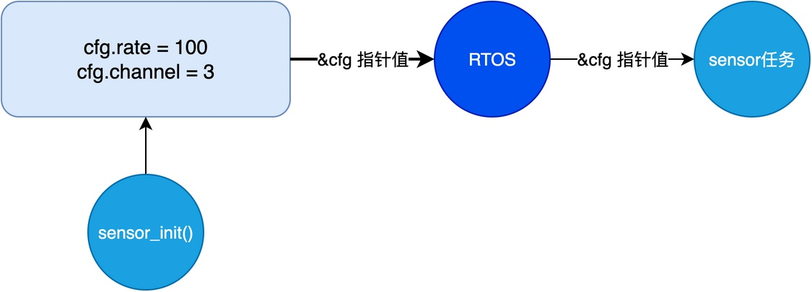
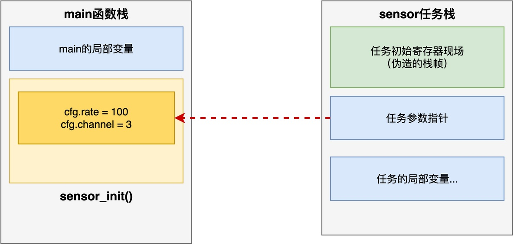
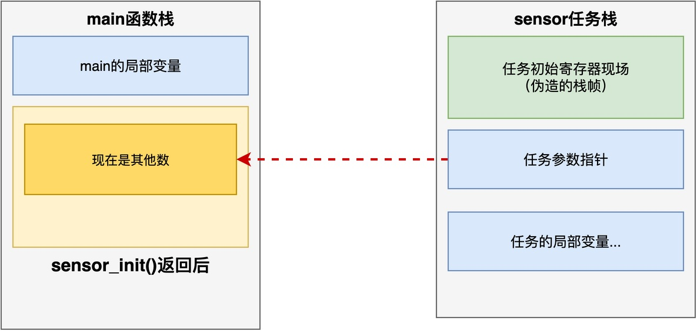

# RTOS中的任务参数，为什么不能随意传递局部变量指针？

碰到过一个很有意思的问题：有位同学可能是RTOS初学者，在使用RT-Thread创建任务时，写了以下的代码。结果发现代码下载到芯片后，程序运行出现了数据打印乱码，甚至于进入HardFault。

```c
void sensor_init(void)
{
    struct sensor_cfg cfg;

    cfg.rate = 100;
    cfg.channel = 3;

    rt_thread_t tid = rt_thread_create("sensor",
                        sensor_thread_entry,
                        &cfg, 1024, 10, 10);
    rt_thread_startup(tid);
}

int main(void) {
    // ....
    sensor_init();
    //.....
}
```

在上述代码中，定义了局部变量cfg。由于这是一个结构体，他可能出于提升程序运行效率的目的，将&cfg传给新创建的任务sensor，用作该任务的参数。

这位同学很疑问：任务参数不能这么传吗？出现问题的原因是什么？
## 任务参数的传递过程

要分析这个问题，我们得先看一下任务参数到底是怎么传递的。rt_thread_create()的声明如下：

```c
rt_thread_t rt_thread_create(const char *name,
                             void (*entry)(void *parameter),
                             void       *parameter,
                             rt_uint32_t stack_size,
                             rt_uint8_t  priority,
                             rt_uint32_t tick);
```

其中，parameter参数用于向任务传递初始运行参数，该参数的类型是void*，表示可以向其传入任意类型的指针。

**这位同学可能误以为：RTOS会帮我们把这块内容拷一份过去，再传给任务**。其实完全不是这么回事。**内核做的事情非常简单：只是把传进来的那个指针值，原封不动地交给任务**。



这就导致sensor任务开始运行的时候，实际拿到的只是指针值。
## 为什么不能传局部变量指针

了解了参数传递的过程，再来看前面那段代码，问题就很明显了。

由于cfg这个变量是在sensor_init()函数里定义的局部变量，该变量被分配到当前栈上。如果将&cfg传给rt_thread_create()，RTOS实际是将这个地址值（栈内的地址）传递给sensor任务。**在sensor任务自己的栈中，实际上并没有cfg这个变量，而仅有该变量的指针**。




那么，问题就来了：**当sensor_init()函数一返回，cfg变量在原来栈上占用的那段栈帧会被释放掉，用来放置新的局部变量、返回地址和保存的寄存器**。



更要命的是，sensor任务并不一定是调用rt_thread_startup()后就立即运行，而是可能在就绪队列中等待。具体什么时候开始执行，取决于调度器。在这段时间里，main()可能又调了好几个函数，这就导致cfg所处的位置可能被其他函数或任务改写。

等sensor任务开始运行，再通过获得的任务参数指针去访问cfg那块区域时，得到的数据早已不是原来的数据。

## 正确的做法

在进行以上分析之后，我们可以知道：**问题并不在于能否向任务传递局部变量的指针，而在于能否保证任务运行时，该局部变量所在的内存区域不会被释放或覆盖**。

因此，为了将参数传给任务，我们可以采用以下更为安全的选择。

### 方法一：使用静态变量或全局变量

可以将局部变量改成static变量，或者直接定义成全局变量。

```c
void sensor_init(void)
{
    /* 静态变量，生命周期覆盖整个程序 */
    static struct sensor_cfg cfg;

    cfg.rate = 100;
    cfg.channel = 3;

    rt_thread_t tid = rt_thread_create("sensor",
                        sensor_thread_entry,
                        &cfg, 1024, 10, 10);
    rt_thread_startup(tid);
}
```

此时，cfg变量不再放在栈上，而是放在全局数据段(.bss)里。这样一来，**它的生命周期和整个程序一样长**，sensor任务任何时候都能安全读写。

不过，这种方法的缺点也明显：如果多次调用sensor_init()创建多个任务，则所有任务会共享同一个cfg，后面的赋值会覆盖前面的。而且如果sensor任务只是在初始化时使用一次cfg，之后cfg仍然会一直占用着内存。

### 方法二：从堆中动态分配

如果需要多次调用sensor_init()创建多个任务，需要为每个任务独立配置cfg变量。此时，可以从堆中申请一块内存，然后把这块内存的地址传给任务。

```c
void sensor_init(void)
{
    struct sensor_cfg *cfg = rt_malloc(sizeof(struct sensor_cfg));

    cfg->rate = 100;
    cfg->channel = 3;

    rt_thread_t tid = rt_thread_create("sensor",
                        sensor_thread_entry,
                        cfg, 1024, 10, 10);
    rt_thread_startup(tid);
}
```

注意，任务函数里用完cfg之后，需要记得及时释放，以免造成内存泄漏。这种方法比较灵活，但需注意内存及时释放，并且需要依赖堆管理机制，这将引入额外的内存和Flash开销。

## 总结

综上所述，**不能向任务传递局部变量的指针，除非能保证任务使用该局部变量期间，该局部变量一直存在**。

当无法保证局部变量一直存在时，常见的解决方案主要有两种：第一种是使用静态变量或全局变量，从而将变量放在全局数据段里；第二种是从堆上动态分配。具体用哪种，可根据实际的场景和需求来决定。

---

> 如果你希望系统地学习RTOS底层原理，可以了解我的《RTOS开发与实战》课程。
>
> 课程不是简单地讲解FreeRTOS API的使用，而是带你从零开始编写一个RTOS内核，逐步实现任务管理、任务调度、上下文切换、同步与通信等核心机制，并通过一个远程温湿度监控设备项目，将操作系统原理应用到实际嵌入式开发中。
>
> 适合希望深入理解RTOS工作原理、提升嵌入式底层开发能力的同学。
>
> [课程详情](/blog/diyrtos/)
