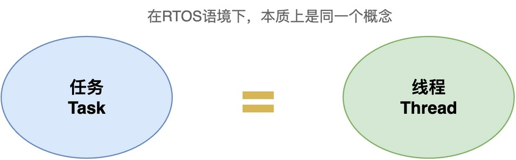
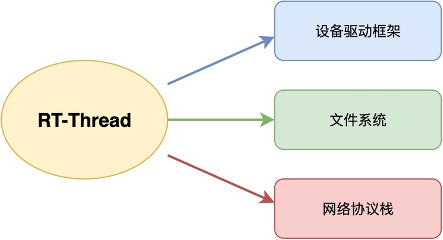
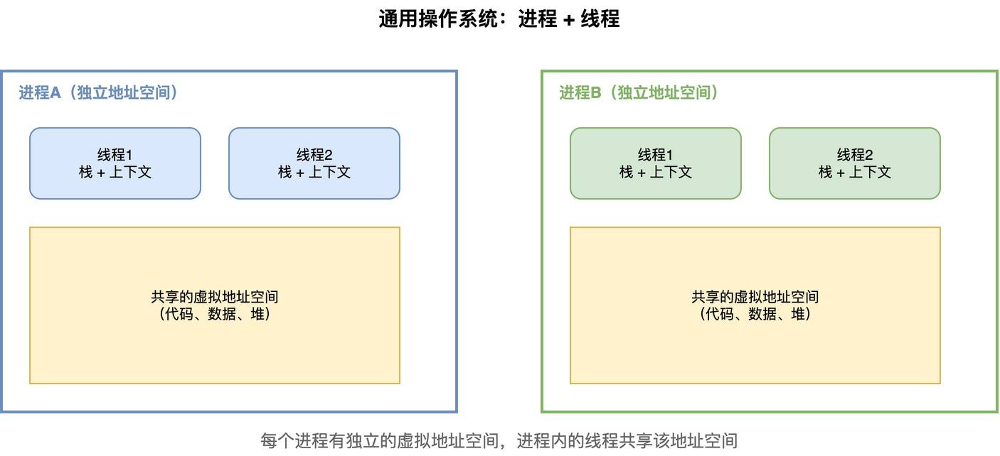
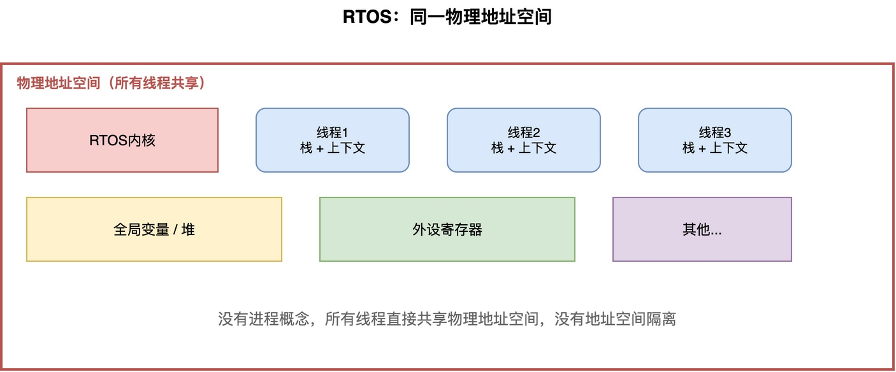

# 为什么RT-Thread中将任务叫做线程？两者有什么区别？

在从FreeRTOS转到RT-Thread的时候，你可能会发现一个有意思的问题：在FreeRTOS里，将执行单元叫做任务，而在RT-Thread里，却叫做线程（Thread）。那么，任务和线程到底有什么区别？为什么RT-Thread要将其叫做线程呢？

## 本质上是一回事

首先，要说明的是，**在RTOS中，任务和线程本质上是一回事**。

不管是叫任务还是叫线程，**指的都是系统中独立执行的基本单元**。每个这样的执行单元都有自己的栈空间、有自己的入口函数、有自己的寄存器上下文，也有自己的优先级，内核通过调度器来决定让哪个执行单元运行。

也就是说，无论是FreeRTOS中调用xTaskCreate()创建任务，还是在RT-Thread中调用rt_thread_create()创建线程，做的事情是一样的：分配栈空间，初始化上下文，把执行单元加入调度队列。

所以，这只是不同RTOS的命名习惯不同而已，没有本质上的区别。就像有的地方把土豆叫马铃薯，有的地方叫洋芋，其实指的是同一个东西。

## 为什么RT-Thread选择叫做线程

那么，RT-Thread为什么选择叫线程而不是任务呢？这主要是因为RT-Thread的设计参考了通用操作系统的命名方式。

在通用操作系统里，比如Linux、Windows，执行单元叫做线程（Thread），并且线程是隶属于进程（Process）的。一个进程可以有多个线程，这些线程共享进程的地址空间。

RT-Thread借鉴了通用操作系统的很多概念和设计思想，所以沿用了线程这个叫法。同时，RT-Thread的功能比较丰富，有设备驱动框架、文件系统、网络协议栈这些组件，更接近一个小型的通用操作系统，用线程这个叫法也更符合大家对操作系统的认知。

而FreeRTOS这些更轻量级的RTOS，强调的是"任务"这个概念。在嵌入式开发中，我们习惯把一个独立的工作单元叫做一个任务，比如采集任务、显示任务，所以使用任务这一表述更为直观。

## 与通用操作系统中的线程的不同

虽然都叫做线程，但RTOS中的线程和通用操作系统中的线程还是有一些区别的。

在通用操作系统中，线程是隶属于进程的。**每个进程有自己独立的地址空间，进程里面的多个线程共享这个地址空间**。线程自己只有栈和寄存器上下文，没有独立的地址空间。

例如，在下图中，进程A和进程B相互独立，拥有自己的虚拟地址空间。每个进程拥有多个线程，这些线程共享代码、数据和堆。

而在RTOS中，没有进程这个概念，这主要是因为：**RTOS运行在资源受限的单片机上，通常没有MMU（内存管理单元），没法实现虚拟内存和地址空间隔离**。

**所有的线程都直接运行在同一个物理地址空间中，共享所有的全局变量和外设**。每个线程有自己的栈，但没有独立的地址空间隔离。

## 总结

综上所述，在RTOS中，任务和线程本质上是同一个概念，只是不同RTOS的命名习惯不同。RT-Thread之所以使用线程，是因为参考了通用操作系统的概念和设计思想。但需要注意的是，RTOS中的线程和通用操作系统中的线程还是有区别的：RTOS中没有进程的概念，所有线程直接共享物理地址空间，而通用操作系统中的线程是隶属于进程的，共享进程的虚拟地址空间。

---

> 如果你希望系统地学习RTOS底层原理，可以了解我的《RTOS开发与实战》课程。
>
> 课程不是简单地讲解FreeRTOS API的使用，而是带你从零开始编写一个RTOS内核，逐步实现任务管理、任务调度、上下文切换、同步与通信等核心机制，并通过一个远程温湿度监控设备项目，将操作系统原理应用到实际嵌入式开发中。
>
> 适合希望深入理解RTOS工作原理、提升嵌入式底层开发能力的同学。
>
> [课程详情](/blog/diyrtos/)
