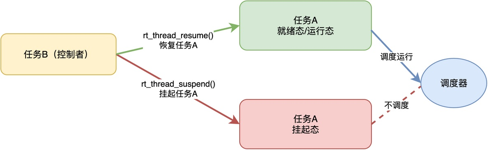
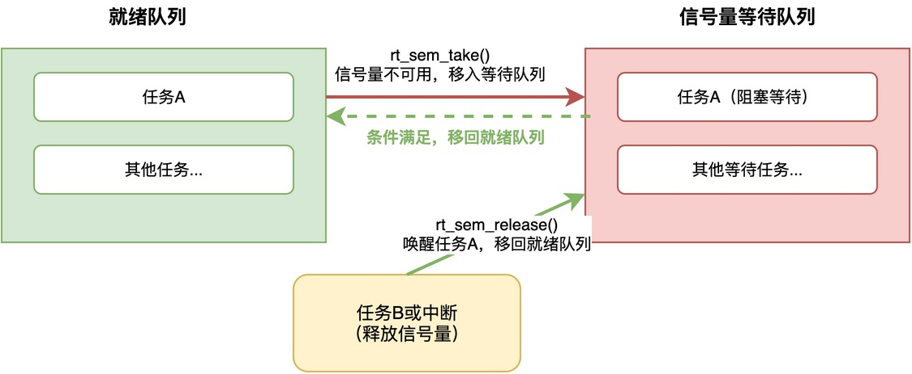
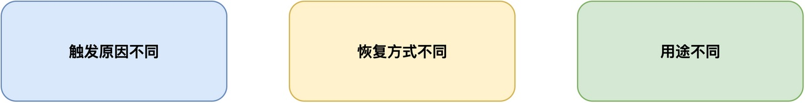

# RTOS的任务挂起与阻塞有什么区别？

在RT-Thread中，内核提供了两种可以让任务暂停运行的操作。

一种是调用rt_thread_suspend()将任务挂起，另一种是调用rt_sem_take()这类获取信号量的函数，让任务进入阻塞状态。

> 这两种操作看起来都会让任务停下来不再运行，那么，它们之间到底有什么本质区别呢？
> 既然已经有了阻塞这种机制，为什么还要单独提供挂起这个功能？
> 能不能直接用阻塞来代替挂起呢？

在这篇文章中，我将分别介绍挂起和阻塞的工作原理，从而解答这些问题。

## 任务挂起原理

**任务挂起，简单来说就是外部主动“暂停”某个任务的运行。**

**当调用挂起接口时，该任务就会从就绪态或者运行态进入挂起态**。进入挂起态的任务，调度器是不会去调度它的，哪怕CPU空闲着，也不会运行这个任务。**最关键的一点是，挂起的任务不会自动恢复运行，必须由其他任务或者中断显式地调用恢复接口**，它才能重新回到就绪态。

下面这张图展示了任务挂起的基本过程：



在该图中，任务B可将任务A进行挂起，此时任务A进入挂起状态，调度器不再管理该任务。只有当任务B恢复任务A时，任务A才会进入就绪态或运行态，被调度器管理。

在RT-Thread中，可以使用以下接口进行挂起和恢复：

```c
/* 挂起指定任务 */
rt_thread_suspend(thread);

/* 恢复指定任务 */
rt_thread_resume(thread);
```

## 任务阻塞原理

任务阻塞的工作原理与挂起完全不一样。**任务阻塞是任务因为等待某个事件而主动进入的一种等待状态**。

常见的导致任务阻塞的机制有很多种，比如等待信号量、等待互斥锁，以及调用rt_thread_mdelay()进行延时等。这里以等待信号量为例，看一下任务阻塞的具体过程：


当任务A调用rt_sem_take()获取信号量时，如果信号量当前不可用（计数为0），此时任务就不会傻等着占着CPU，而是主动进入阻塞态，把CPU让给其他任务运行。

当等待的事件发生时，比如任务B或中断释放了信号量，RTOS内核会自动把这个任务从阻塞态移到就绪态，同时将任务移回就绪队列。一旦该任务的优先级最高，就会立即被调度运行。

整个过程不需要人工干预，任务等待的条件满足了，内核自动就把它唤醒了。

## 两者的区别

虽然挂起和阻塞都能够让任务暂停运行，但它们在触发原因、恢复方式和用途上都有本质的不同。



具体来说，挂起和阻塞的核心区别如下：

1. **触发原因不同**：**被挂起的任务是被动的**，通常由其他任务或者中断服务程序调用rt_thread_suspend()接口来导致，任务不知道自己什么时候会被挂起；**而阻塞是任务自己主动进入的**，当任务需要等待某个资源或者事件时，比如主动调用rt_sem_take()获取信号量但信号量不可用，任务就会主动进入阻塞态。

2. **恢复方式不同**：**挂起的任务必须由外部显式调用恢复接口才能重新运行**，比如任务A被挂起后，必须等任务B调用rt_thread_resume()才能恢复；而**阻塞则不同，当任务等待的条件满足时，任务就会唤醒**，比如另一个任务释放了信号量，任务便从阻塞态移到就绪态，整个过程不需要任何外部干预。

3. **用途不同**：**挂起是一种外部控制手段，用于人为地控制任务的运行和停止**，典型的场景是"我让你停你就停，我让你跑你才能跑"，比如临时禁用某个功能、调试时观察系统行为等；而**阻塞是任务自身的主动行为，常用于任务间的同步和资源等待**，典型的场景是"等某个条件满足了自动继续跑"，比如等待硬件操作完成、等待其他任务发来消息等。

## 总结

综上所述，任务挂起和阻塞虽然都能让任务暂停执行，但本质完全不同。

挂起是外部主动施加的暂停，必须显式恢复，用于人为控制任务的运行状态；阻塞是任务主动进入的等待状态，条件满足时由内核自动唤醒，用于任务间同步和资源等待。

---

> 如果你希望系统地学习RTOS底层原理，可以了解我的《RTOS开发与实战》课程。
>
> 课程不是简单地讲解FreeRTOS API的使用，而是带你从零开始编写一个RTOS内核，逐步实现任务管理、任务调度、上下文切换、同步与通信等核心机制，并通过一个远程温湿度监控设备项目，将操作系统原理应用到实际嵌入式开发中。
>
> 适合希望深入理解RTOS工作原理、提升嵌入式底层开发能力的同学。
>
> [课程详情](/blog/diyrtos/)
