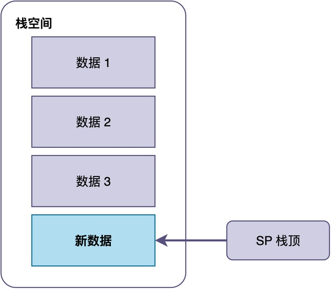
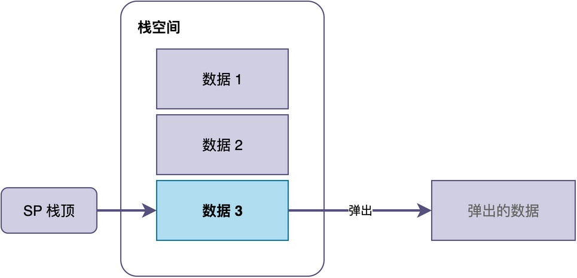
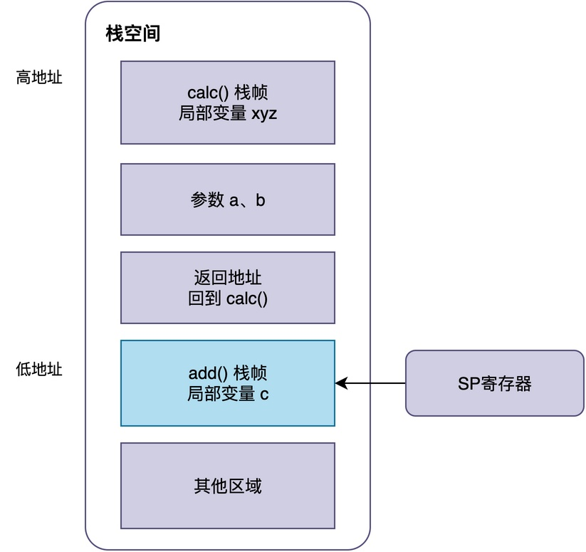
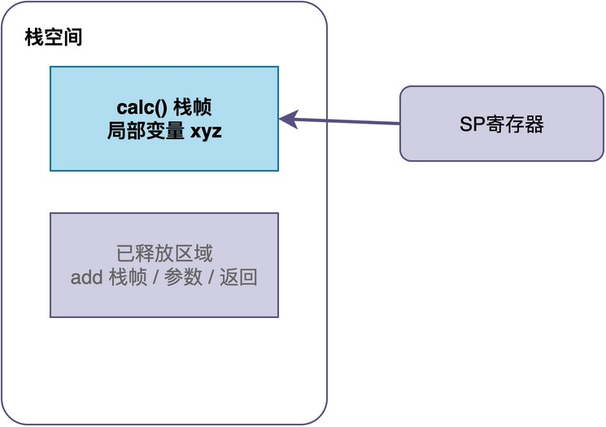
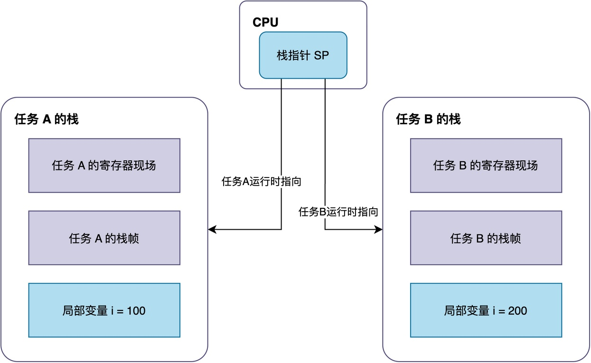

# 为什么每个任务都需要自己的栈？

很多人第一次接触RTOS的时候，会注意到：创建任务时需要传递一个特殊参数：栈大小。RTOS将根据这一参数的大小，动态分配一块栈空间，用于任务的执行。

例如，在RT-Thread里，创建任务时可以传入1024来指定栈大小。

```
int main(void)
{
    rt_thread_t tid;
    tid = rt_thread_create("sensor", sensor_thread_entry,
                           RT_NULL, 1024, 10, 10);
    rt_thread_startup(tid);
    tid = rt_thread_create("display", display_thread_entry,
                           RT_NULL, 1024, 11, 10);
    rt_thread_startup(tid);
    tid = rt_thread_create("upload", uart_send_thread_entry,
                           RT_NULL, 1024, 11, 10);
    rt_thread_startup(tid);
    return 0;
}
```

这时候，你可能会产生疑问：**栈到底是什么东西？为什么创建任务时需要单独指定一块栈？能不能让多个任务共用一块栈，从而节省内存？**

接下来，我将通过这篇文章将这些问题解释清楚。

## 一、栈到底是什么

简单来说，栈是程序运行时使用的一块连续内存空间。

> 栈的最主要的特点在于其使用方式上：数据按照后进先出（LIFO）的方式进行存取。也就是说，后放进去的数据，会被最先取出来。
>
> 往栈里放数据的操作，叫做压栈；反之，从栈里取数据的操作叫做出栈。无论是压栈还是出栈，都是从栈顶位置开始进行。通常情况下，CPU里的栈指针寄存器指向当前栈顶位置。





实际上，在程序运行的过程中，栈一直在默默工作。栈主要承担两个职责：

1. **存放函数的局部变量**。函数内部定义的变量会被分配到当前栈上，当函数执行完返回，这块空间会被回收。
2. **支持函数调用**。当调用函数时，CPU需要把函数参数、返回地址等信息压到栈上，等被调用函数执行完返回时，再从栈中取出返回地址，回到原来的位置继续执行。

## 二、普通函数调用是怎么用栈的

下面，通过一个具体的例子来看栈是怎么工作的，该示例代码如下：

```
int add(int a, int b)
{
   int c = a + b;
   return c;
}

void calc(void)
{
   int x = 10;
   int y = 20;
   int z = add(x, y);
}
```

当calc()函数执行时，它的局部变量x和y会被分配到栈上。

而当calc()调用add()时，CPU会把参数x和y以及返回地址（即add()执行完后应该回到calc()的哪个位置继续执行），一起压到栈上。之后，add()函数开始运行，该函数的局部变量c又会被分配到栈上。



这样一层套一层，栈上就依次叠放了calc()和add()的信息，每一层叫做一个栈帧。

当add()执行完返回时，CPU根据栈中保存的返回地址回到calc()，同时add()的栈帧被撤销，栈又恢复到只有calc()栈帧的状态。



通过这种机制，使得程序能够不断调用函数，并正常返回。

## 三、为什么每个任务必须有自己的栈

我们已经知道：任务并不是等于普通函数，而是一条可以被随时暂停、之后再恢复的独立执行流。

任务在执行过程中，**实际上是执行某个特定任务函数中的代码，任务函数与普通函数并无本质区别。所以，为了让任务顺利执行任务函数，需要为任务分配栈空间**。

那么，能不能让所有的任务共享相同的栈空间呢？下面，通过一个具体的例子进行说明。

假设有两个任务，它们都定义了一个同名的局部变量 i：

```
void task_a_entry(void *parameter)
{
   int i = 100;
   while (1) {
       i++;
       rt_thread_mdelay(1000);
   }
}

void task_b_entry(void *parameter)
{
   int i = 200;
   while (1) {
       i--;
       rt_thread_mdelay(1000);
   }
}
```

注意，虽然两个任务里的变量都叫 i；但是，它们实际上是各自函数内部的局部变量，彼此之间应当是完全相互独立的。也就是说，**这两个变量i就应当各自占用不同的内存空间**。



**由于局部变量需要放在栈中，因此，RTOS需要为这两个任务分别分配不同的栈空间，避免相互干扰。**

例如，当CPU运行任务A时，栈指针寄存器指向任务A的栈，访问到的是任务A的 i；当CPU切换到任务B时，栈指针寄存器也随之切换，指向任务B的栈，访问到的可能任务B的 i。这样一来，两个i虽然同名，但各自存放在不同的栈中，完全互不影响。

**与此同时，每个任务在运行过程中会调用不同的函数、有着不同的函数调用深度，这些数据同样需要一块独立的栈空间来存放，才能保证任务之间互不干扰。**

正因为如此，创建任务时必须为每个任务单独指定栈大小，内核也会为每个任务初始化独立的栈空间和栈指针。

此外，RTOS还会在任务上下文切换时，将CPU寄存器的完整状态（如程序计数器、栈指针、通用寄存器等）保存到当前的任务栈中。关于这部分内容，将在后面的文章中说明。

## 四、总结

综上所述，栈是用来存放局部变量、函数调用信息的内存空间。

每个任务之所以必须拥有自己独立的栈，根本原因在于：只有独立的栈才能保证各自的局部变量、函数栈帧等信息不会被其他任务覆盖。

这也正是我们创建任务时，必须为每个任务单独指定栈大小的根本原因。

---

> 如果你希望系统地学习RTOS底层原理，可以了解我的《RTOS开发与实战》课程。
>
> 课程不是简单地讲解FreeRTOS API的使用，而是带你从零开始编写一个RTOS内核，逐步实现任务管理、任务调度、上下文切换、同步与通信等核心机制，并通过一个远程温湿度监控设备项目，将操作系统原理应用到实际嵌入式开发中。
>
> 适合希望深入理解RTOS工作原理、提升嵌入式底层开发能力的同学。
>
> [课程详情](/blog/diyrtos/)
