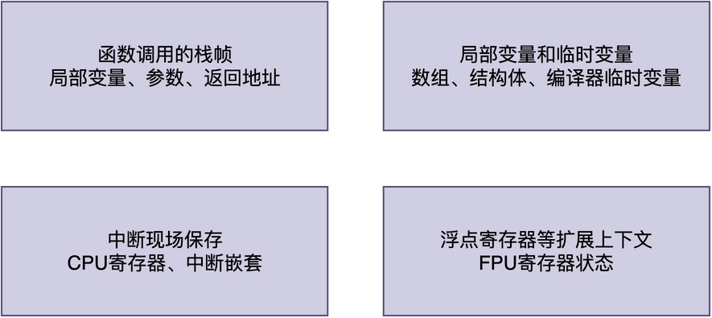

# 任务的栈应当设置成多大？

当第一次使用RTOS创建任务的时候，你可能对于栈大小这个参数往往没有什么概念。最常见的做法是，照着例程里的数值随便填一个，比如1024或者512。

粗看起来，这似乎没什么问题，程序能正常跑起来。可是，一旦项目功能变多、任务里调用的函数变复杂，系统偶尔会出现各种莫名其妙的问题：

> 有时候是死机，有时候是变量被意外改写......

最后，查了半天，才发现是栈溢出了。这时候你才意识到，**原来任务的栈大小不是随便设置的，而是需要根据实际需求认真估算**。

那么，我们应当如何知道任务的栈到底应该设置成多大才合适呢？

## 一、栈到底用在了什么地方

要回答栈应该设置成多大，**首先得搞清楚任务运行的时候，栈空间到底用在什么地方**。

任务栈的消耗主要来自以下四个方面：



下面分别展开说明。

1. **函数调用的栈帧**。任务函数每调用一层函数，CPU就需要在栈上分配一块空间，用来存放这个函数的局部变量、函数参数、返回地址等信息，这块空间叫做栈帧。调用层次越深，栈帧叠加得越多，占用的栈空间就越大。

2. **局部变量和临时变量**。函数内部定义的局部变量，直接分配在栈上。对于一些数组、结构体这类占用空间较大的变量，也会占用更大的栈空间。此外，编译器在优化过程中还可能产生一些临时变量，也会占用栈空间。

3. **中断现场保存**。如果任务在运行过程中发生了中断，CPU需要把当前的寄存器现场压到栈上保存起来，等中断处理完再恢复。如果中断嵌套层数比较多，这部分开销也不能忽视。

4. **浮点寄存器等扩展上下文**。如果CPU支持浮点运算，并且任务中也使用了浮点运算，那么在任务切换时还需要保存浮点寄存器的状态，这也会额外占用一部分栈空间。

综合所有这些因素，我们会发现：**需要仔细分析清楚任务实际运行的环境和实现，才能评估一个任务真正需要的栈大小**。

## 二、栈过小和过大分别有什么问题

**当栈设置的过小时，任务运行时会导致栈溢出，进而引发任务运行异常甚至整个系统崩溃**。

比如，栈指针会越界，指向栈空间外，进而导致写数据到与栈相邻的内存区域里。而这些区域可能是其他任务的栈、堆空间、全局变量，甚至是RTOS内核的数据结构。

一旦出现这种情况，你可能会发现：某个变量的值莫名其妙变了、函数调用后无法正常返回、系统直接崩溃死机。最要命的是，这种问题往往很难复现和排查，因为它的表现是随机的。

> 此时，有的同学可能会想：为了避免栈不够用导致任务运行异常，宁可分配多一点，也不要少给。

这种想法在内存资源非常富裕的环境上可能还行。不过，绝大多数时候，任务通常运行在内存只有几十KB甚至几KB的环境中。

**如果每个任务都分配远超实际需要的栈空间，那么当任务数量一多，很快就会出现内存不够用的情况。并且，任务实际只用了很小一部分栈空间，这就造成了极大的浪费。**

所以，**栈大小的设置需要综合权衡：既要保证最坏情况下不会溢出，又要尽量节省内存**。

## 三、怎样估算任务所用栈大小

为了估算任务所用栈大小，通常有以下两种方式：

**第一种方法是静态估算**。这种方法需要分析任务的实现代码，手动分析任务的最深函数调用链，把每一层的局部变量、参数、返回地址等所用的栈空间加起来，再加上中断现场保存的开销。考虑任务运行过程中，不断地发生压栈、出栈，中断也是随机发生的，所以这种手动分析方法非常繁琐。

有些编译器工具链（比如arm官方编译器，参考我的《ARM编译器使用指南》课程）提供了分析功能，可以帮助简化计算，它可以将任务函数执行所需的栈空间大小计算出来。我们可以直接利用该结果，将其与中断现场保存等开销进行相加。

显然，这种方法的缺点是较为繁琐，而且结果也不一定很准确。

**第二种方法是RTOS自带的检测机制**，比如RT-Thread的rt_thread_stack_check()。这种方法的实现机制为：在任务创建的时候，把整个栈填充一个固定的标记值（比如0xAA）。然后，当任务运行一段时间后，再扫描栈空间，找到第一个不是该标记值的位置。根据这个位置，就可以知道任务实际用了多少栈空间。

在开发调试阶段，我们可以定期调用相关API获知用了多少栈，根据实际使用量来调整栈大小。

不过，这种方法也有明显的缺点：**它有可能无法覆盖所有执行路径**，这就导致检测出来的栈大小也不一定准确。

## 四、一个简单的估算例子

所以，即便我们已经估算出了任务需要使用多大的栈，也不能直接使用这个栈大小作为创建任务时的参数传入RTOS内核。

例如，有一个温湿度采集任务，其任务函数的大致实现如下：

```
void sensor_thread_entry(void *parameter)
{
    float temp, humi;
    char buf[128];
    while (1) {
        read_sensor(&temp, &humi);
        sprintf(buf, "T=%.1f H=%.1f", temp, humi);
        uart_send(buf, strlen(buf));
        rt_thread_mdelay(1000);
    }
}
```

假设根据静态估算，该任务的局部变量使用大约是200字节，函数参数和返回地址大约是60字节，中断现场保存大约是100字节，那么最坏情况下的栈使用量大约是360字节。

**考虑到编译器可能产生的临时变量、未来功能扩展的需要以及估算的不准确性，可以再乘以1.5~2的安全系数**。这里取1.5倍，360乘以1.5得到540字节，这样就比较合理了。当然，如果内存资源足够，可以分配更大的栈空间。

## 五、总结

综上所述，任务栈大小的设置没有一个放之四海而皆准的固定值，它取决于任务的函数调用深度、局部变量大小、中断嵌套情况等多种因素。

> 如果栈过小，会导致溢出崩溃；而如果栈过大，则会浪费内存。

<font color="#2DC26B">在实际开发中，可以先分配一个保守的较大值；然后，通过检测工具测出实际最高使用量，并再在此基础上增加一定的余量，最终确定一个既安全又节省的栈大小。</font>

---

> 如果你希望系统地学习RTOS底层原理，可以了解我的《RTOS开发与实战》课程。
>
> 课程不是简单地讲解FreeRTOS API的使用，而是带你从零开始编写一个RTOS内核，逐步实现任务管理、任务调度、上下文切换、同步与通信等核心机制，并通过一个远程温湿度监控设备项目，将操作系统原理应用到实际嵌入式开发中。
>
> 适合希望深入理解RTOS工作原理、提升嵌入式底层开发能力的同学。
>
> [课程详情](/blog/diyrtos/)
