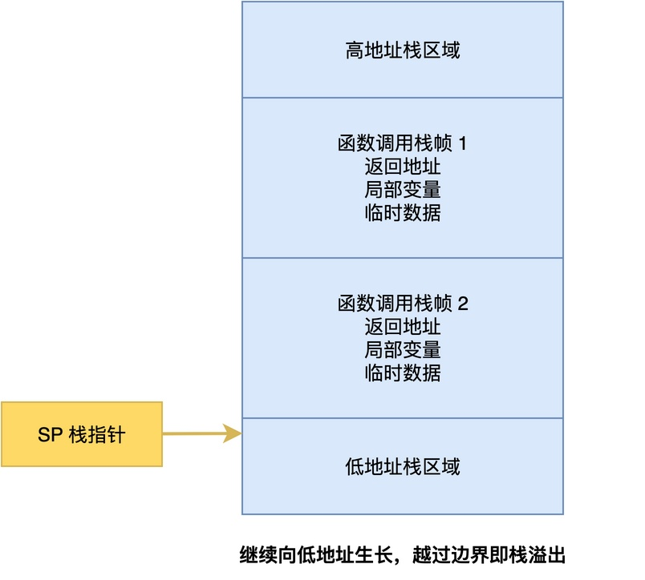
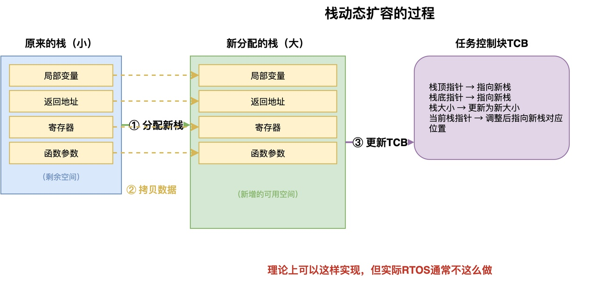

# 可以动态修改任务栈大小吗

在C标准库里面，对于动态分配的内存，我们可以使用realloc()函数来调整它的大小，而且不影响里面已经存的数据。该函数的原型如下，参数p指向先前分配内存块的指针，成功时返回新内存块的首地址。

```c
void *realloc(void *p, unsigned int size);
```

那么，在RTOS里面，任务的栈空间能不能也这样做呢？也就是说，当发现任务运行的时候栈不够用了，能不能自行把栈调大一点？这样就可以避免栈溢出的情况？

在这篇文章中，将深入分析这个问题，分析其可行性。

## 任务栈是什么

要分析这个问题，我们首先要搞清楚任务栈到底是什么。

创建任务的时候，内核会在内存中分配一块连续的空间作为这个任务的栈，用于存放局部变量、函数调用的返回地址、任务切换时保存的CPU寄存器、还有函数的参数等等。



当任务运行的时候，栈指针会从栈底往栈顶方向增长，函数调用越深、局部变量越多，栈用得就越多。如果栈用得超过了分配的大小，就会发生栈溢出，覆盖到相邻的内存，导致程序跑飞。

## 为什么不能直接扩大原栈

当任务的栈快要溢出的时候，能不能在原来的栈后面再扩大一点空间？

**如果要这么做，就意味着使用栈后面的那部分内存**。但问题是，栈后面的内存可能已经被别的东西占用，比如另一个任务的栈、任务控制块、全局变量、或者动态分配的堆内存。


从图中可以看到，任务A的栈后面紧挨着其他任务的栈空间、任务控制块、全局变量等内容。如果直接把任务A的栈扩大，就会覆盖掉这些内存区域，导致其他任务或者内核数据被破坏，进而使得整个系统崩溃。

所以，直接在原有栈的基础上进行扩大，是行不通的。

## 那要怎么才能实现

既然如此，如果一定要实现栈的动态扩容，应该怎么做？这里我们可以参考realloc()的实现思路，实现思路如下图所示。


具体而言，一共分为三步：

1. **分配新栈：**从堆里面额外分配一块更大的、新的栈空间。
2. **拷贝数据：**将原来栈里面的所有数据，原封不动地拷贝到新分配的栈空间里面。
3. **更新TCB**：将TCB里面和栈相关的配置（如栈顶指针等），改成指向新的栈空间。

所以，从理论上来说，是可以实现任务栈的动态扩容。但是，为什么大部分RTOS都没有提供这个功能呢？

## 为什么RTOS通常不支持这种操作

RTOS通常不支持运行时动态调整栈大小，主要有以下几个原因，如下图所示。


### 依赖堆内存，资源有限

在嵌入式系统中，内存资源通常都很紧张，堆里面往往没有大的连续空间，而任务的栈通常有1KB到几KB。

频繁地分配和释放不同大小的内存，也会产生更多的内存碎片。时间一长，堆里面可能就找不到足够大的连续空间，这时候想扩容也扩不了。

### 性能比较差

栈的动态扩容比较麻烦，需要先分配新内存，再把整个栈的数据拷贝过去，最后更新任务控制块。当栈比较大时，拷贝的时间就会比较长。

### 有更好的处理方法

其实，对于栈不够用这个问题，我们有更好的处理方法。

1. **使用栈溢出检测功能提前进行预防**。在开发阶段，通过栈溢出检测和栈使用率统计，查看每个任务实际用了多少栈，再预先分配合理的空间，从源头上避免栈不够用的情况。
2. **动态重建任务**。如果确实需要调整栈大小，可以考虑把原来的任务删掉，然后用更大的栈重新创建。

## 总结

综上所述，任务栈的动态调整在理论上是可以实现的，通过分配新栈、拷贝数据、更新任务控制块这三步就可以完成。

但在实际的RTOS中，通常不支持这种操作，主要是因为内存资源有限、易产生碎片、性能较差，更好的方式是提前预防。实在不得不动态调整时，也可以考虑动态删除重建任务。

---

> 如果你希望系统地学习RTOS底层原理，可以了解我的《RTOS开发与实战》课程。
>
> 课程不是简单地讲解FreeRTOS API的使用，而是带你从零开始编写一个RTOS内核，逐步实现任务管理、任务调度、上下文切换、同步与通信等核心机制，并通过一个远程温湿度监控设备项目，将操作系统原理应用到实际嵌入式开发中。
>
> 适合希望深入理解RTOS工作原理、提升嵌入式底层开发能力的同学。
>
> [课程详情](/blog/diyrtos/)
