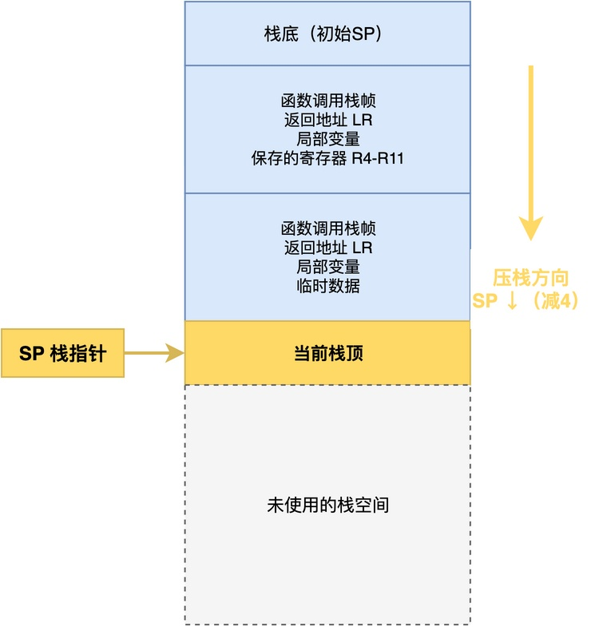
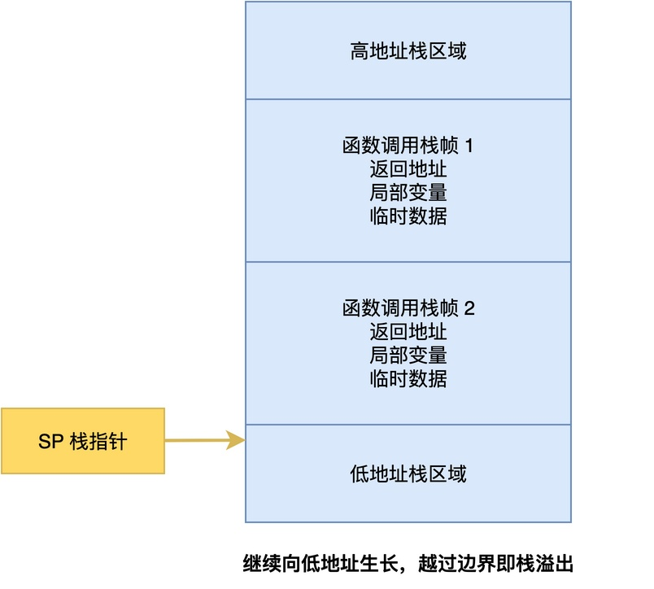
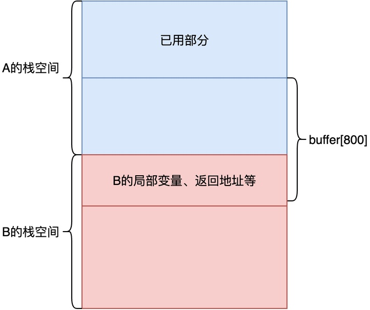

# 任务栈溢出后，程序为什么可能突然跑飞？

当项目中使用RTOS后，程序出现问题时，排查分析的工作量有时会大幅增加。

例如，有同学遇到过这样的问题：

> 程序正常跑了几天，然后突然死机，复位后又正常。经过反复地调试分析，才发现是任务栈溢出，导致系统崩溃死机。

这种问题是最让人头疼的，尤其是问题很难复现，它往往在程序运行过程中不定时发生。

在这篇文章中，我将分析为什么栈溢出会导致程序崩溃、以及为什么程序不会立即崩溃，最后会给出几种检查方法。

## 栈的作用

简单来说，**任务栈就是创建任务时分配的一段连续RAM，数据按后入先出（LIFO）的方式进出栈。**

CPU里通常有一个栈指针寄存器SP指向当前栈顶。在ARM Cortex-M架构中，采用满递减栈操作，压栈时先将SP减4，再将数据存入SP指向的位置，即SP指向压入栈中的最后一个数据单元。每次压入的栈数据单元大小为32位。

下面这张图展示了Cortex-M架构中递减栈的内存布局。



**栈常用来保存程序运行的返回地址、局部变量、临时数据。对于任务栈而言，还会在任务切换时保存任务的上下文**。

再来看一下任务栈的整体内存布局。



由于栈从高地址向低地址生长，每调用一层函数就会压入一个栈帧。

SP指针始终指向当前栈顶的位置。如果栈继续向低地址生长，越过了栈区域的边界，就会发生栈溢出。

## 栈溢出时会发生什么

这里来看一个栈溢出的具体例子。

假设创建了一个任务A，并为该任务分配了1024字节的栈空间，代码如下：

```c
/* 创建任务A，栈大小1024字节 */
rt_thread_t task_a = rt_thread_create("task_a",
                                       task_a_entry,
                                       RT_NULL,
                                       1024,   /* 栈大小 */
                                       10,     /* 优先级 */
                                       10);    /* 时间片 */
rt_thread_startup(task_a);
```

通常情况下，其任务函数平时只用几百字节栈。但是，在某些特殊情况下（如传感器读到0xAA），会分配一个很大的局部数组buffer：

```c
void task_a_entry(void *param)
{
    while (1)
    {
        int flag = read_sensor();

        if (flag == 0xAA)  /* 很少执行到的分支 */
        {
            char buffer[800];  /* 大局部数组，一下吃掉800字节栈 */
            process_data(buffer, sizeof(buffer));
        }

        rt_thread_mdelay(100);
    }
}
```

任务栈空间只有1024字节，加上函数调用栈帧和其他局部变量，再分配这个800字节的buffer，栈空间就不够用了。但编译器并不会检查这点，而是”傻傻地”在栈上为buffer分配空间。



此时，SP一路向低地址走，最后越过了栈区域的最低地址，将栈边界相邻的部分区域也作为buffer的空间。

这样一来，当buffer写到接近栈边界的位置时，就会将数据写到任务栈之外的空间。这些空间通常存放着其他重要的数据，比如：**其他任务的栈**、**全局变量或消息队列缓冲区**、**某个任务的任务控制块**等。

## 为什么程序不会立即崩溃

你可能会想：既然已经写到栈外空间了，很明显就是有问题啊，为什么程序不立即崩溃？

实际上，CPU并不知道任务栈是什么，它只是机械地进行压栈出栈。当溢出的那一刻，CPU当下执行的指令还是正常的，所以程序不会立刻出错。

**问题往往等到误写的那些内存被读取的时候才会爆发，而这中间可能隔了几毫秒，也可能隔了好几天。**

## 如何尽早发现栈溢出

为了有效地预防栈溢出问题，很多RTOS都提供了栈溢出检查的功能，方便我们在开发阶段对栈的使用情况进行检查。

以RT-Thread为例，最常用的方法是：注册栈溢出钩子函数。内核在每次任务切换时会检查栈指针是否还落在合法范围内，一旦越界就立刻调用这个钩子函数。

```c
#include <rtthread.h>

/* 栈溢出钩子函数 */
void rt_stack_overflow_hook(rt_thread_t thread)
{
    rt_kprintf("栈溢出: %s\n", thread->name);

    while (1);   /* 停在这里，用调试器看现场 */
}
```

此外，我们还可以在代码中主动检查某个任务的栈使用情况。RT-Thread提供了rt_thread_check_stack函数，它会返回栈的历史最大使用量。我们可以通过该数值来判断给任务分配的栈空间是否够大。

```c
#include <rtthread.h>

void check_stack_usage(void)
{
    rt_thread_t thread = rt_thread_self();
    rt_uint32_t used = rt_thread_check_stack(thread);

    rt_kprintf("任务 %s 栈已使用 %u 字节\n", thread->name, used);
}
```

## 总结

综上所述，栈溢出的本质是任务栈空间不够用，导致栈指针越过边界覆盖了旁边的数据。

被覆盖的区域可能是别的任务栈、全局变量或任务控制块。当这些区域被读到时，就会出现返回地址错乱、指针失效等问题，最终导致程序崩溃死机。

---

> 如果你希望系统地学习RTOS底层原理，可以了解我的《RTOS开发与实战》课程。
>
> 课程不是简单地讲解FreeRTOS API的使用，而是带你从零开始编写一个RTOS内核，逐步实现任务管理、任务调度、上下文切换、同步与通信等核心机制，并通过一个远程温湿度监控设备项目，将操作系统原理应用到实际嵌入式开发中。
>
> 适合希望深入理解RTOS工作原理、提升嵌入式底层开发能力的同学。
>
> [课程详情](/blog/diyrtos/)
