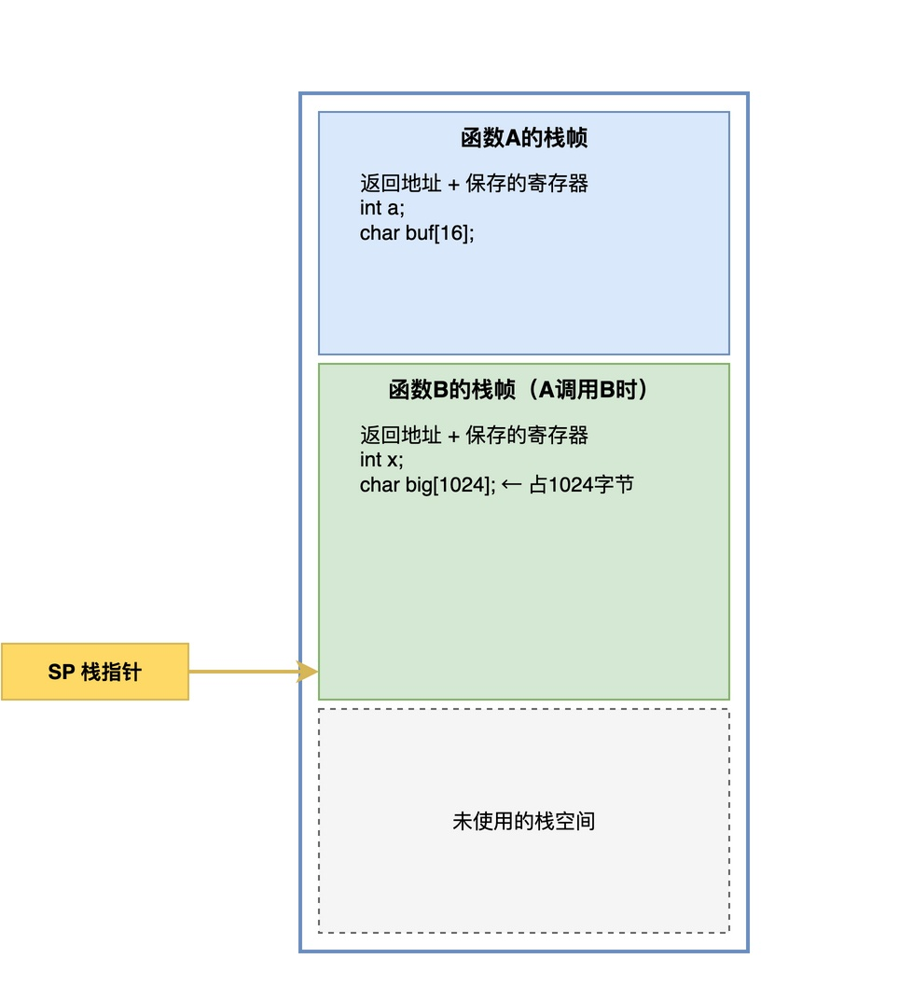
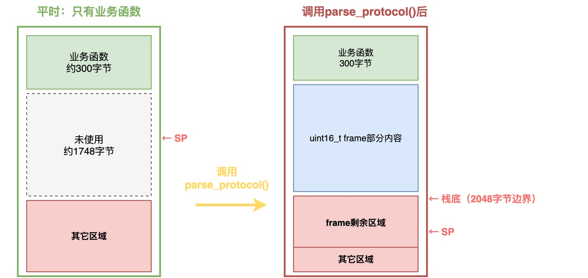

# 为什么局部大数组容易导致任务栈溢出？

刚刚帮一位学习RTOS课程的同学调试他的工程时，发现他的程序运行一段时间后就死机了，但是复位后又能正常跑，但是过一会儿又死。

通过加入测试代码并反复测试分析，最终发现问题出现在了一个大数组上。简单来说，他写了这样一段代码：

```c
void parse_protocol(void)
{
    uint16_t frame[1024];

    /* ... 后面是解析逻辑 ... */
}
```

就语法而言，这段代码本身没有任何问题。但是，聪明的你可能意识到：函数中定义了一个大型的数组，会不会是它造成的？

实际确实是这样，有的同学可能想不通：**我之前在PC机上写程序也这么干，从来没出过问题，为什么在这里就不行？**

在接下来的文章，我将深入分析：为什么在嵌入式环境中不能这么做？

## 局部变量存放到哪里

要理解这件事，我们得先搞清楚C语言里的局部变量，到底存在哪里。

答案很简单：**函数内部定义的局部变量，默认放在栈上。**

编译器在编译代码时，当碰到函数时，会根据这个函数里所有局部变量的总大小，在栈上预留出一段空间，这一段空间就叫这个**函数的栈帧**。**每调用一层函数，栈帧便会增加一层，用于放置不同函数的局部变量等信息**。

例如，假设有A和B两个函数，其代码如下：

```c
void func_B(void)
{
    int x;
    char big[1024];  /* 大局部数组 */

    /* ... */
}

void func_A(void)
{
    int a;
    char buf[16];

    func_B();  /* A调用B */
}
```

当A调用B时，整个栈帧如下所示。



从图中可以看到，栈从高地址向低地址生长。

最上面是函数A的栈帧，里面保存了A的返回地址、需要保存的寄存器，以及A的局部变量a和buf[16]。当A调用B时，又会在栈上压入B的栈帧，包括B的返回地址、寄存器，以及B的局部变量x和big[1024]。SP指针始终指向当前栈顶，也就是B的栈帧位置。

## 大数组带来的问题

在嵌入式环境中，内存资源是非常有限的。通常情况下，我们仅会为程序分配有限的栈空间。

在这位同学的项目中，他创建了一个任务，分配了2048字节的任务栈。通常情况下，该任务只调用某些栈需求量较小的函数，加起来只用了300多字节，看起来栈空间非常宽裕。但是，当调用parse_protocol()时，就需要为frame分配2048字节的栈空间。



从图中可以看到，业务函数的栈帧占了300字节，再加上内部调用parse_protocol()时，frame[1024]占了2048字节，总共需要2348字节。显然，这已经超过了任务栈2048字节的上限。此时，栈指针就会越过栈底，把栈外面的内存区域给覆盖掉。

**这些被覆盖的区域可能存放着其他重要的数据，比如：其他任务的栈或代码 、全局变量、OS内核的关键数据结构。**

这就是为什么会出现"运行一段时间后突然死机，复位后又正常"的现像，因为：溢出的时机不确定，被覆盖的内存区域什么时候被读取也不确定。

## 解决方法

既然已经知道问题的根源，那么解决起来就很容易了，常见的方法有以下几种：

### 加static关键字

当给局部变量加上static关键字时，这个变量不再放在栈上，而是放到了全局数据区。**如果是未初始化的，放在.bss段；如果有初始值，放在.data段**。

```c
/* 加static后，数组不占栈空间 */
void parse_protocol(void)
{
    static uint16_t frame[1024];

    /* ... 解析逻辑 ... */
}
```

这种方法的缺点也很明显：**变量的生命周期从函数调用期间变成了整个程序运行期间**。也就是说，即便函数未被调用，该变量始终占用一大块内存空间。

此外，如果该函数会被多个任务同时调用，或者在中断里也会被调用，那**该局部变量就需要加锁保护，否则会出现数据访问冲突的问题**。

### 定义为全局变量

如果不加static关键字，直接定义成全局变量，作用效果类似，缺点也是类似的。

**二者的主要区别在于：全局变量的作用域是整个文件，甚至整个程序。**

### 使用动态内存分配

**如果只是希望临时使用一大块内存空间，可以考虑从堆中动态分配内存**。当需要的时候用malloc从堆上申请内存，用完之后用free释放掉。

```c
void parse_protocol(void)
{
    uint16_t *frame = malloc(1024 * sizeof(uint16_t));

    /* ... 解析逻辑 ... */
    free(frame);
}
```

当采用这种方案时，栈中只需要保存frame这个指针（4字节），实际的内存块从堆中分配，不会占用栈空间。

不过，采用这种方式缺点也很明显：

1. 动态内存分配会产生内存碎片，频繁申请释放可能导致堆空间不足。
2. malloc()的执行时间不确定：可能影响实时性。
3. 容易忘记调用free()，引发内存泄漏。

## 总结

综上所述，**最好是不要在栈上放大的局部变量，以免发生栈溢出的问题**。

当需要使用大的变量时，可以考虑改为静态变量或全局变量，或者也可以改用动态内存分配从堆上申请。具体用哪种，需要综合函数会不会被并发调用、对实时性的要求、以及内存碎片的承受能力这几方面进行权衡。

## 写在最后

如果只停留在"局部数组别开太大"这条经验上，遇到多层函数嵌套还是会踩坑。如果想真正理解，就得回到栈帧布局和任务栈初始化这些细节，看清楚每次调用到底从栈上切走了多少，现场才能一眼算出这行代码吃掉了多少栈。我在《从0手写嵌入式操作系统》的第3章里，就是带着大家把栈的初始化和栈帧的布局一行一行写出来的。

---

> 如果你希望系统地学习RTOS底层原理，可以了解我的《RTOS开发与实战》课程。
>
> 课程不是简单地讲解FreeRTOS API的使用，而是带你从零开始编写一个RTOS内核，逐步实现任务管理、任务调度、上下文切换、同步与通信等核心机制，并通过一个远程温湿度监控设备项目，将操作系统原理应用到实际嵌入式开发中。
>
> 适合希望深入理解RTOS工作原理、提升嵌入式底层开发能力的同学。
>
> [课程详情](/blog/diyrtos/)
