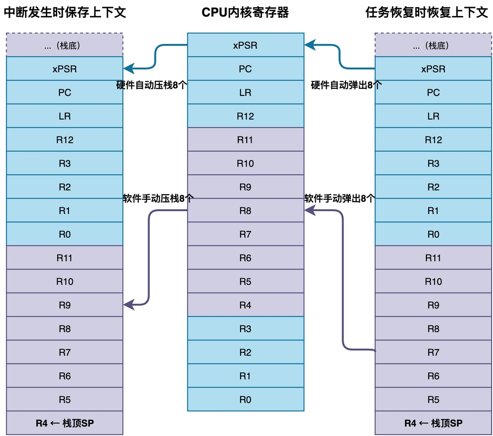
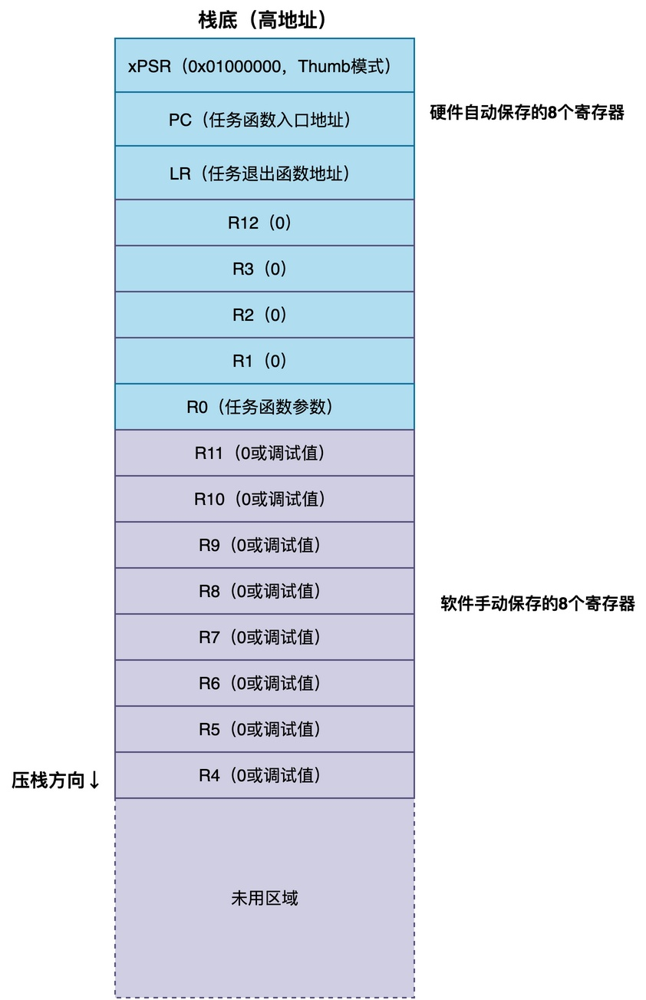

# RTOS创建任务时栈里放了什么？任务栈是如何初始化的？

在我们的课程源码中，创建任务时需要为任务传入一块空的缓冲区用于栈空间。这块栈空间会用于后续任务切换时，保存和恢复任务的上下文。

```c
static cpu_stack_t task1_stack[200];
static os_task_t task1;

static void task1_entry(void *arg)
{
    while (1)
    {
        os_task_sleep(1000);
    }
}

void led_task_run(void)
{
    os_task_init(&task1, "task1", task1_entry,
                 OS_NULL, 0,
                 task1_stack, sizeof(task1_stack));
    os_task_start(&task1);
}
```

可是，当任务第一次被调度运行的时候，RTOS是如何让CPU跳转到任务函数的入口处运行？又是如何让任务能够正确获取传给任务的参数值？要解答这些问题，需要了解任务栈是如何初始化的。

在这篇文章中，我将介绍任务栈是如何初始化的：栈里到底放了些什么东西？为什么要这么放？

## 任务切换过程

首先，我们需要回顾RTOS的任务切换过程。

以Cortex-M架构的处理器为例，任务切换是借助PendSV中断来完成的。当一个任务正在运行的时候，如果触发了PendSV中断，CPU会自动把一部分内核寄存器压到当前任务的栈里，包括xPSR、PC、LR、R12、R0-R3这8个寄存器。然后进入PendSV中断服务程序，再把剩下的R4到R11也手动压栈。这样便完成了任务的上下文保存。



等到要恢复这个任务运行的时候，再反过来，先从栈里弹出R4到R11，然后从中断返回，CPU又会自动从栈里弹出R0-R3、R12、LR、PC、xPSR。

**整个任务切换的过程，对调度器来说就是：保存的时候把寄存器压栈，恢复的时候把寄存器出栈**。

那么，问题来了：<font color="#ff0000">一个刚创建的新任务，从来没有被中断打断过，栈里本来是空的。如果调度器直接从该栈出栈，弹出来的都是垃圾值，任务肯定没有办法运行</font>。
## 伪造任务的“上下文”

**为了简化处理，我们可以在创建任务的时候，在栈里预先填好一份伪造的上下文，就好像这个任务曾经被中断打断过一样。**

通常来说，这份伪造的上下文应该实现至少这两个目的：

第一，让任务恢复的时候，从任务函数开始执行；

第二，让任务函数能够拿到参数。

在Cortex-M架构的CPU上，可以对栈作如下设置。

注意，**这份伪造的上下文必须和任务切换时的上下文保存恢复机制严格对应**，否则恢复出来的寄存器就全乱了。

其次，各个寄存器的初始值如下：

1. **xPSR**：程序状态寄存器，第24位设置为1，表示Thumb模式。
2. **PC**：程序计数器，设置成任务函数的入口地址，以便让任务跳转到任务函数开始执行。
3. **LR**：链接寄存器，设置成任务退出函数的地址。
4. **R12、R3、R2、R1**：这些通用寄存器一般初始化为0就可以。
5. **R0**：参数寄存器，用来传递任务函数的参数。
6. **R11到R4**：这些寄存器也是初始化为0，或者填一个固定的调试值，方便出问题的时候排查。

以上寄存器的值设置，与CPU架构特性、RTOS上下文恢复的方式、编译器有关，这里不便赘述。

我们只需要知道，当将PC设置为任务函数的入口地址、R0寄存器设置为任务参数的值后，当任务开始运行时，CPU会自动跳转到入口函数开始运行，并且可以通过函数参数arg取得参数值。

## 具体实现

下面以RT-Thread的源码为例，看看这个栈初始化具体是怎么做的。在cpuport.c文件中，给出了rt_hw_stack_init()函数：

```c
rt_uint8_t *rt_hw_stack_init(void       *tentry,
                             void       *parameter,
                             rt_uint8_t *stack_addr,
                             void       *texit)
{
    struct stack_frame *stack_frame;
    rt_uint8_t         *stk;

    stk  = stack_addr + sizeof(rt_uint32_t);
    stk  = (rt_uint8_t *)RT_ALIGN_DOWN((rt_uint32_t)stk, 8);
    stk -= sizeof(struct stack_frame);

    stack_frame = (struct stack_frame *)stk;

    /* 把所有寄存器初始化为0xdeadbeef，方便调试 */
    for (i = 0; i < sizeof(struct stack_frame) / sizeof(rt_uint32_t); i ++)
    {
        ((rt_uint32_t *)stack_frame)[i] = 0xdeadbeef;
    }

    stack_frame->exception_stack_frame.r0  = (unsigned long)parameter;
    stack_frame->exception_stack_frame.lr  = (unsigned long)texit;
    stack_frame->exception_stack_frame.pc  = (unsigned long)tentry;
    stack_frame->exception_stack_frame.psr = 0x01000000L;

    return stk;
}
```

这段代码先把栈指针对齐到8字节，然后在栈里留出一个stack_frame大小的空间，将R0、LR、PC、xPSR这几个关键寄存器设置成正确的值，其余寄存器设置为0xdeadbeef用于调试观察。

在PendSV异常处理程序中，完成任务的上下文切换：

```asm
PendSV_Handler:
    // 忽略其他代码
    /* 保存当前任务的上下文 */
    MRS     R1, PSP
    STMFD   R1!, {R4 - R11}
    STR     R1, [R0]

switch_to_thread:
    /* 恢复下一个任务的上下文 */
    LDR     R1, =rt_interrupt_to_thread
    LDR     R1, [R1]
    LDR     R1, [R1]            /* 从任务控制块里取出栈顶指针 */

    LDMFD   R1!, {R4 - R11}     /* 先弹出R4到R11 */
    MSR     PSP, R1             /* 更新PSP为新任务的栈指针 */

pendsv_exit:
    ORR     LR, LR, #0x04       /* 返回线程模式，使用PSP */
    BX      LR                  /* 中断返回，硬件自动弹出剩余寄存器 */
```

其中，switch_to_thread这部分实现任务上下文的恢复。对于初始运行的任务而言，栈的上下文虽是伪造的，但是看起来就像是“任务在运行入口时被打断一样”，当恢复上下文时，CPU自然就从任务的入口函数处开始运行。

**由此可见，整个过程对调度器来说是完全透明的，它不需要知道这是新任务的第一次运行还是旧任务的恢复。**

## 总结

综上所述，RTOS创建任务时会在任务栈里预先填充一份伪造的上下文，以便让新创建的任务也能通过统一的任务切换流程开始运行，调度器不需要区分新任务和旧任务。

其中，最关键的是设置成任务函数的入口地址、以及入口参数的值。具体如何设置，与CPU架构特性、RTOS上下文恢复的方式、编译器有关。

---

> 如果你希望系统地学习RTOS底层原理，可以了解我的《RTOS开发与实战》课程。
>
> 课程不是简单地讲解FreeRTOS API的使用，而是带你从零开始编写一个RTOS内核，逐步实现任务管理、任务调度、上下文切换、同步与通信等核心机制，并通过一个远程温湿度监控设备项目，将操作系统原理应用到实际嵌入式开发中。
>
> 适合希望深入理解RTOS工作原理、提升嵌入式底层开发能力的同学。
>
> [课程详情](/blog/diyrtos/)
