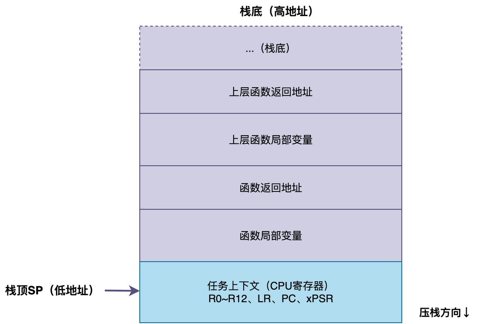
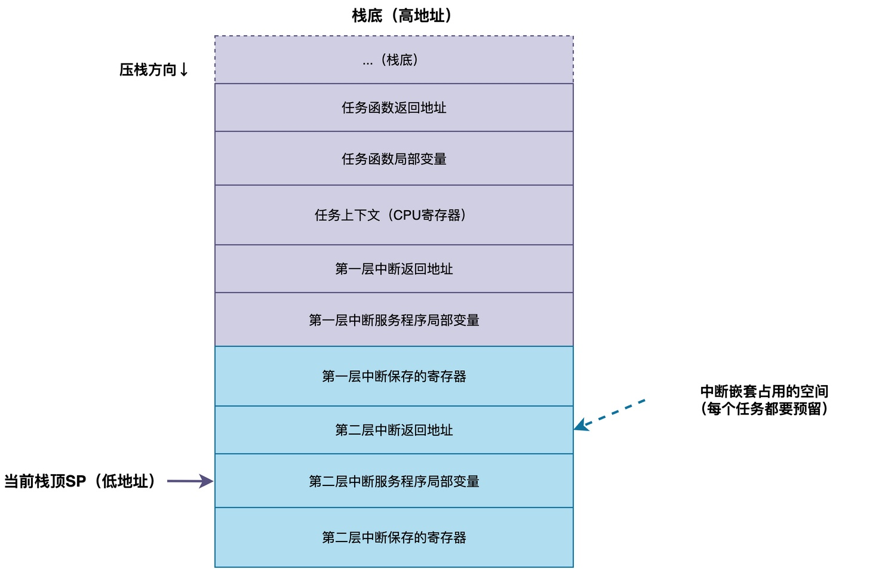
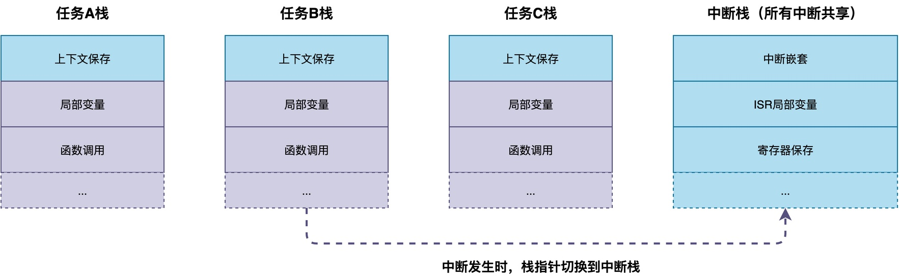
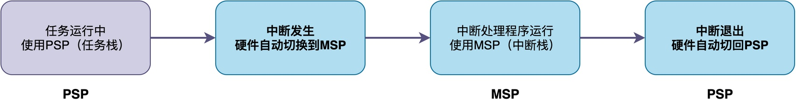

# RTOS中中断栈和任务栈为什么要分离？

在学习RTOS的时候，很多同学会听到一个概念：**中断栈和任务栈分离。** 此时，你可能会有疑问：

> 我知道每个任务之间的栈是分离互不干扰的。为什么还要分中断栈和任务栈？这种分离有什么好处？不分离会怎么样？

在这篇文章中，我将一一对上述问题进行解答。

## 什么是任务栈

在RTOS里，每个任务都有自己的栈，叫任务栈。

**任务栈主要用来保存任务的上下文，也就是CPU各个寄存器的值，以及函数调用的局部变量、返回地址等。由于每个任务的栈是独立的，所以任务切换的时候，只要把栈指针切换到目标任务的栈，就能恢复那个任务的运行状态。**

该栈的大小是创建任务的时候指定的，设置多大取决于这个任务里函数调用有多深、局部变量有多少。

## 不分离栈会有什么问题

当中断发生的时候，CPU要去执行中断服务程序。执行的时候也要用栈，用于保存寄存器、局部变量及函数调用的返回地址。那么，问题来了，中断服务程序应该用谁的栈？

**最简单的做法就是：用当前正在运行的那个任务的栈**。中断来了，就在当前任务的栈上保存上下文，执行中断处理函数，用完了再恢复。这样做实现起来最简单，不需要额外的处理。

不过，这样做有一个问题：**每个任务的栈都必须足够大，大到能容纳最坏情况下中断处理需要的栈空间。并且，如果支持中断嵌套的话，还要考虑多层中断嵌套的栈使用量**。

例如，当系统里有20个任务时，每个任务的栈都要预留出中断处理需要的那部分空间。假设中断处理最坏需要512字节，那20个任务就多占用了20x512=10KB的内存。这在资源紧张的MCU上，是无法忍受的。

## 分离栈之后的好处

中断栈分离就是为了解决这个问题，这做法很简单，具体如下图所示：

首先，在内存里专门划出一块空间，作为中断栈，所有的中断处理都用这个栈。

其次，当中断发生的时候，把栈指针切换到中断栈，在中断栈上保存上下文、执行中断处理函数。

最后，中断退出的时候，再把栈指针切回原来的任务栈。

由此可见，这样做的好处很明显：

1. **节省内存**：不管系统有多少个任务，只需要一个中断栈就够了。
2. **任务栈评估更简单**：评估任务栈大小的时候，不需要考虑中断处理的栈使用量。
3. **中断栈可以单独优化**：中断栈的大小可以单独评估和调整，和任务栈完全独立，互不影响。

## Cortex-M对栈分离的支持

那么，具体到某种特定的CPU架构，栈是如何切换的？下面以Cortex-M为例说明。

在Cortex-M处理器上，**有两个栈指针：主栈指针MSP和进程栈指针PSP，复位之后默认用MSP**。

**RTOS启动之后，会把任务的栈指针设置到PSP，CPU使用PSP进行压栈和出栈；而中断发生的时候，CPU会自动用MSP来处理中断；当中断退出的时候，再自动切回PSP。**

所以在Cortex-M上，中断栈分离几乎是免费的，硬件自动帮你做了切换，你只需要把MSP的栈设置好就行了。这也是为什么Cortex-M的RTOS基本上都用中断栈分离的原因。

至于具体栈是如何切换完成的、涉及到哪些操作、哪些寄存器配置，由于篇幅有限，本文不便说明。

## 总结

综上所述，中断栈和任务栈分离，指的是中断处理用的栈和任务用的栈分开，所有任务共享一个独立的中断栈。

这样做的主要好处是节省内存，不需要每个任务都预留中断处理的栈空间，同时也让任务栈大小的评估更简单。在Cortex-M处理器上，CPU会自动切换所用的栈。

---

> 如果你希望系统地学习RTOS底层原理，可以了解我的《RTOS开发与实战》课程。
>
> 课程不是简单地讲解FreeRTOS API的使用，而是带你从零开始编写一个RTOS内核，逐步实现任务管理、任务调度、上下文切换、同步与通信等核心机制，并通过一个远程温湿度监控设备项目，将操作系统原理应用到实际嵌入式开发中。
>
> 适合希望深入理解RTOS工作原理、提升嵌入式底层开发能力的同学。
>
> [课程详情](/blog/diyrtos/)
