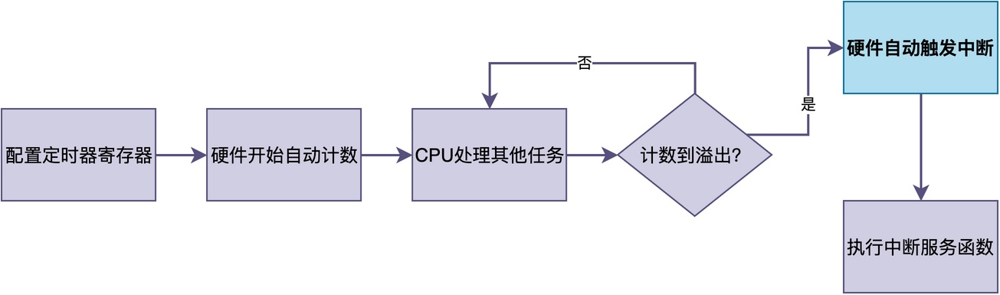
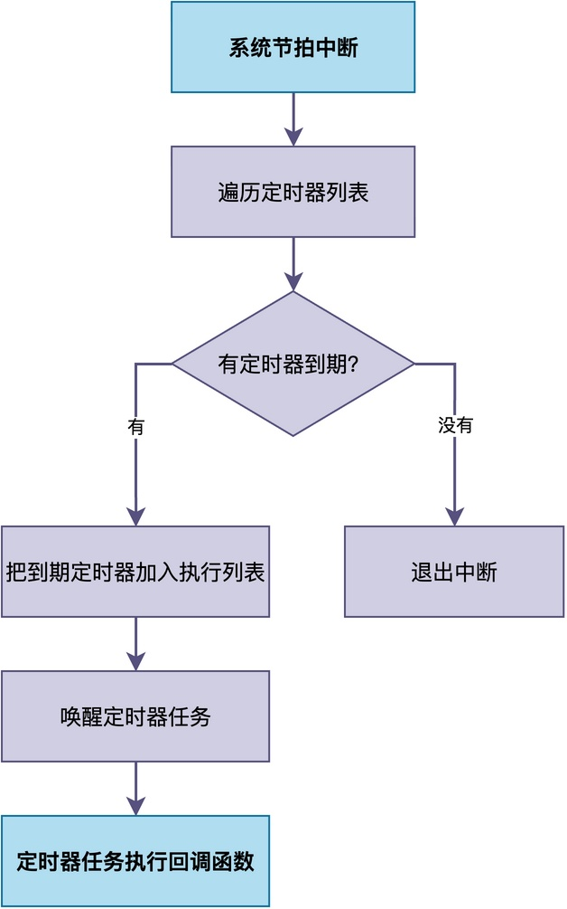
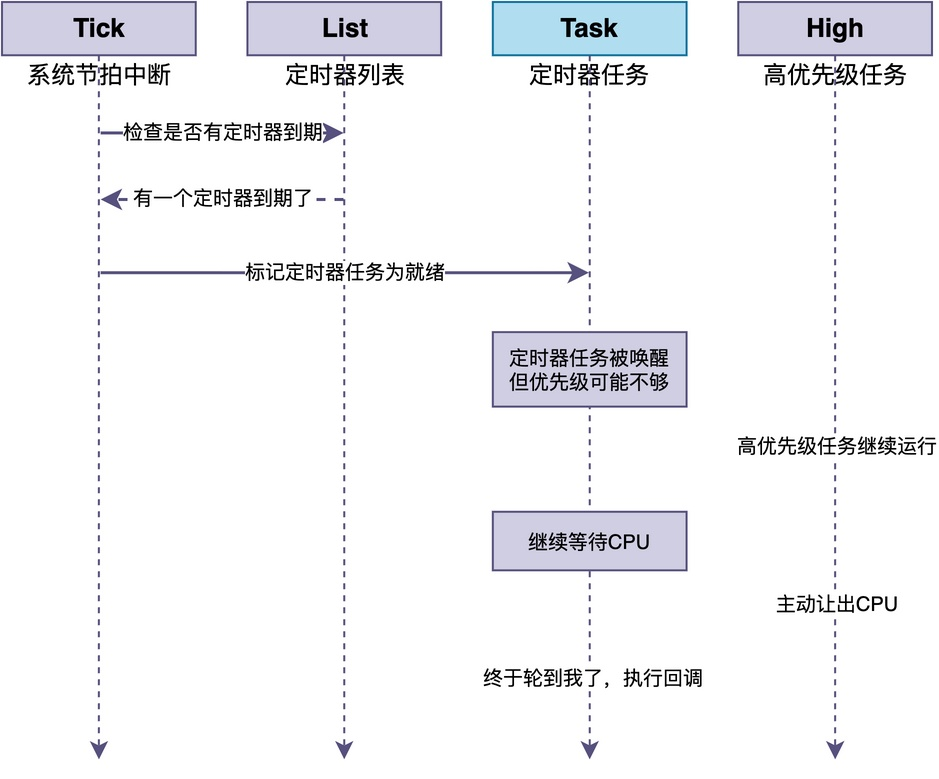
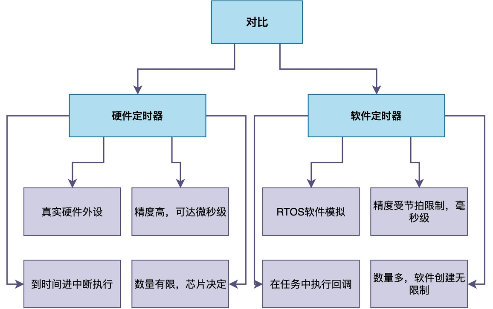

# 软件定时器和硬件定时器有什么区别？

有同学在做项目的时候问我：RT-Thread里有个rt_timer_create()可以创建软件定时器，但是MCU本身也有硬件定时器外设，那我到底该用哪个，软件定时器和硬件定时器到底有什么区别。

> [!note]
> 他的困惑很有代表性：
>
> > 一个是OS提供的API，一个是芯片自带的外设，看起来都能定时，可真到选型的时候就犯难了。
>
> 这两种定时器，本质上根本不是一回事。
>
> 这篇文章我就来把这两种定时器讲明白，以后再遇到就知道该挑哪个。

## 硬件定时器：芯片里真实存在的外设

先说硬件定时器。每颗MCU里面，都有若干个硬件定时器外设。它们是真实的硬件电路，有自己的计数器寄存器、自动重装载寄存器、比较寄存器。

你配置好定时器的分频系数和重装载值，它就自己开始计数。数到溢出了，硬件自动触发中断。整个过程不需要CPU干预，CPU该干嘛干嘛，时间到了硬件会主动通知你。


硬件定时器的优点是精度高、不占CPU、到时间一定进中断。你可以用它做微秒级的延时、做PWM输出、做输入捕获。这些对精度要求很高的事情，软件定时器是做不到的。

## 软件定时器：RTOS用软件模拟出来的

软件定时器就不一样了。它不是真实的硬件，而是RTOS内核用软件模拟出来的功能。

RTOS内部维护一个定时器列表。你调用rt_timer_create()创建一个软件定时器的时候，内核会给它分配一个控制块，记录到期时间，然后把这个定时器挂到列表上。

每次系统节拍中断触发的时候，内核会遍历这个定时器列表，检查有没有到期的定时器。如果有，就把它标记为超时。


注意这里的关键点，回调函数不是在中断里执行的，而是在一个专门的定时器任务里执行的。

这意味着什么呢？意味着即使定时器到时间了，回调函数也不一定马上执行。如果此时有更高优先级的任务在运行，定时器任务就得等着。只有等高优先级任务阻塞或者退出了，定时器任务才有机会跑起来，去执行回调函数。


## 两者的核心区别

我来把两者的差别总结一下：


## 使用场景怎么选

那实际开发的时候，到底该用哪个呢？我的建议是这样的。

1. 对精度要求高的：比如做PWM、做精确延时、做输入捕获，用硬件定时器。
2. 对精度要求不高的：比如每隔1秒采集一次数据、每隔500ms刷新一下LED，用软件定时器就够了。
3. 需要大量定时器的：比如系统里有十几个定时任务，硬件定时器数量不够，就用软件定时器。
4. 回调函数里要做复杂处理的：用软件定时器，因为回调在任务上下文，不会占用中断时间。

还有一点要特别注意，软件定时器的回调函数里，不能调用会阻塞的API。因为回调函数是在定时器任务的上下文中执行的，如果你在回调里调用rt_thread_mdelay()或者rt_sem_take()永久等待，那整个定时器任务就被你卡住了，后面其他软件定时器的回调都没法执行。

```c
/* 软件定时器的回调函数示例 */
void timer_callback(void *parameter)
{
    /* 这里只能做简短的处理 */
    /* 不能调用rt_thread_mdelay() */
    /* 不能调用rt_sem_take()永久等待 */

    static int count = 0;
    count++;
    rt_kprintf("定时器触发了，第%d次\n", count);
}

/* 创建并启动软件定时器 */
rt_timer_t timer;
timer = rt_timer_create("timer1",
                        timer_callback,
                        RT_NULL,
                        1000,    /* 1000个tick，即1秒 */
                        RT_TIMER_FLAG_PERIODIC);  /* 周期性定时器 */

if (timer != RT_NULL)
{
    rt_timer_start(timer);
}
```

## 综上所述

硬件定时器和软件定时器各有各的用途。硬件定时器精度高、响应快，但数量有限；软件定时器数量多、使用灵活，但精度受限于系统节拍，而且回调函数有执行延迟。搞清楚它们的区别，才能在合适的场景选对合适的工具。

## 写在最后

如果只停留在会调用rt_timer_create()，是想不明白软件定时器为什么不能在中断里执行回调、为什么要专门搞一个定时器任务的。亲手实现过定时器列表的管理和回调执行流程，你就知道为什么回调不能阻塞，也理解RTOS为什么要这样设计了。

---

> 如果你希望系统地学习RTOS底层原理，可以了解我的《RTOS开发与实战》课程。
>
> 课程不是简单地讲解FreeRTOS API的使用，而是带你从零开始编写一个RTOS内核，逐步实现任务管理、任务调度、上下文切换、同步与通信等核心机制，并通过一个远程温湿度监控设备项目，将操作系统原理应用到实际嵌入式开发中。
>
> 适合希望深入理解RTOS工作原理、提升嵌入式底层开发能力的同学。
>
> [课程详情](/blog/diyrtos/)
