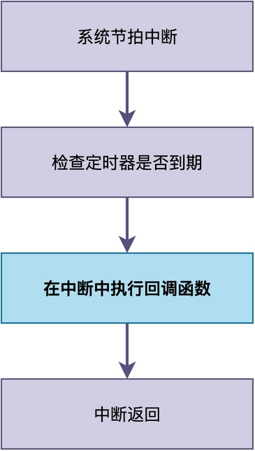
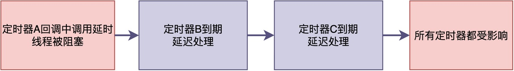
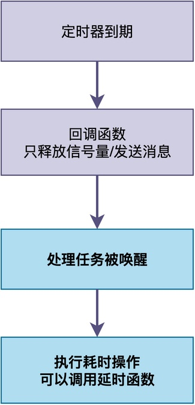

# RTOS软件定时器到期后，可以在回调函数中调用延时函数吗？

碰到有位同学咨询我一个关于软件定时器的使用问题。在他的工程中，他写了类似下面的代码：

```c
void timer_callback(void *parameter)
{
    /* 定时器到期后，做一些操作 */
    do_something();

    /* 延时100毫秒 */
    rt_thread_mdelay(100);

    /* 再做一些操作 */
    do_other_thing();
}
```

运行后发现，其他定时器的执行都被大大延后了。这是为什么呢？

你可能猜到问题出在rt_thread_mdelay()调用上，那么：

> 这个调用为什么会影响其他定时器的执行？
> 到底能不能调用延时函数？能不能调用等待信号量等阻塞函数？
> 如果不能调用，又该怎么办？

在今天的这篇文章中，我们就来好好聊一聊这个问题。

## 定时器的回调函数在哪里执行

首先，我们需要先搞清楚：**定时器的回调函数到底是在什么上下文中执行的？**

不同的RTOS有不同的做法。以RT-Thread为例，定时器有两种模式：硬件定时器和软件定时器。

### 硬件定时器回调

在硬件定时器中，定时器的回调函数是在系统节拍中断的上下文中执行的。


这里以ARM Cortex-M + RT-Thread架构为例，系统节拍中断处理函数SysTick_Handler()的实现如下：

```c
void SysTick_Handler(void)
{
    /* 进入中断 */
    rt_interrupt_enter();

    /* 系统tick加1，并检查定时器 */
    rt_tick_increase();

    /* 离开中断 */
    rt_interrupt_leave();
}
```

在rt_tick_increase()函数中，会调用rt_timer_check()来检查并处理到期的硬件定时器。在该函数中，如果发现定时器时间到，则调用相应的回调函数（具体代码略）。

```c
/* 简化版本实现 */
void rt_tick_increase(void)
{
    struct rt_thread *thread;

    /* 全局tick加1 */
    ++rt_tick;

    /* 检查当前线程的时间片 */
    thread = rt_thread_self();
    --thread->remaining_tick;
    if (thread->remaining_tick == 0)
    {
        thread->remaining_tick = thread->init_tick;
        rt_thread_yield();
    }

    /* 检查硬件定时器，到期的话直接调用回调函数 */
    rt_timer_check();
}
```

**由此可见，硬件定时器的回调函数是在SysTick中断中被调用的。**

### 软件定时器回调

在软件定时器模式下，RT-Thread创建了一个专门的定时器任务，用于执行定时回调函数。

```c
void rt_system_timer_thread_init(void)
{
    /* .....略..... */
    /* start software timer thread */
    rt_thread_init(&_timer_thread,
                   "timer",
                   _timer_thread_entry,
                   RT_NULL,
                   &_timer_thread_stack[0],
                   sizeof(_timer_thread_stack),
                   RT_TIMER_THREAD_PRIO,
                   10);

    /* startup */
    rt_thread_startup(&_timer_thread);
}
```

该任务的入口函数是_timer_thread_entry()，其源码如下所示。

```c
static void _timer_thread_entry(void *parameter)
{
    rt_tick_t next_timeout;

    while (1)
    {
        /* get the next timeout tick */
        if (_timer_list_next_timeout(_soft_timer_list, &next_timeout) != RT_EOK)
        {
            /* no software timer exist, suspend self. */
            rt_thread_suspend(rt_thread_self());
            rt_schedule();
        }
        else
        {
            rt_tick_t current_tick;

            /* get current tick */
            current_tick = rt_tick_get();

            if ((next_timeout - current_tick) < RT_TICK_MAX / 2)
            {
                /* get the delta timeout tick */
                next_timeout = next_timeout - current_tick;
                rt_thread_delay(next_timeout);
            }
        }

        /* check software timer */
        rt_soft_timer_check();
    }
}
```

从上图代码可以看出，rt_soft_timer_check()函数会遍历软件定时器列表，找到到期的定时器，然后调用它的回调函数。

由此可见，**软件定时器的回调函数是在定时器任务中执行的**。

## 能否在回调函数中调用延时函数

了解了回调函数的执行上下文后，我们再来看为什么不建议在回调函数中调用延时函数。
### 硬件定时器：绝对不能

**对于硬件定时器来说，不能调用任何会阻塞的函数，如延时或等待信号量等。**

中断处理函数需要尽快执行完毕并返回，如果调用了阻塞函数，那么中断可能会长时间无法返回，使得：

- 其他中断无法得到响应，包括系统时钟节拍中断。
- 系统任务调度无法正常进行。
- 整个系统看起来就像卡死了一样。

### 软件定时器：可以但不建议

对于软件定时器来说，它的回调函数是在定时器线程中执行的，属于线程上下文。

**理论上，在线程中是可以调用延时函数等阻塞函数的；但是，不建议这么做。**

在整个系统中，**只有一个定时器任务，负责处理所有的软件定时器。当多个定时器时间到达时，定时器任务会依次调用各个定时器的回调函数**。如果在一个定时器的回调函数中调用了阻塞函数，那么其他定时器回调将被延后。

例如，定时器A、B、C的定时都到期时，A的回调函数可能先执行。如果A的回调函数中调用了延时函数，那么B、C的回调函数只有在A延时到达之后，才会被调用。


这就好比一个邮局只有一个营业员，如果他在处理一个客户的业务时停下来喝了杯茶，那后面排队的所有客户都得等着。

这种做法将使得：其他所有定时器到期了都无法及时处理，后续定时器的触发时间都会被推迟，定时误差会累积。

## 正确的做法是什么

那么，如果需要执行耗时的操作，或者需要调用延时函数，应该怎样处理呢？

更好的做法是：**仅在回调函数中做最简单的通知工作，通过信号量等机制通知专门的任务来完成**。


下面给出一段示例代码。timer_callback()通过释放信号量sem，来通知process_task()任务完成耗时操作，并调用延时函数。

```c
/* 定义一个信号量，用于定时器和任务之间的同步 */
static struct rt_semaphore sem;

/* 软件定时器回调函数 */
void timer_callback(void *parameter)
{
    /* 只做最简单的通知：释放信号量 */
    rt_sem_release(&sem);
}

/* 专门的处理任务 */
void process_task(void *parameter)
{
    while (1)
    {
        /* 等待定时器到期的通知 */
        rt_sem_take(&sem, RT_WAITING_FOREVER);

        /* 在这里执行耗时操作，可以调用延时函数 */
        do_something_time_consuming();
        rt_thread_mdelay(100);
    }
}
```

## 总结

简单来说，**定时器回调函数中是否能调用延时阻塞函数，取决于回调函数的执行上下文。**

1. 中断上下文：绝对不能调用延时函数或其他阻塞函数。
2. 任务上下文：理论上可以，但仍然不建议，因为会影响其他定时器的处理。

实际项目中，最佳的做法是：**在回调函数中只做最简单的通知工作，然后由一个专门的任务来执行这些操作。**

---

> 如果你希望系统地学习RTOS底层原理，可以了解我的《RTOS开发与实战》课程。
>
> 课程不是简单地讲解FreeRTOS API的使用，而是带你从零开始编写一个RTOS内核，逐步实现任务管理、任务调度、上下文切换、同步与通信等核心机制，并通过一个远程温湿度监控设备项目，将操作系统原理应用到实际嵌入式开发中。
>
> 适合希望深入理解RTOS工作原理、提升嵌入式底层开发能力的同学。
>
> [课程详情](/blog/diyrtos/)
