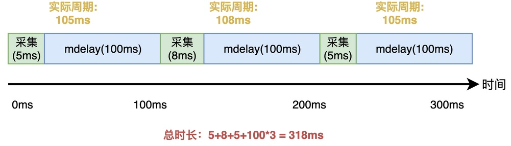
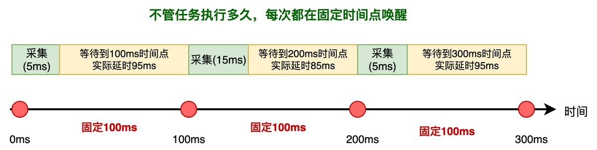
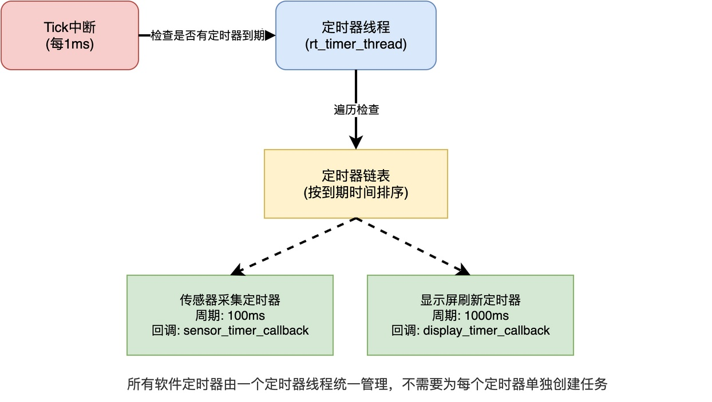

# RTOS中如何实现任务的周期性执行？

在做物联网项目时，我们经常需要让某个功能每隔固定时间执行一次。比如，希望传感器能够每隔100毫秒采集一次数据，显示屏每隔一秒钟刷新一次显示内容。

对于这样的周期性任务，在RTOS中应该怎样去实现呢？在这篇文章中，我将介绍三种不同的实现方式。

## 第一种方式：相对延时

最简单的方法，就是在任务的while(1)循环里，调用延时函数，例如：

```c
static void sensor_thread_entry(void *parameter)
{
    while (1)
    {
        read_sensor();        /* 采集传感器数据 */
        rt_thread_mdelay(100); /* 延时100毫秒 */
    }
}
```

这种方式采用的是相对延时。**所谓相对延时，就是从调用延时函数的那一刻开始算，延时固定时间后再唤醒**。

这种方式虽然简单，但实际运行后，会发现周期并不精确。问题出在哪里呢？

这是因为rt_thread_mdelay(100)只保证延时100毫秒，但没有算上read_sensor()本身执行花的时间。如果read_sensor()执行需要5毫秒，则实际的周期就是105毫秒。此外，考虑到read_sensor()执行期间可能被被更高优先级的任务抢占，实际周期就更长了。

此外，**这个误差会一直累积，随着运行的时间越长，偏差就越大**。



从这个时序图可以看到，第一次执行花了5毫秒，实际周期就是105毫秒；第二次执行花了8毫秒，实际周期就是108毫秒；第三次实际周期为105ms毫秒。三次采用的耗时为318ms，而我们可能希望的是300ms。

所以，**相对延时只适合对周期精度要求不高的场景**，比如闪烁指示灯、刷新状态显示等。

## 第二种方式：绝对延时

如果对周期精度要求比较高，就需要用绝对延时。

绝对延时的思路是：**不管read_sensor()执行花了多长时间，也不管中间被抢占了多久，只保证每次都在固定的时间点被唤醒**。

采用这种方式的具体做法如下所示：

```c
static void sensor_thread_entry(void *parameter)
{
    rt_tick_t next_wakeup_time;

    /* 记录第一次唤醒的时间点 */
    next_wakeup_time = rt_tick_get();

    while (1)
    {
        read_sensor();  /* 采集传感器数据 */

        /* 延时到指定的时间点，函数内部会自动更新next_wakeup_time */
        rt_thread_delay_until(&next_wakeup_time,
                              rt_tick_from_millisecond(100));
    }
}
```

可以看到，此处用的是rt_thread_delay_until()。这个函数的第一个参数是指向上一次唤醒时间的指针，第二个参数是每次要增加的时间。**函数内部会自动计算下一次应该唤醒的时间点，然后把任务延时到那个时间点，同时更新指针指向的变量。如果当前时间已经超过了目标时间点，就立即返回**。

通过这种方式，每次延时的时候，不是从当前时间开始算，而是。。。。



从这个图可以看到，不管执行花了5毫秒，还是被抢占了20毫秒，任务每次都会在固定的100毫秒、200毫秒、300毫秒这些时间点被唤醒。

这样一来，read_sensor()的执行周期始终是准确的100毫秒。

## 第三种方式：软件定时器

除了在任务里用延时的方式，还可以用软件定时器来实现周期性执行。

**软件定时器是RTOS提供的一种定时机制**。我们可以**设置一个定时时间，时间到了之后，RTOS会自动调用注册的回调函数**。定时器可以设置成单次触发，也可以设置成周期触发。



**通常情况下，所有的软件定时器都是由一个专门的定时器任务统一管理的。当每次Tick中断发生时，定时器任务就去检查有没有定时器到期，如果有就调用对应的回调函数**。用户只需要创建定时器、设置回调函数、启动定时器，不需要为每个周期性工作单独创建一个任务。

以RT-Thread为例，周期性定时器的使用方法如下：

```c
static rt_timer_t sensor_timer;

static void sensor_timer_callback(void *parameter)
{
    /* 定时器到期，在这里执行周期性工作 */
    read_sensor();
}

int main(void)
{
    /* 创建定时器，周期触发 */
    sensor_timer = rt_timer_create("sensor",
                                   sensor_timer_callback,
                                   RT_NULL,
                                   rt_tick_from_millisecond(100),
                                   RT_TIMER_FLAG_PERIODIC);

    /* 启动定时器 */
    rt_timer_start(sensor_timer);
    return 0;
}
```

这样设置之后，每隔100毫秒，定时器任务就会调用一次read_sensor()。

可以看到，这种方式不需要单独创建一个任务，节省任务栈和TCB的开销。不过，由于定时器回调函数是在定时器任务的上下文里执行，因此不能调用阻塞API，也不能执行耗时的操作。

## 三种方式的适用场景

综上所述，RTOS中实现任务周期性执行主要有三种方式：相对延时、绝对延时和软件定时器。这三种方式的适用场景如下：

1. **相对延时**：写法简单、不准确且有误差累积，适合对周期精度要求不高的场景。
2. **绝对延时**：通过固定唤醒时间点消除了误差累积，较精确，适合对周期精度要求高、任务执行时间不固定的场景。
3. **软件定时器**：不需要单独创建任务，节省资源，但不能执行阻塞或太耗时的操作，适合轻量的周期性操作。

在实际项目中，可以根据具体的需求灵活选择。

---

> 如果你希望系统地学习RTOS底层原理，可以了解我的《RTOS开发与实战》课程。
>
> 课程不是简单地讲解FreeRTOS API的使用，而是带你从零开始编写一个RTOS内核，逐步实现任务管理、任务调度、上下文切换、同步与通信等核心机制，并通过一个远程温湿度监控设备项目，将操作系统原理应用到实际嵌入式开发中。
>
> 适合希望深入理解RTOS工作原理、提升嵌入式底层开发能力的同学。
>
> [课程详情](/blog/diyrtos/)
