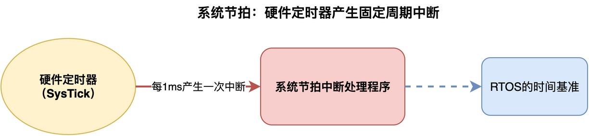
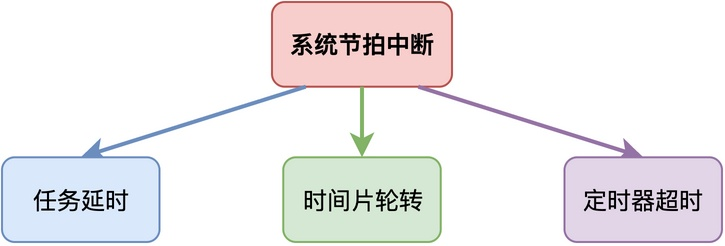
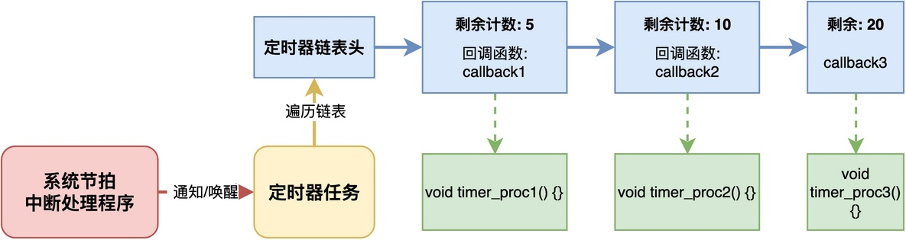
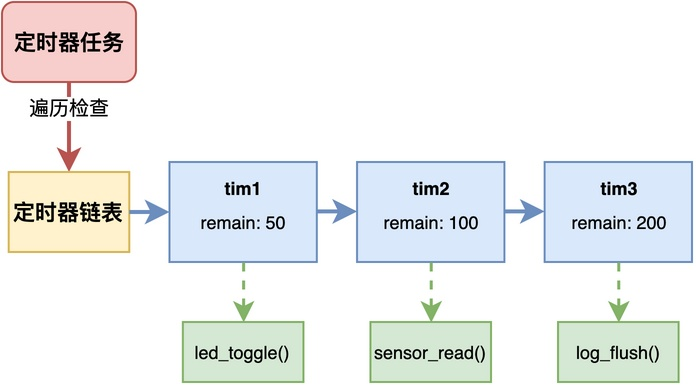

# RTOS是如何做到基于一个硬件定时器实现多个软件定时器？

很多RTOS会提供一种叫做软件定时器的机制。

这种机制允许我们在系统内存资源足够的情况下，创建任意多个定时器。**利用这些定时器，可以指定在指定的时间调用特定的处理函数，从而可以不受硬件定时器的数量限制**。

例如，在RT-Thread中，我们可以创建如下的定时器，用于周期性闪烁LED灯。

```c
static rt_timer_t timer1;

static void timeout_cb(void *parameter)
{
    rt_pin_write(LED_PIN, !rt_pin_read(LED_PIN));
}

int main(void)
{
    timer1 = rt_timer_create("timer1", timeout_cb, RT_NULL,
                             1000, RT_TIMER_FLAG_PERIODIC);
    rt_timer_start(timer1);
}
```

不知道你有没有想过这样一个问题：RTOS是如何做到这一点的？在这篇文章中，我将介绍这种定时器的一般实现原理。

## 核心是系统节拍

要理解软件定时器的实现，首先要理解系统节拍（Tick）这个概念。

RTOS通常会使用一个硬件定时器，比如Cortex-M的SysTick定时器，配置成每隔固定的时间（如1ms）产生一次中断。**这个固定的时间间隔就是系统节拍，它是整个RTOS的时间基准**。



无论是任务的延时，还是时间片轮转、定时器超时，所有和时间相关的功能，都是基于这个系统节拍来实现的。**系统节拍中断就像"心跳"，每跳一下，内核就检查一下有没有到期的任务、有没有到期的定时器**。



所以，**RTOS只需要一个硬件定时器来产生系统节拍，其他所有的时间相关功能都可以基于这个节拍来软件实现**。

## 软件定时器的实现原理

软件定时器的实现思路其实很简单，其中一种实现方法是创建专门的定时器任务。

**内核会维护一个软件定时器的链表，每个定时器节点里保存了这个定时器的定时时间、回调函数、以及剩余节拍数。创建定时器的时候，把定时时间转换成对应的节拍数，存到剩余节拍数里。**



每次系统节拍中断到来，就会唤醒这个定时器任务，由定时器任务去遍历这个定时器链表，将每个定时器的剩余计数减1。当定时器的剩余计数减到0的时候，就说明这个定时器到期了，内核就调用它的回调函数。

对于周期性定时器，还需要剩余计数重新设为定时周期，继续下一轮；而如果是单次定时器，就把它从链表里移除。

这样一来，只需要内存资源足够，我们就能创建任意多个定时器，用于实现周期性的事件处理或者在指定时间执行某项工作。

当然，不同的RTOS可能会采用不同的实现方式。但不管采用哪种方式，本质上的原理都是一样的：基于系统节拍，通过遍历链表来检查定时器是否到期。

## 具体实现

了解了基本原理之后，这里以我的《从0手写嵌入式操作系统》课程中设计的RTOS为例，来看看软件定时器具体是怎么设计的。

在该RTOS中，**软件定时器基于链表进行管理。每个定时器是一个结构体，里面嵌入了一个链表节点，这样所有的定时器就可以通过链表串起来**。定时器的结构体定义大致如下：

```c
typedef struct _os_timer_t {
    os_list_item_t item;      // 链表节点，嵌入在结构体中
    char name[OS_TIMER_NAME_SIZE];
    uint32_t init_ticks;      // 初始定时节拍数
    uint32_t remain_ticks;    // 剩余节拍数
    uint8_t flag;             // 定时器标志：单次/周期
    void (*callback)(void *); // 到期回调函数
    void * arg;               // 回调函数参数
} os_timer_t;
```

在内核中，维护了一个定时器链表timer_list，所有创建的定时器都挂在这个链表上：

```c
os_list_t timer_list;    // 定时器链表
```

在系统初始化的时候，会创建一个专门的定时器任务。该定时器任务的工作很简单：被系统节拍中断唤醒后，遍历定时器链表，把每个定时器的剩余节拍数减1，如果减到0了，就调用对应的回调函数。



这样设计的好处是，**定时器的回调函数是在任务上下文中执行的**，而不是在中断上下文中执行的，不影响中断响应时间。

## 总结

综上所述，RTOS通过维护一个软件定时器链表，并定时扫描该链表、调用到期定时器的回调函数，来实现任意多个软件定时器。

具体不同的RTOS，可能采用某种特定的链表结构、执行不同的扫描算法，但核心原理是相同的。

---

> 如果你希望系统地学习RTOS底层原理，可以了解我的《RTOS开发与实战》课程。
>
> 课程不是简单地讲解FreeRTOS API的使用，而是带你从零开始编写一个RTOS内核，逐步实现任务管理、任务调度、上下文切换、同步与通信等核心机制，并通过一个远程温湿度监控设备项目，将操作系统原理应用到实际嵌入式开发中。
>
> 适合希望深入理解RTOS工作原理、提升嵌入式底层开发能力的同学。
>
> [课程详情](/blog/diyrtos/)
