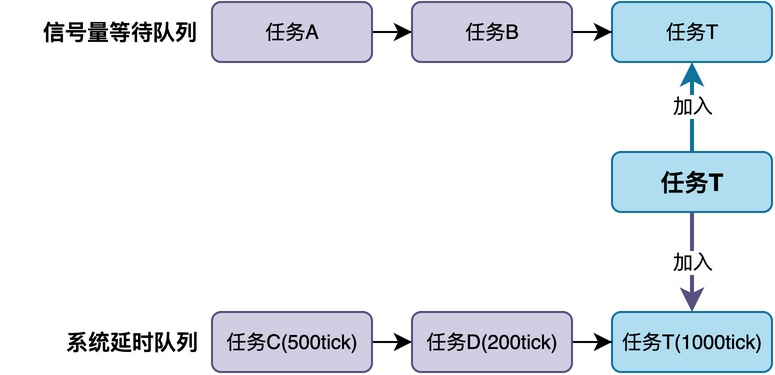
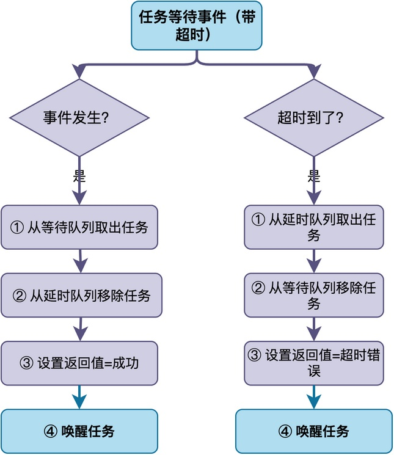

# RTOS中任务的等待超时是怎么实现的？

在使用RTOS做项目的时候，我们经常会调用类似os_sem_wait(sem, 1000)这样的函数。

其中，函数的第二个参数表示超时时间，也就是最多等信号量1000毫秒。也就是说，如果1000毫秒内等不到信号量，函数就会自动返回，这样就避免了任务一直等下去。

不知道你有没有好奇：这种超时机制到底是怎么实现的？这篇文章将以我的《从0手写嵌入式操作系统》为例，介绍这种等待超时是如何实现的。
## 问题难点

首先，我们可以先想一下这个问题的难点在哪。

当任务调用os_sem_wait(sem, 1000)的时候，任务其实是在等待以下两个条件中的任意一个：

1. **事件发生**：当其他任务或者中断释放这个信号量，任务应该被唤醒。
2. **超时到了**：当等了1000毫秒还没等到信号量时，任务也应该被唤醒。

在实际系统中，这两个条件谁先发生、谁后发生是不确定的。RTOS怎么同时管理这两个条件呢？

## 解决方法

为了解决这个问题，**常见的解决方法是：将任务同时挂到两个队列上。**



第一个队列是IPC对象的等待队列。我们知道每个信号量、消息队列等IPC对象，内部都维护一个等待队列，所有正在等这个对象的任务都挂在这个链表上。

第二个队列是系统的延时队列。所有正在延时的任务或者正在等待超时的任务都挂在这个队列上，按超时时间排序。每个系统节拍中断里都会检查这个队列，看有没有任务的超时时间到了。

因此，**当任务调用带超时的os_sem_wait()的时候，RTOS将这个任务同时挂到信号量的等待队列和系统的延时队列上，再切换到其他任务运行**。

当任务挂到两个队列之后，可能会出现两种唤醒方式，这两种方式如下：



**第一种是事件先发生**。当其他任务或中断释放了信号量，RTOS从等待队列里取出任务并唤醒。与此同时，将任务从延时队列里也移除掉。移除之后把任务的返回值设为成功。

**第二种是超时先发生**。系统节拍中断检查延时队列，发现这个任务的超时时间到了，就从延时队列里取出它准备唤醒。与此同时，将任务从等待队列里也移除掉。移除之后把任务的返回值设为超时错误。

也就是说，不管是哪种情况，唤醒任务的时候会将任务从两条队列中都移除。
## 具体实现

下面，我们以《从0手写嵌入式操作系统》中的手写RTOS源码为例，看看这个过程具体是怎么实现的。

在该RTOS内部，无论是信号量还是消息队列，都会调用核心函数os_event_wait()。该函数负责把任务同时挂到等待队列和延时队列上：

```c
void os_event_wait (os_event_t * event, void * reason, int ms) {
    os_task_t * self = os_task_self();

    /* 初始化等待事件结构 */
    task_wait_init(&self->event_wait, event, reason);

    /* 从就绪队列移除，加入延时队列 */
    os_sched_remove_ready(self);
    if (ms > 0) {
        os_sched_set_delay(self, ms);
    }

    /* 再插入到IPC对象的等待队列中 */
    os_event_insert_task(event, self);
}
```

当事件发生时（如信号量唤醒），会调用唤醒函数os_event_notify()。该函数负责把任务从等待队列里取出来，同时从延时队列里移除：

```c
os_task_t * os_event_notify (os_event_t * event) {
    os_task_t * task = (os_task_t *)os_list_first(&event->wait_list);
    if (task == OS_NULL) {
        return OS_NULL;
    }

    /* 从等待队列中移除 */
    os_event_remove_task(event, task);

    /* 如果有延时，从延时队列中移除 */
    if (task->flags & OS_TASK_STATE_DELAYED) {
        os_sched_remove_delay(task);
    }

    /* 加入就绪队列 */
    os_sched_set_ready(task);
    return task;
}
```

而在系统节拍中断处理函数里，会调用os_sched_time_tick()。该函数检查延时队列里有没有任务超时，如果有则把任务从等待队列里移除并唤醒：

```c
void os_sched_time_tick (void) {
    os_task_t * task = (os_task_t *)os_list_first(&os_core.delay_list);
    while (task) {
        os_task_t * next = (os_task_t *)os_list_item_next(&os_core.delay_list, task);
        if (--task->delay_tick == 0) {
            if (task->flags & OS_TASK_STATE_WAIT) {
                /* 任务在等待IPC对象，超时了，通知它超时 */
                os_event_notify_task(task->event_wait.event, task, OS_NULL, OS_ERR_TMO);
            } else {
                /* 任务只是在延时，直接唤醒 */
                os_sched_remove_delay(task);
                os_sched_set_ready(task);
            }
        }
        task = next;
    }
}
```
## 总结

综上所述，RTOS的等待超时是通过双重队列实现的：**任务同时挂到IPC对象的等待队列和系统的延时队列，只要两个条件任一满足就唤醒任务。**

---

> 如果你希望系统地学习RTOS底层原理，可以了解我的《RTOS开发与实战》课程。
>
> 课程不是简单地讲解FreeRTOS API的使用，而是带你从零开始编写一个RTOS内核，逐步实现任务管理、任务调度、上下文切换、同步与通信等核心机制，并通过一个远程温湿度监控设备项目，将操作系统原理应用到实际嵌入式开发中。
>
> 适合希望深入理解RTOS工作原理、提升嵌入式底层开发能力的同学。
>
> [课程详情](/blog/diyrtos/)
