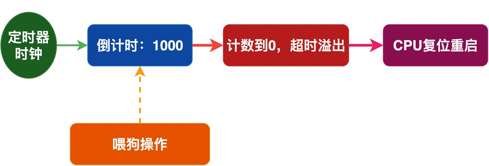
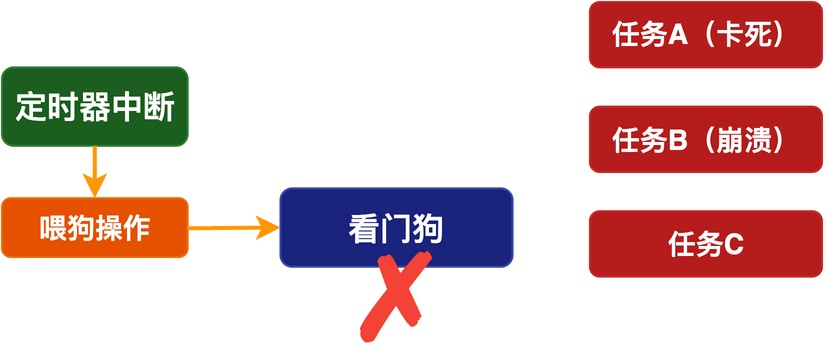
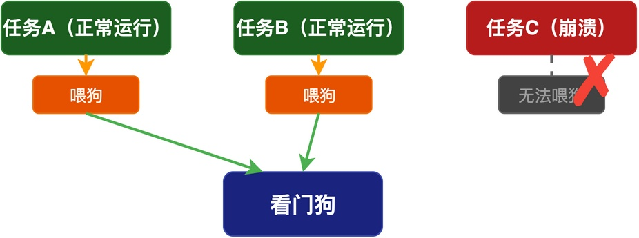
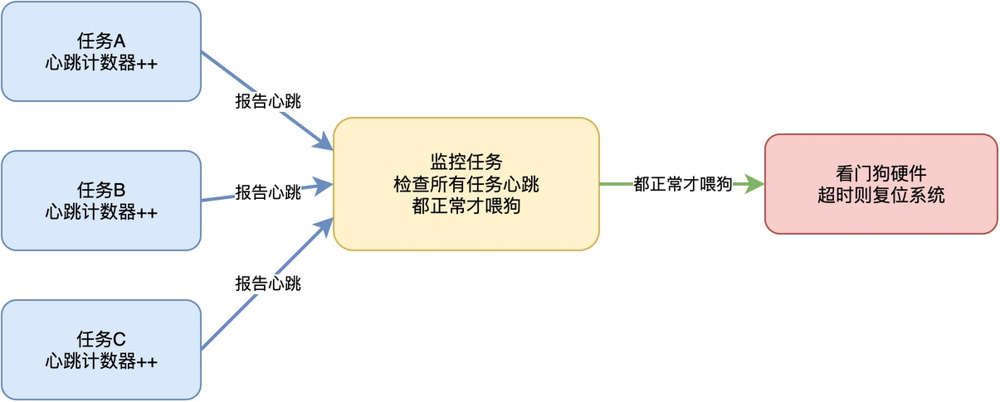

# 什么是看门狗？在RTOS中如何正确使用看门狗？

在裸机系统中，我们通常会在主循环里加入喂狗的程序。比如下面这段代码：

```c
int main(void)
{
    system_init();
    while (1) {
        /* 处理各种事情 */
        watchdog_feed();
    }
}
```

正常情况下，每次循环都会执行一次喂狗操作，看门狗不会复位；但如果因程序跑飞、硬件干扰等问题无法喂狗，看门狗就会超时复位系统。

在RTOS环境中，往往有多个任务运行，此时喂狗操作应该放在哪个任务中呢？在这篇文章中，我将给出一种推荐方法。

## 看门狗工作原理

首先，我们需要先回顾下看门狗的工作原理。

**看门狗本质上就是一个硬件定时器，该定时器有一个特点：当计数到0的时候，就会触发一个复位信号，导致整个系统重启。** 为了不让它触发复位信号，我们需要在计数到0之前，进行“喂狗操作”，将计数器重置。这个工作机制如下图所示：



正常情况下，程序正常运行，可以及时喂狗；但是，当出现程序跑飞、系统死机等情况下，无法进行喂狗操作，使得系统重启。

简单来说，**看门狗就是一个"监督员"：它定期检查程序是不是还在正常运行。如果出现异常，就重启系统，让系统恢复正常。**

## 常见的喂狗误区

了解了看门狗的基本原理之后，我们来看看在RTOS中，常见的几个喂狗误区。

### 误区一：在中断里喂狗

有人把喂狗操作放在一个定时器中断里，这样每隔一段时间中断自动喂狗，认为当整个系统死机时，中断肯定也不能正常工作。

这种方式看起来很方便，但存在着问题。如下图所示，当系统中的A、B任务运行发生异常（卡死和崩溃）时，系统应当重启。而此时，定时器中断可能还在正常运行，并在中断中进行喂狗操作，系统没有重启的机会。



由此可见，**我们不能简单地通过中断系统是否正常工作，来判断是否需要通过看门狗重启，还需要监控任务的正常运行。**

### 误区二：在每个任务里都喂狗

有人觉得，既然要监控任务是否正常运行，那么干脆让每个任务都喂狗。

这种方式也可能存在问题。如下图所示，虽然任务C运行崩溃无法喂狗，但是任务A、B仍然正常运行，并且还在喂狗，这使任务C一直得不到恢复。


因此，**我们应当做的是：只要有一个任务崩溃无法及时喂狗，系统就应该重启。**

### 推荐做法：监控任务统一喂狗

我们可以考虑创建一个专门的监控任务，由该任务统一喂狗。

**监控任务用于定期检查其他所有任务的运行状态，当发现有任务不正常时，就停止喂狗，等看门狗超时复位系统。**

例如，下图中的每个任务都有一个"心跳"计数器，任务每运行一次就把自己的计数器加1。监控任务定期检查所有任务的计数器是不是都在增加，如果都在增加，说明所有任务都在正常运行，这时候才喂狗。



而如果有任何一个任务的计数器长时间不变化，说明这个任务可能卡住或崩溃，这时候监控任务停止喂狗，等看门狗超时复位系统。

当然，也可以不采用"心跳"计数器，只要有某种机制能够让监控任务判断任务是否正常运行即可。

## 实现示例

下面给出了"心跳"计数器 + 监控任务喂狗的代码示例。

任务A和任务B各自维护一个心跳计数器（task_a_heartbeat和task_b_heartbeat），在运行过程中会更新自己的心跳：

```c
volatile uint32_t task_a_heartbeat = 0;
volatile uint32_t task_b_heartbeat = 0;

void task_a_entry(void *arg)
{
    while (1) {
        /* 任务A正常工作 */
        do_something_a();
        /* 心跳加1 */
        task_a_heartbeat++;
        rt_thread_mdelay(100);
    }
}

void task_b_entry(void *arg)
{
    while (1) {
        /* 任务B正常工作 */
        do_something_b();
        /* 心跳加1 */
        task_b_heartbeat++;
        rt_thread_mdelay(200);
    }
}
```

监控任务定期检查所有任务的心跳，确认所有心跳都发生了变化时才喂狗：

```c
void watchdog_task_entry(void *arg)
{
    uint32_t last_a = 0, last_b = 0;

    while (1) {
        /* 检查所有任务的心跳是否都在增加 */
        if (task_a_heartbeat != last_a &&
            task_b_heartbeat != last_b) {
            /* 所有任务都正常，喂狗 */
            watchdog_feed();
            last_a = task_a_heartbeat;
            last_b = task_b_heartbeat;
        }
        /* 等一段时间再检查 */
        rt_thread_mdelay(500);
    }
}
```

这样，只要有一个任务卡住了，它的心跳就不变化，监控任务就不喂狗，看门狗就会复位系统。

## 总结

综上所述，看门狗是一个硬件定时器，通过定期喂狗来监控程序是否正常运行，程序异常时自动复位系统。

在RTOS中使用看门狗时，不能简单地在中断里或者每个任务里喂狗。推荐的做法是，创建一个专门的监控任务，检查所有任务的运行状态，确认都正常后才喂狗。这样才能真正起到监控整个系统的作用。

---

> 如果你希望系统地学习RTOS底层原理，可以了解我的《RTOS开发与实战》课程。
>
> 课程不是简单地讲解FreeRTOS API的使用，而是带你从零开始编写一个RTOS内核，逐步实现任务管理、任务调度、上下文切换、同步与通信等核心机制，并通过一个远程温湿度监控设备项目，将操作系统原理应用到实际嵌入式开发中。
>
> 适合希望深入理解RTOS工作原理、提升嵌入式底层开发能力的同学。
>
> [课程详情](/blog/diyrtos/)
